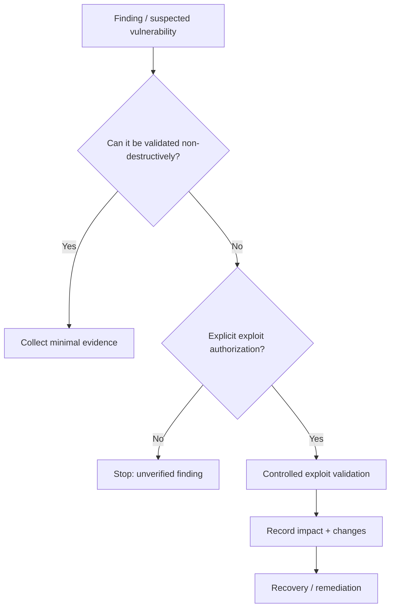
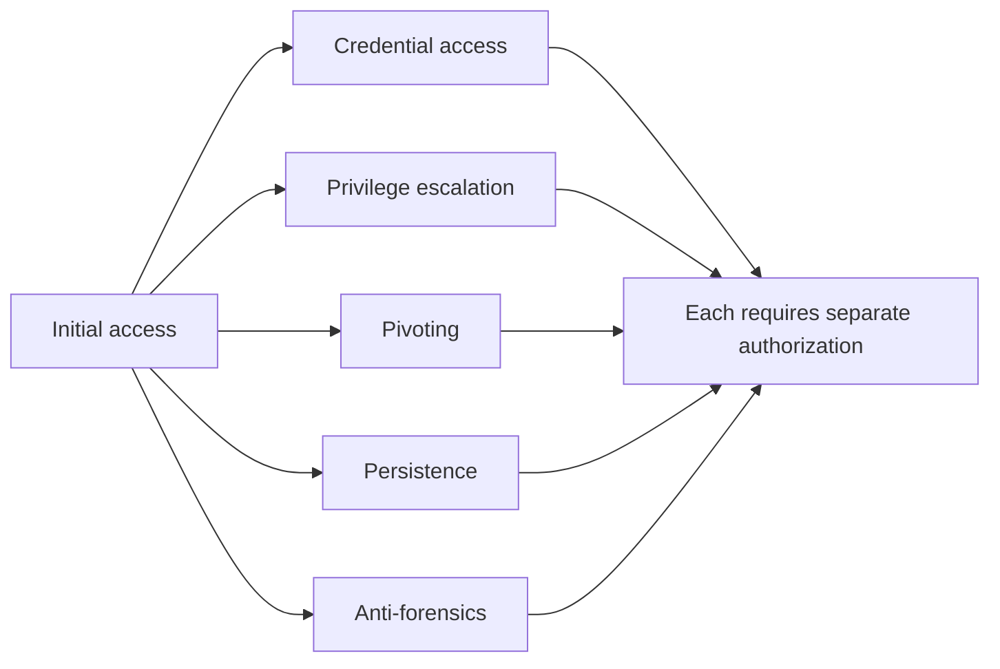
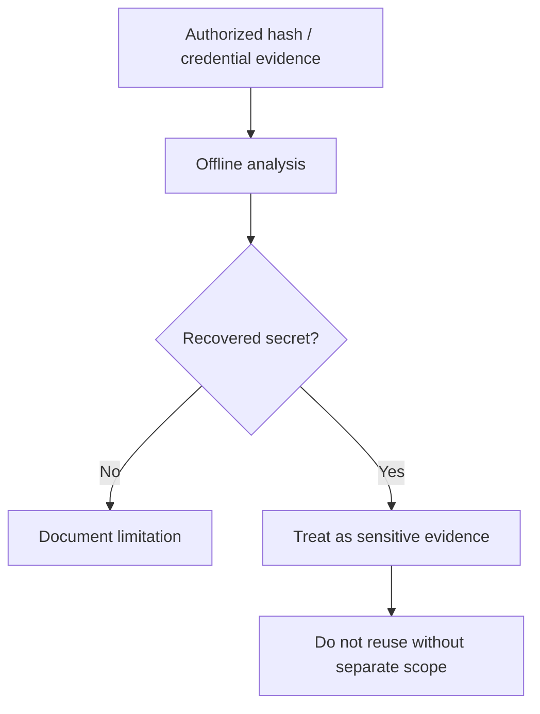
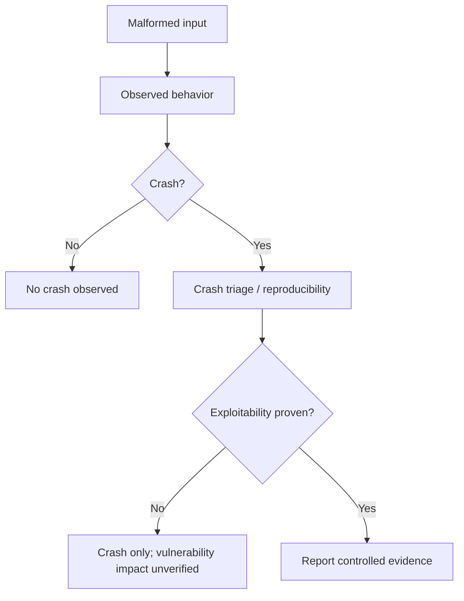

# Диаграммы — глава 7

## 1. Vulnerability validation boundary

## 2. Post-exploitation is a separate scope

## 3. Password evidence flow

## 4. Fuzzing interpretation

Source basis: `p0169:c01`–`p0209:c01`.
