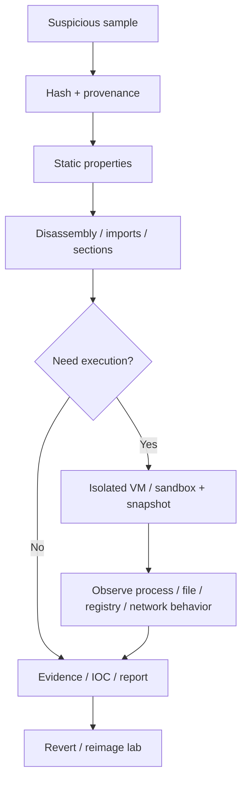
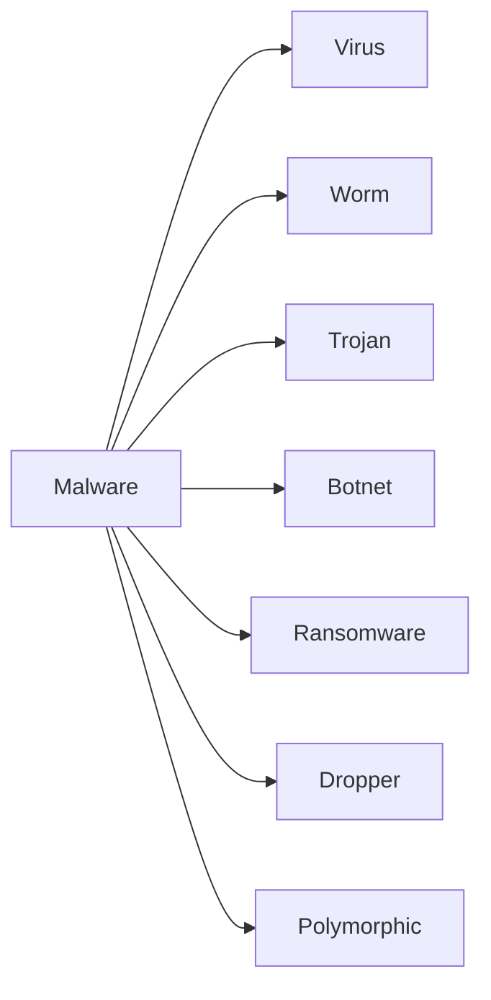
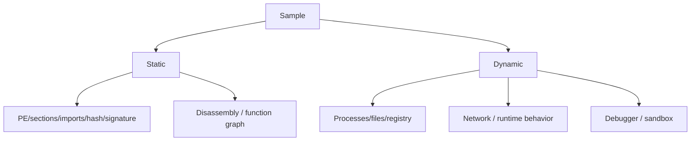
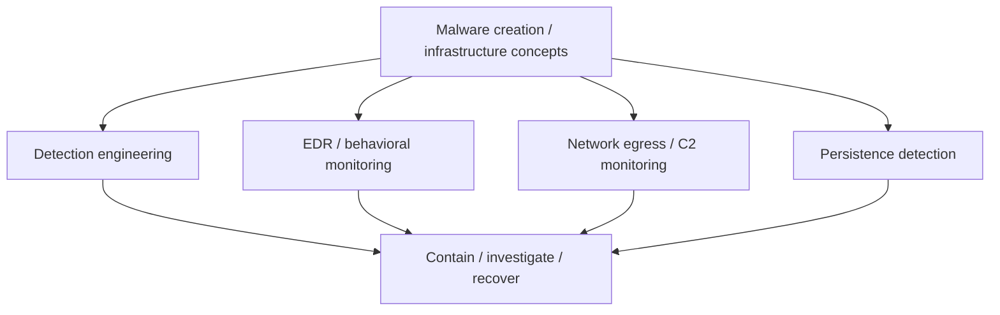

# Диаграммы — глава 8

## 1. Safe malware-analysis flow

## 2. Malware classes

## 3. Static vs dynamic evidence

## 4. Defensive interpretation of section 8.3

Source basis: `p0210:c01`–`p0245:c02`.
