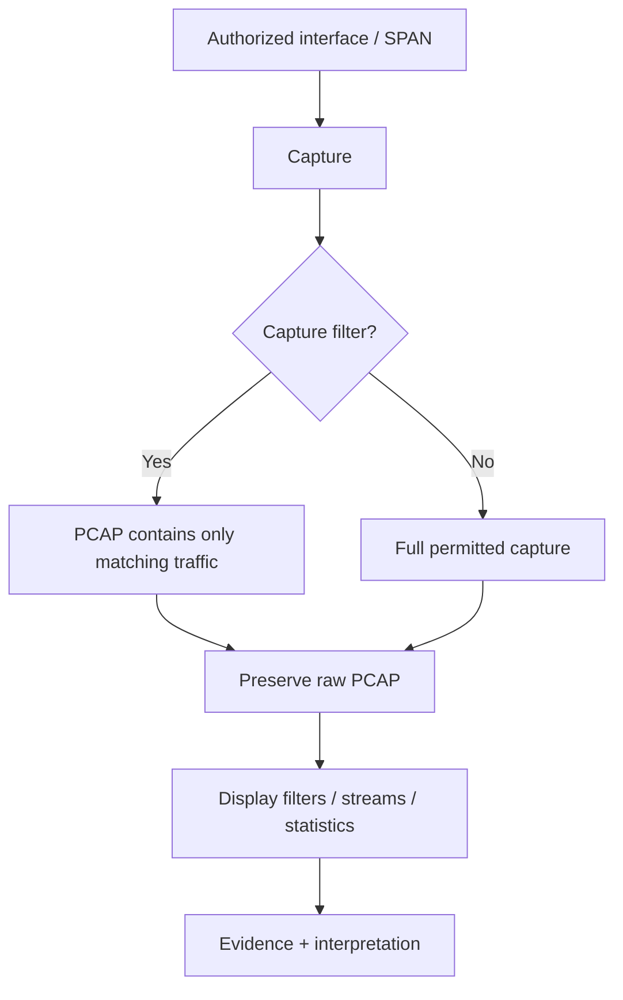
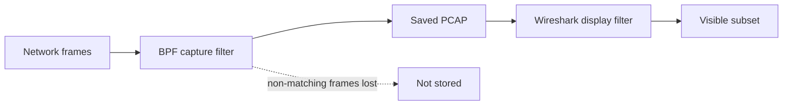
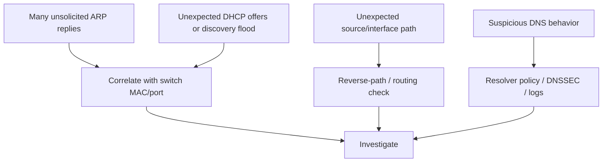
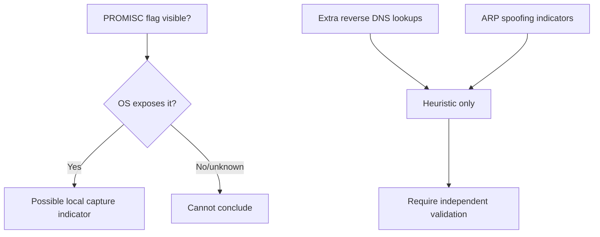

# Диаграммы — глава 9

## 1. Capture → preserve → analyze

## 2. Capture filter vs display filter

## 3. Defensive spoofing signals

## 4. Sniffer detection uncertainty

Source basis: `p0246:c01`–`p0273:c01`.
