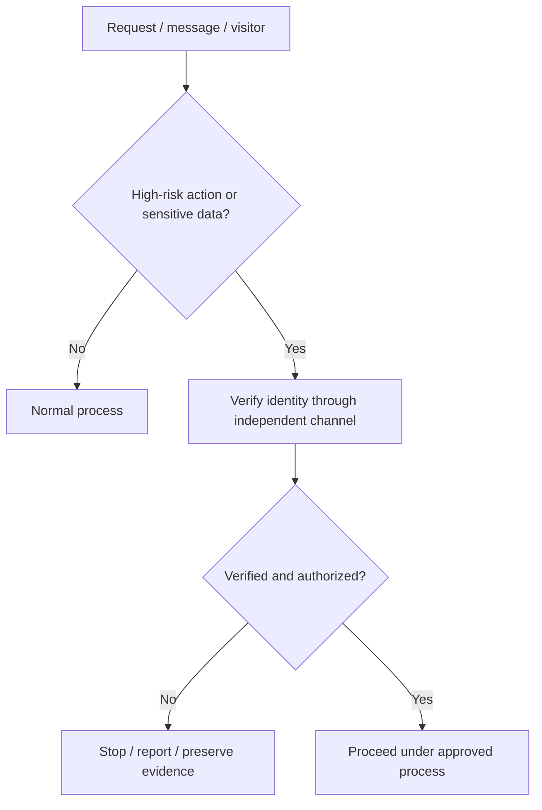
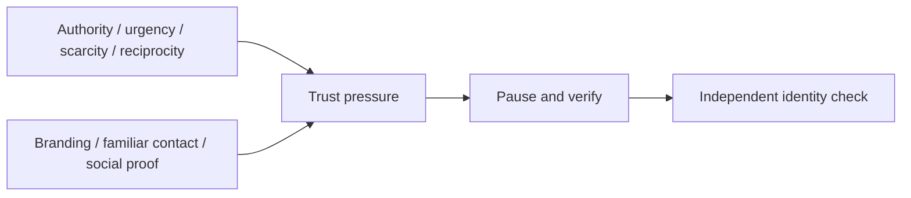
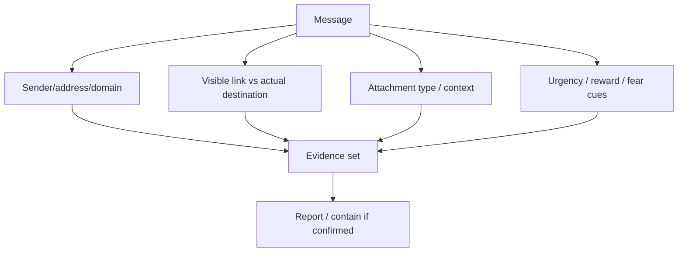
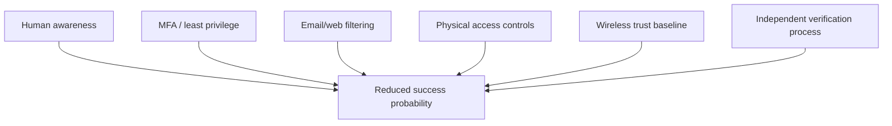

# Диаграммы — глава 10

## 1. Social-engineering decision boundary

## 2. Influence cues are not authentication

## 3. Phishing artifact review

## 4. Defense-in-depth for social engineering

Source basis: `p0274:c01`–`p0297:c01`.
