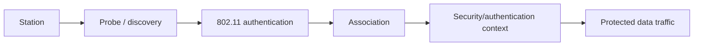
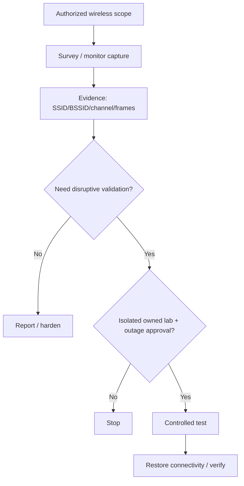
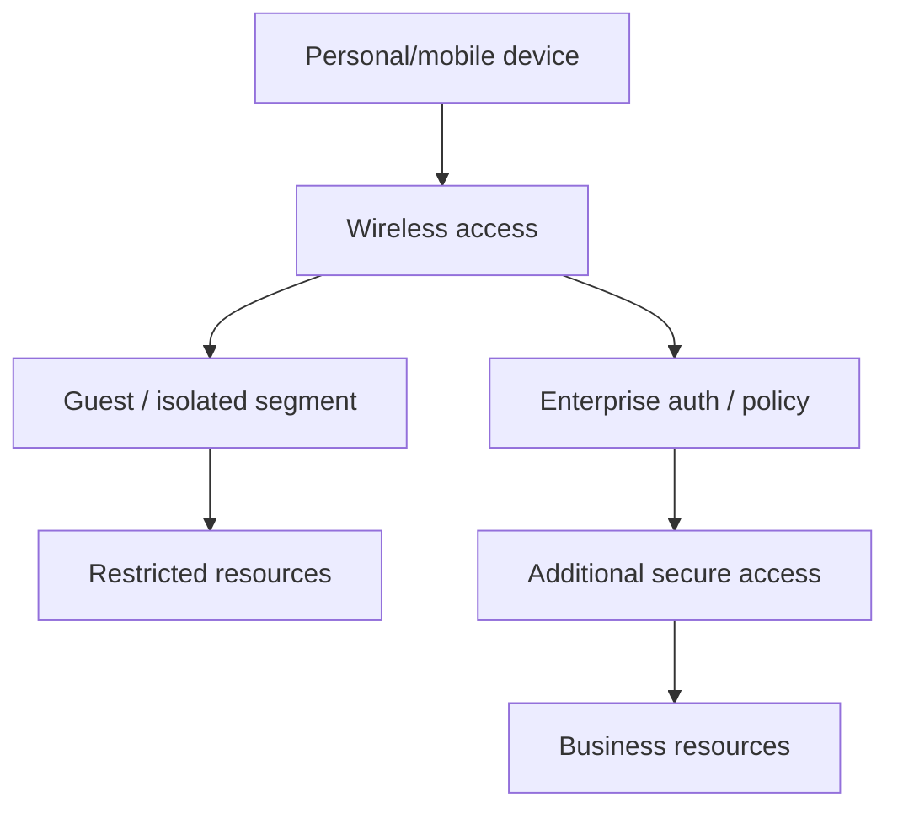
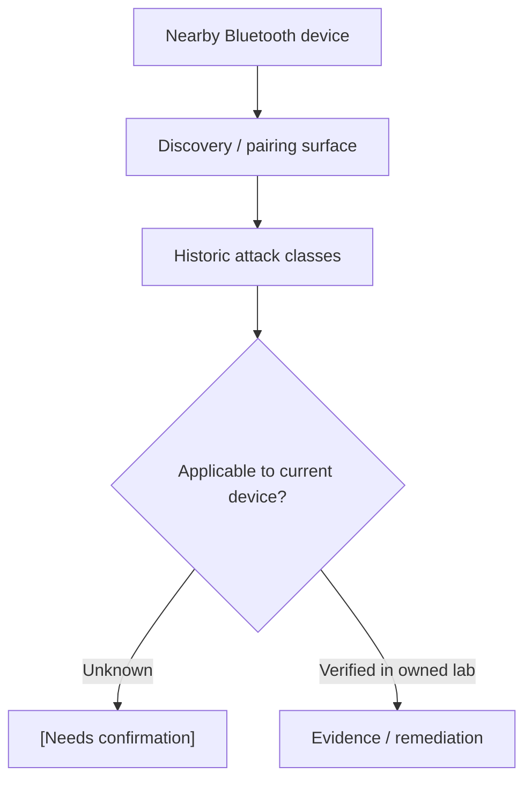

# Диаграммы — глава 11

## 1. Wi‑Fi connection evidence

## 2. Passive observation vs disruptive testing

## 3. BYOD / mobile trust boundary

## 4. Bluetooth threat interpretation

Source basis: `p0298:c01`–`p0323:c01`.
