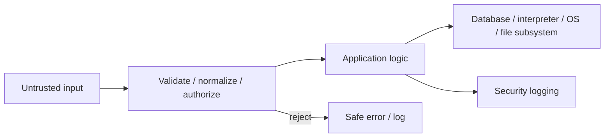
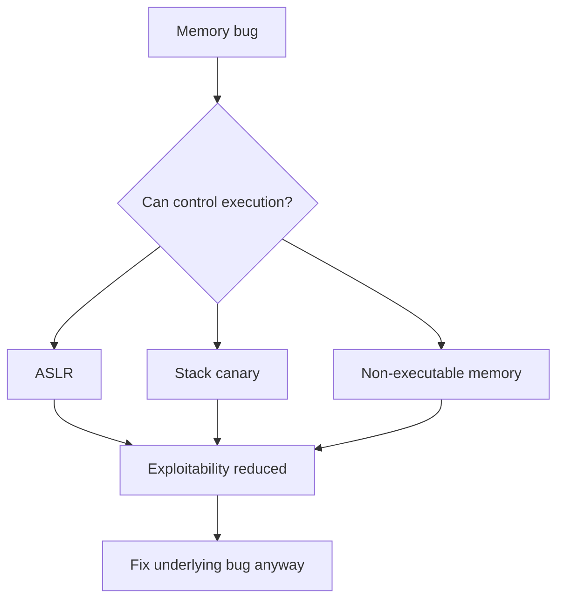
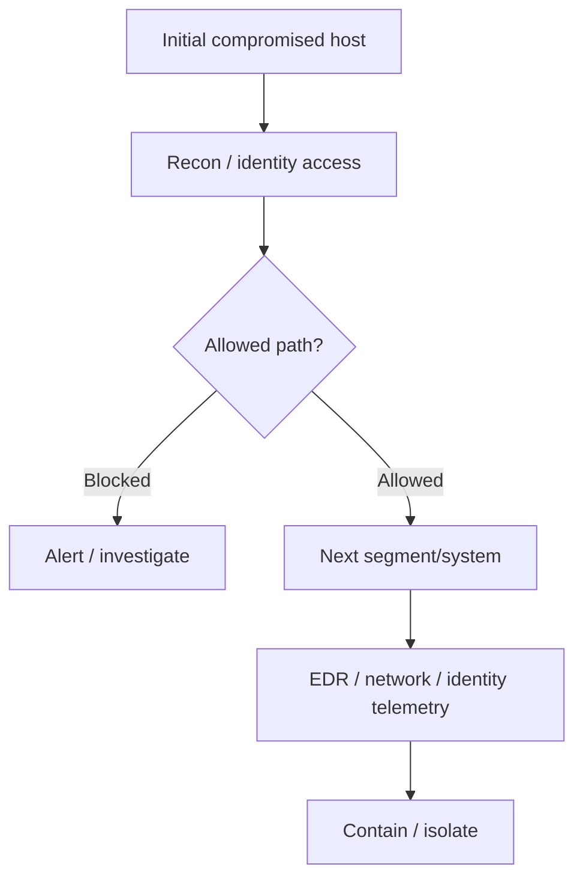
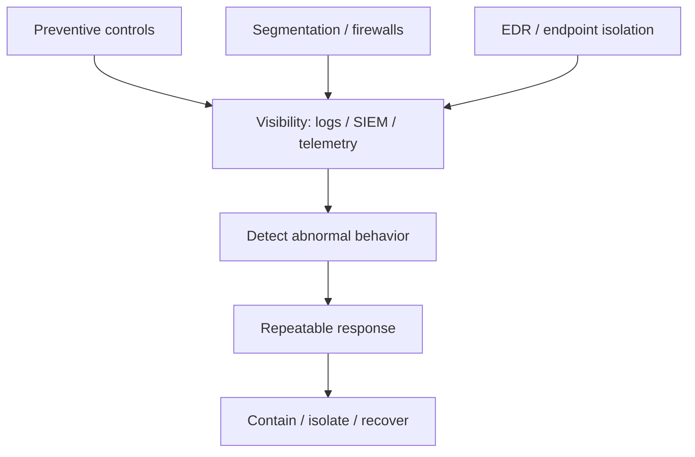

# Диаграммы — глава 12

## 1. Application trust boundary

## 2. Defense against memory-corruption impact

## 3. Post-compromise lateral-movement control

## 4. Defensible architecture

Source basis: `p0324:c01`–`p0349:c02`.
