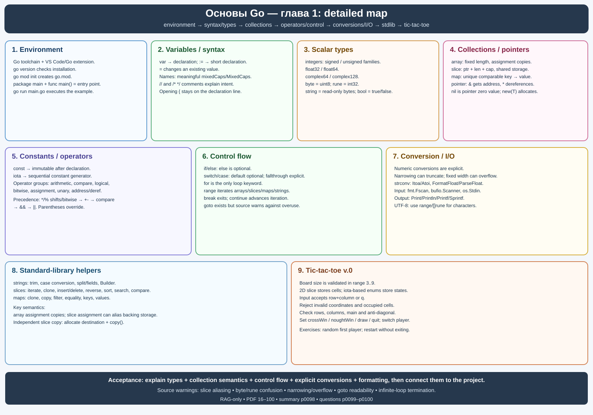
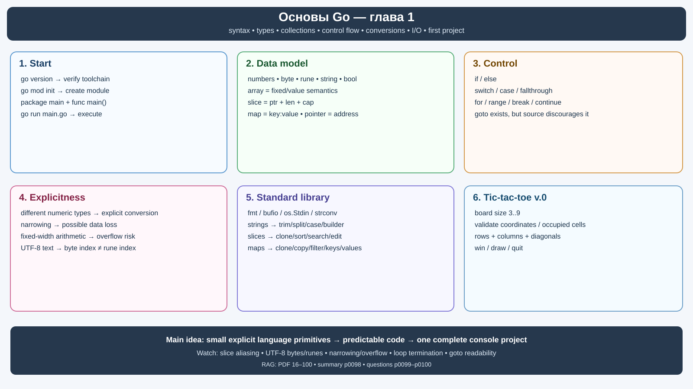

# Глава 1. Синтаксис, встроенные типы данных и управляющие конструкции Go

Status: `RAG_GROUNDED`

## Scope

Канонический источник содержимого: addressable RAG книги `go-basics-chernyshev-ru`.

- Source format: PDF
- RAG source-unit range: `p0016–p0100`
- RAG chunk boundary: `p0016:c01–p0100:c01`
- PDF page range: `16–100`
- Printed page range: `15–99`
- Chapter boundary: verified
- Chapter start: `p0016:c01`
- Chapter-end summary: `p0098:c01`
- Review questions: `p0099:c01–p0100:c01`
- Next chapter starts at `p0101:c01`: «Функции, модули, пакеты и их тестирование»
- Source SHA-256: `4053ecbf84c72e4f03756add8a03874e4caf928a5c3ed69b6a06ef06f21d60cd`

Внешние источники, model memory и прямое чтение `source/book.pdf` для содержимого главы не использовались.

## Chapter map

1. **1.1. Краткая история и основные особенности Go**
   - происхождение языка;
   - компилируемость, статическая типизация, сборка мусора;
   - минималистичный синтаксис и пакетная модель.
2. **1.2. Установка и настройка рабочего окружения**
   - Go toolchain;
   - VS Code + Go extension;
   - `go version`, `go mod init`, `go run`.
3. **1.3–1.6. Базовый синтаксис**
   - объявления переменных;
   - правила именования;
   - комментарии;
   - обязательное расположение открывающей фигурной скобки.
4. **1.7. Типы данных Go**
   - integers, floats, complex;
   - `byte`, `rune`, `string`, `bool`;
   - arrays, slices, maps, pointers.
5. **1.8. Константы**
   - typed/untyped constants;
   - `iota`.
6. **1.9. Операторы**
   - arithmetic, comparison, logical, bitwise, assignment, unary;
   - приоритет операций.
7. **1.10–1.12. Управление потоком**
   - `if/else`;
   - `switch/case`;
   - единственный цикл `for`, `range`, `break`, `continue`;
   - `goto` и его риски.
8. **1.13. Преобразование типов**
   - явные числовые преобразования;
   - риск потери данных и переполнения;
   - `strconv.Itoa/Atoi`, `FormatFloat/ParseFloat`.
9. **1.14. Ввод, отладка и форматирование**
   - `fmt`, `os.Stdin`, `bufio.Scanner`;
   - `Print`, `Println`, `Printf`, `Sprintf`;
   - formatting verbs.
10. **1.15–1.17. Стандартная библиотека для строк, срезов и map**
    - `strings`;
    - `slices`;
    - `maps`.
11. **Проект: «Крестики-нолики», v.0**
    - доска 3×3–9×9;
    - ввод и валидация хода;
    - проверка строк, столбцов и диагоналей;
    - состояния победы/ничьей/выхода.
12. **Задания, резюме и 36 вопросов для самопроверки**.

## Main principle

Глава строит базовую модель программирования на Go вокруг явности и небольшого числа языковых конструкций:

~~~text
environment
→ variables and types
→ collections and pointers
→ operators
→ control flow
→ explicit conversions
→ I/O and standard-library helpers
→ one working console project
~~~

Практическая линия главы — не просто перечислить синтаксис, а применить его в первой версии «Крестиков-ноликов».

## Key concepts

### Переменные

Поддерживаются:
- `var name type`;
- объявление с инициализацией;
- автоматический вывод типа;
- короткое объявление `:=`.

Для повторного присваивания используется `=`, а не повторный `:=`.

### Имена и комментарии

Источник рекомендует:
- meaningful names;
- `MixedCaps` / `mixedCaps`;
- exported identifiers начинаются с заглавной буквы;
- аббревиатуры сохраняют верхний регистр;
- комментарии объясняют **почему**, а не очевидное **что**.

Комментарии:
- `//` — однострочные;
- `/* ... */` — многострочные.

### Типы

Встроенные типы в главе:
- integers;
- floats;
- complex;
- `byte`;
- `rune`;
- `string`;
- `bool`.

Составные типы разделены на:
- агрегатные: arrays, structs;
- ссылочные: slices, maps, channels, pointers, functions, methods;
- interface.

### Array vs slice

~~~text
array
→ fixed length
→ value semantics on assignment

slice
→ ptr + len + cap
→ shares backing storage
→ copy() when an independent copy is required
~~~

### String and Unicode

`string` описывается как read-only sequence of bytes.

Следствие:
- byte indexing не равно character indexing для UTF-8;
- для безопасной работы по Unicode-символам глава использует `[]rune` или `range`.

### Map

`map` связывает уникальные keys с values.

Глава показывает:
- creation;
- read/write;
- `delete`;
- existence check через второе возвращаемое значение.

### Pointer

- `&value` — получить адрес;
- `*pointer` — разыменовать;
- присваивание через `*pointer = ...` меняет исходное значение;
- zero value указателя — `nil`;
- `new(T)` возвращает указатель на выделенный zeroed object.

### Constants and iota

`const` создаёт значение, которое нельзя изменить после объявления.

`iota` используется как генератор последовательных значений в constant block.

### Control flow

Go использует:
- `if/else`;
- `switch/case`;
- один цикл `for`.

`else` и `default` необязательны.

`range` используется для обхода массивов, срезов, строк и map.

`goto` существует, но глава прямо предупреждает о снижении читаемости и риске непреднамеренного бесконечного цикла.

### Explicit conversion

Глава подчёркивает явные преобразования между числовыми типами. Приведение к более узкому типу может отсечь биты, а арифметика фиксированной разрядности может переполниться.

Для string/integer conversions показан `strconv`.

## Project v.0

Первая версия «Крестиков-ноликов» намеренно остаётся в одной функции `main`.

Она использует материал главы:
- custom integer aliases;
- `iota`;
- slices;
- input parsing;
- `if` / `switch`;
- nested `for`;
- `break` / `continue`;
- conversions;
- formatted output.

Проект:
- принимает размер доски от 3 до 9;
- хранит board как двумерный slice;
- принимает координаты или `q`;
- не разрешает ход в занятую клетку;
- проверяет строки, столбцы и обе диагонали;
- определяет win/draw;
- переключает игрока.

Задания на доработку:
1. случайно выбирать первого игрока;
2. запускать новую игру без выхода из приложения.

## Risks / common mistakes explicitly supported by the chapter

- повторное использование `:=` вместо `=`;
- бессмысленные имена переменных;
- неправильная строка с открывающей `{`;
- byte indexing UTF-8 strings как будто каждый символ занимает один байт;
- считать присваивание slice независимым копированием;
- забывать явное преобразование разных numeric types;
- сужать numeric type без учёта потери данных;
- игнорировать overflow;
- разыменовывать `nil`/неинициализированную ссылочную структуру без подготовки;
- злоупотреблять `goto`.

## Artifacts

- [cheatsheet.md](./cheatsheet.md)
- [commands.md](./commands.md)
- [diagram.md](./diagram.md)
- [visual-cheatsheet.svg](./visual-cheatsheet.svg)
- [visual-cheatsheet-detailed.svg](./visual-cheatsheet-detailed.svg)
- [summary.md](./summary.md)
- [review-questions.md](./review-questions.md)
- [review-answers.md](./review-answers.md)

## RAG provenance used

Boundary / map:
- `p0005:c01–p0006:c01`
- `p0016:c01`
- `p0101:c01`

Core language:
- `p0016:c01–p0066:c01`

I/O and formatting:
- `p0067:c01`
- `p0073:c01–p0078:c01`

Standard-library helpers:
- `p0079:c01–p0092:c01`

Project:
- `p0092:c01–p0098:c01`

Chapter-end artifacts:
- `p0098:c01–p0100:c01`
