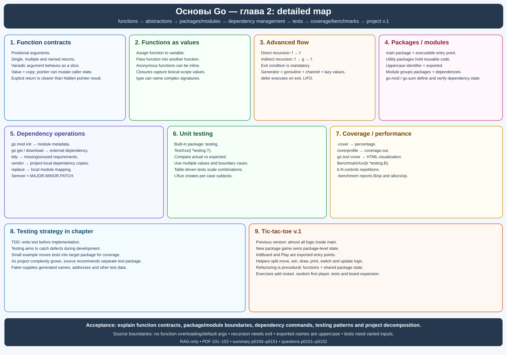
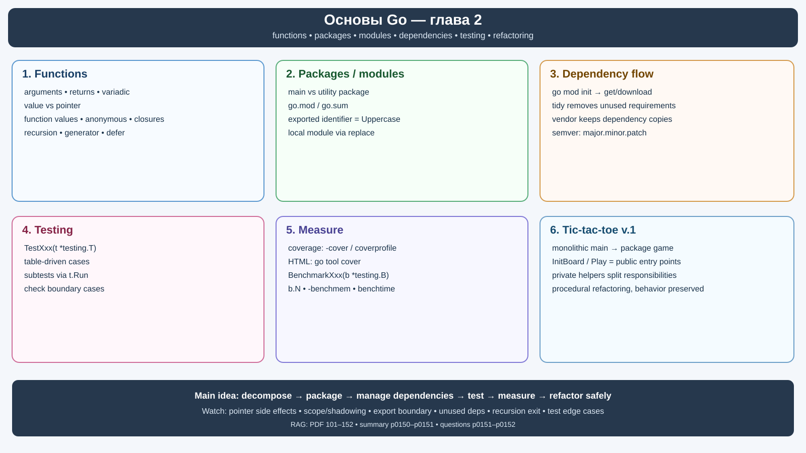

# Глава 2. Функции, модули, пакеты и их тестирование

Status: `RAG_GROUNDED`

## Scope

Канонический источник содержимого: addressable RAG книги `go-basics-chernyshev-ru`.

- Source format: PDF
- RAG source-unit range: `p0101–p0152`
- RAG chunk boundary: `p0101:c01–p0152:c01`
- PDF page range: `101–152`
- Printed page range: `100–151`
- Chapter boundary: verified
- Chapter start: `p0101:c01`
- Project v.1: `p0144:c01–p0149:c01`
- Chapter-end summary: `p0150:c01–p0151:c01`
- Review questions: `p0151:c01–p0152:c01`
- Next chapter starts at `p0153:c01`: «Объектно-ориентированное программирование в Go»
- Source SHA-256: `4053ecbf84c72e4f03756add8a03874e4caf928a5c3ed69b6a06ef06f21d60cd`

Внешние источники, model memory и прямое чтение `source/book.pdf` для содержимого главы не использовались.

## Chapter map

1. **2.1. Функции в Go**
   - declaration and call;
   - positional arguments;
   - one/multiple/named return values;
   - variadic arguments;
   - value vs pointer arguments;
   - type aliases for complex types and function signatures;
   - lexical scope;
   - function values and higher-order functions;
   - anonymous functions and closures;
   - direct/indirect recursion;
   - generator functions;
   - `defer`.
2. **2.2. Модули и пакеты**
   - executable vs utility packages;
   - executable vs non-executable modules;
   - `go.mod` / `go.sum`;
   - external dependencies;
   - semantic versioning;
   - `vendor`;
   - package creation and exported identifiers;
   - import aliases;
   - local modules through `replace`.
3. **2.3. Тестирование**
   - unit tests;
   - table-driven tests;
   - subtests;
   - code coverage;
   - benchmarks;
   - Faker-generated test data.
4. **Проект: «Крестики-нолики», v.1**
   - refactoring monolithic `main`;
   - package `game`;
   - decomposition into functions;
   - procedural organization around package-level state.
5. **Задания, резюме и 39 вопросов для самопроверки**.

## Main principle

~~~text
monolithic code
→ functions
→ reusable abstractions
→ packages/modules
→ explicit dependency management
→ tests/coverage/benchmarks
→ refactored project v.1
~~~

Глава переводит код от линейного сценария к композиции через функции и пакеты, а затем добавляет проверяемость тестами.

## Functions

Источник описывает функции как first-class objects. Функцию можно присвоить переменной, передать другой функции, вернуть из функции или создать анонимно.

Базовая форма:

~~~go
func name(args...) returnType {
    return value
}
~~~

Аргументы позиционные. Go поддерживает одно, несколько и named return values. Неиспользуемое возвращаемое значение можно принять в `_`.

Variadic argument имеет форму `values ...int`; внутри функции он рассматривается как `[]int` и должен быть последним параметром.

## Value vs pointer

При передаче по значению функция получает копию. При передаче pointer копируется address, и dereference позволяет менять исходный объект.

Глава также показывает возврат результата через pointer argument, но в сравнительном примере предпочитает явный `return`, поскольку contract функции виден в signature.

## Scope, function values, closures

Go в главе описан как язык с lexical scope:
- inner block видит outer variables;
- outer block не видит значения, объявленные только внутри inner block;
- локальное объявление с тем же именем shadow-ит outer variable.

Function value:

~~~go
myFunc := add
fmt.Println(myFunc(3, 5))
~~~

Function может быть аргументом другой function. Для сигнатур chapter использует `type`.

Closure — функция, сохраняющая доступ к значениям enclosing lexical scope. Returned closure может продолжать использовать захваченные значения при последующих вызовах.

## Recursion, generator, defer

Рекурсия бывает:
- direct: function вызывает себя;
- indirect: function вызывает другую function, которая возвращается к первой.

Обязателен exit condition; иначе вызовы продолжаются до переполнения call stack.

Generator function в chapter реализована через goroutine + channel и лениво создаёт значения по запросу вместо предварительного хранения всей sequence.

`defer` откладывает function call до завершения текущей функции. Несколько deferred calls выполняются LIFO. Source связывает механизм с освобождением files/sockets и mutex unlock.

## Packages and modules

Пакеты:
- executable: только `package main`, с top-level `main`;
- utility: reusable functions/types/etc.

Модули:
- executable: содержит executable package `main`;
- non-executable/service: используется как dependency и не содержит executable package.

`go.mod` хранит module path, Go version и dependency requirements. `go.sum` используется для проверки ожидаемого содержимого dependency modules.

## Dependency workflow

~~~text
go mod init
→ declare/get dependency
→ download/use dependency
→ go mod tidy
→ optional vendor
~~~

External dependency можно добавить вручную через `require` + `go mod download` или командой `go get <module>`.

Semantic versioning в chapter: `vMAJOR.MINOR.PATCH`.
- MAJOR — несовместимые API changes;
- MINOR — новый backward-compatible functionality;
- PATCH — backward-compatible fixes.

`go mod vendor` создаёт project-local `vendor` с copies используемых dependencies.

## Package visibility and local modules

Lowercase identifier доступен только внутри package. Uppercase identifier экспортируется и доступен importing package.

Import alias решает directory/package name mismatch, длинные имена и collisions.

Для локальной зависимости chapter показывает `replace` в `go.mod`:

~~~text
replace golang/second => ../second
require golang/second <version>
~~~

## Testing

Глава вводит unit/component/integration/end-to-end testing и TDD. TDD описан как подход, где test пишется до implementation.

Built-in package: `testing`.

Test function:
- name starts with `Test`;
- принимает `*testing.T`.

Source рекомендует проверять разные входные данные и boundary cases.

Table-driven tests хранят наборы input + expected в table/slice и запускают одну проверку для каждого case. `t.Run` создаёт отдельные subtests.

Coverage показывает, какая доля package code выполняется тестами.

Benchmark function:
- name starts with `Benchmark`;
- принимает `*testing.B`;
- target code выполняется `b.N` раз.

Faker используется как external dependency для генерации test data.

## Tic-tac-toe v.1

Версия v.0 была «большим комом грязи» внутри `main`. В v.1 chapter выполняет procedural decomposition и выносит игру в package `game`.

Основные functions:
- `InitBoard`;
- `printBoard`;
- `makeMove`;
- `checkWin`;
- `checkDraw`;
- `switchPlayer`;
- `updateState`;
- `Play`.

Public entry points начинаются с uppercase; internal helpers остаются lowercase.

## Project improvement tasks

1. Случайно выбирать первого игрока.
2. Запускать новую игру без выхода.
3. Покрыть приложение тестами.
4. Добавить команду расширения поля с сохранением уже выставленных X/O.

## Risks / common mistakes supported by source

- recursion без exit condition;
- неявный result через pointer, когда explicit return понятнее;
- shadowing;
- lowercase identifier при использовании из другого package;
- duplicate global names внутри package;
- unused dependencies;
- package/directory naming confusion;
- absolute path к local module;
- тестирование только happy path без boundary cases;
- отсутствие coverage visibility;
- benchmark без понимания `b.N`.

## Artifacts

- [cheatsheet.md](./cheatsheet.md)
- [commands.md](./commands.md)
- [diagram.md](./diagram.md)
- [visual-cheatsheet.svg](./visual-cheatsheet.svg)
- [visual-cheatsheet-detailed.svg](./visual-cheatsheet-detailed.svg)
- [summary.md](./summary.md)
- [review-questions.md](./review-questions.md)
- [review-answers.md](./review-answers.md)

## RAG provenance used

- functions: `p0101:c01–p0116:c01`
- modules/packages: `p0117:c01–p0131:c01`
- testing: `p0132:c01–p0143:c01`
- project: `p0144:c01–p0149:c01`
- summary/questions: `p0150:c01–p0152:c01`
- next chapter boundary: `p0153:c01`
