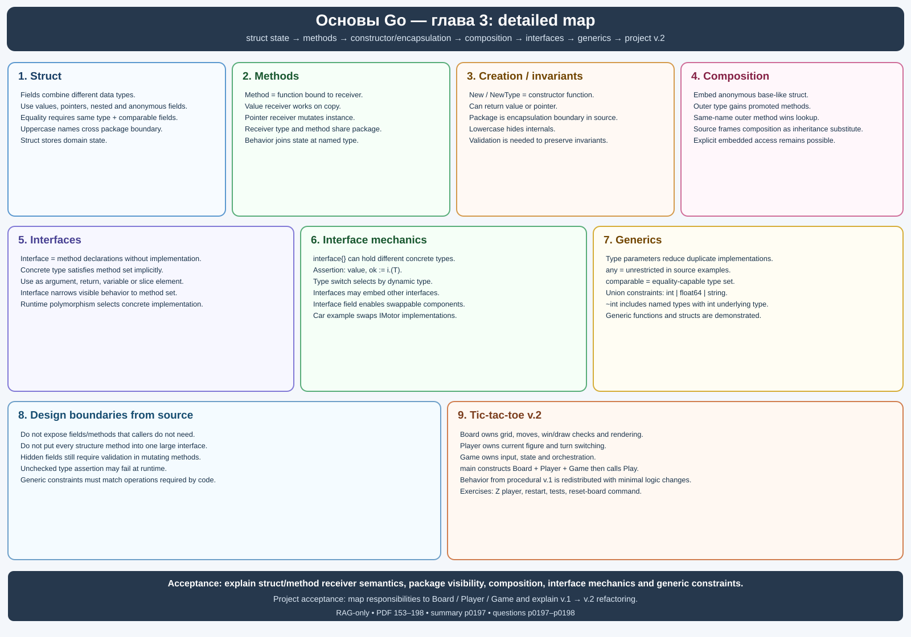
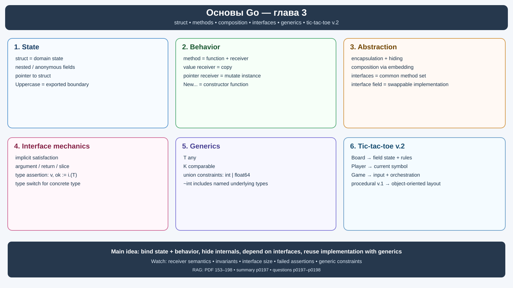

# Глава 3. Объектно-ориентированное программирование в Go

Status: `RAG_GROUNDED`

## Scope

Канонический источник содержимого: addressable RAG книги `go-basics-chernyshev-ru`.

- Source format: PDF
- RAG source-unit range: `p0153–p0198`
- RAG chunk boundary: `p0153:c01–p0198:c01`
- PDF page range: `153–198`
- Printed page range: `152–197`
- Chapter boundary: verified
- Chapter start: `p0153:c01`
- Project v.2: `p0190:c01–p0196:c01`
- Chapter-end summary: `p0197:c01`
- Review questions: `p0197:c01–p0198:c01`
- Next chapter starts at `p0199:c01`: «Обработка ошибок и паник в Go»
- Source SHA-256: `4053ecbf84c72e4f03756add8a03874e4caf928a5c3ed69b6a06ef06f21d60cd`

Внешние источники, model memory и прямое чтение `source/book.pdf` для содержимого главы не использовались.

## Chapter map

1. **3.1. Struct**
   - declaration and initialization;
   - pointers to structs;
   - anonymous fields;
   - structs as function arguments;
   - equality;
   - nested structs;
   - public/private fields.
2. **3.2–3.3. Methods**
   - receiver syntax;
   - value receiver vs pointer receiver;
   - methods attached to named types;
   - method and receiver type must be declared in one package.
3. **3.4. Constructor functions**
   - `New...` functions;
   - return value vs pointer.
4. **3.5. Encapsulation and hiding**
   - package as encapsulation boundary in chapter framing;
   - exported/unexported names;
   - protecting data invariants.
5. **3.6. Composition and method shadowing/override framing**
   - embedded anonymous struct;
   - promoted methods;
   - derived struct method with same name.
6. **3.7–3.9. Interfaces and runtime polymorphism**
   - implicit interface satisfaction;
   - interface-typed arguments/returns/slices;
   - interface as struct field;
   - empty interface;
   - type assertion;
   - type switch;
   - nested interfaces.
7. **3.10. Generics**
   - type parameters;
   - unions of allowed types;
   - `~` underlying-type constraint;
   - custom constraint interfaces;
   - `any`;
   - `comparable`;
   - generic functions and structs.
8. **Проект: «Крестики-нолики», v.2**
   - procedural v.1 → object-oriented organization;
   - `Board`, `Player`, `Game`;
   - behavior moved into methods;
   - state distributed by domain responsibility.
9. **Задания, резюме и 20 вопросов для самопроверки**.

## Source framing

Глава прямо отмечает, что Go не является объектно-ориентированным языком в классическом понимании, но рассматривает знакомые ООП-концепции через Go-механизмы.

В source framing:
- state → structs;
- behavior → methods on named types;
- encapsulation boundary → package;
- inheritance-like reuse → composition;
- runtime polymorphism → interfaces;
- duplicate generic implementations → type parameters.

Этот artifact сохраняет терминологию и framing источника и не подменяет их внешними трактовками.

## Struct

Struct объединяет поля разных типов и используется для хранения состояния объекта предметной области.

~~~go
type employee struct {
    name string
    age  uint8
}
~~~

Создание:

~~~go
var emp employee
emp2 := employee{}
emp3 := employee{name: "Alex", age: 25}
~~~

Поля доступны через dot notation.

## Pointer to struct

Source показывает:

~~~go
empPoint := &emp
empPoint2 := new(employee)
empPoint.age = 23
~~~

Go позволяет обращаться к полям через pointer без явного `(*ptr).field` в обычной записи.

## Anonymous and nested fields

Anonymous field задаётся только type. Struct также может содержать другую struct как named или anonymous field.

Source использует anonymous embedding как основу последующей composition.

## Struct equality

Chapter rule:
- сравниваются только structs одного type;
- все fields должны поддерживать equality.

Struct с slice field в показанном примере уже не может сравниваться через `==`.

## Export boundary

Uppercase:
- exported struct/type;
- exported field;
- exported method.

Lowercase:
- package-internal.

Эта граница используется throughout chapter для сокрытия implementation details.

## Methods

General form:

~~~go
func (receiver ReceiverType) Method(args...) result {
    ...
}
~~~

Chapter emphasizes receiver as key difference from ordinary function.

Value receiver работает с copy. Pointer receiver позволяет менять state исходного instance.

Дополнительное ограничение source: receiver type и method должны быть определены в одном package.

## Constructor functions

В Go chapter не использует language-level constructors. Вместо них предлагает constructor functions:

~~~go
func NewShape(...) Shape
func NewShapeWithPoint(...) *Shape
~~~

Convention: `New` или `New<Type>`.

## Encapsulation and hiding

Source различает:
- **инкапсуляцию** — объединение данных и методов работы с ними;
- **сокрытие** — ограничение доступа к internal state/behavior.

Chapter связывает это с data invariants: private fields недостаточно сами по себе, setter-like methods также должны проверять допустимость input.

## Composition

Source использует anonymous embedded struct как механизм, аналогичный reuse через inheritance in OOP framing:

~~~go
type Rectangle struct {
    shape
    width  uint
    length uint
}
~~~

Methods embedded type становятся доступными через outer struct.

Если outer struct имеет method с тем же именем, source описывает это как переопределение, а затем уточняет фактическое lookup behavior: Go сначала ищет method у outer type, затем у embedded type.

## Interfaces

Interface объявляет method set без implementation.

~~~go
type IShape interface {
    GetArea() float64
    GetPerimeter() uint
    MoveCenter(Point)
    GetCenter() Point
}
~~~

В chapter structure satisfies interface по наличию нужных methods; отдельного explicit declaration не требуется.

Interfaces используются как:
- variable type;
- function argument;
- return type;
- slice element type;
- struct field.

Это позволяет работать с разными concrete types через один method set.

## Interface as struct field

Car example:

~~~go
type Car struct {
    motor motor.IMotor
    ...
}
~~~

`ChangeMotor(motor.IMotor)` позволяет заменить concrete engine implementation при сохранении interface contract.

## Empty interface and type assertion

Source показывает `interface{}` как interface без methods, которому можно присвоить values разных types.

Type assertion:

~~~go
value, ok := i.(TargetType)
~~~

Форма с `ok` позволяет не падать при неверном assertion.

Type switch:

~~~go
switch i.(type) {
case shape:
case car:
default:
}
~~~

## Generics

Chapter связывает generics с уменьшением code duplication начиная с Go 1.18.

Basic example:

~~~go
func Sum[T int | float64 | string](a, b T) T {
    return a + b
}
~~~

`any` — unrestricted constraint in source examples.

`~int` разрешает named types с underlying type `int`.

Custom constraint:

~~~go
type MyInterface interface {
    ~int | float64 | string | uint16 | uint32
}
~~~

Map-related example uses:
- `K comparable` for keys;
- `V any` for values.

Chapter also demonstrates generic structs and methods whose receiver repeats already-declared type parameters.

## Tic-tac-toe v.2

Version v.2 refactors procedural v.1 into three domain structs:

### Board
Responsible for:
- board state;
- initialization;
- move validation;
- setting symbol;
- win detection;
- draw detection;
- rendering.

### Player
Responsible for:
- current figure;
- switching X/O;
- symbol representation.

### Game
Responsible for:
- coordinating `Board` + `Player` + input reader;
- game state;
- input parsing;
- game loop;
- state transitions;
- final result output.

Project structure includes separate files for board, player, game and enums.

## Project improvement tasks

1. Добавить третьего игрока `Z`, minimum board `5×5`, победа по линии из четырёх symbols.
2. Запускать новую игру без выхода.
3. Покрыть application tests.
4. Добавить command для reset board с удалением X/O.

## Risks / common mistakes supported by source

- value receiver used when mutation is expected;
- exporting fields that should remain internal;
- private fields without validation methods do not preserve invariants by themselves;
- one oversized interface exposing too much functionality;
- failed type assertion without `ok` can cause runtime failure;
- assuming interface exposes concrete-only methods;
- generic constraint excludes named underlying type unless `~` is used;
- generic map key without `comparable` constraint;
- generic struct methods introducing new type parameters beyond receiver declaration;
- confusing composition method lookup with classical inheritance semantics.

## Artifacts

- [cheatsheet.md](./cheatsheet.md)
- [commands.md](./commands.md)
- [diagram.md](./diagram.md)
- [visual-cheatsheet.svg](./visual-cheatsheet.svg)
- [visual-cheatsheet-detailed.svg](./visual-cheatsheet-detailed.svg)
- [summary.md](./summary.md)
- [review-questions.md](./review-questions.md)
- [review-answers.md](./review-answers.md)

## RAG provenance used

- chapter framing / structs: `p0153:c01–p0160:c01`
- methods / constructor / encapsulation / composition: `p0161:c01–p0168:c01`
- interfaces: `p0168:c01–p0183:c01`
- generics: `p0184:c01–p0189:c01`
- project v.2: `p0190:c01–p0196:c01`
- summary/questions: `p0197:c01–p0198:c01`
- next chapter boundary: `p0199:c01`
