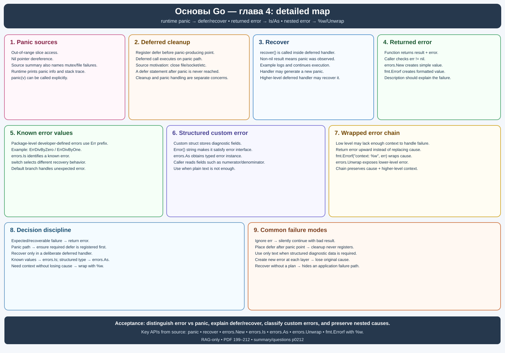
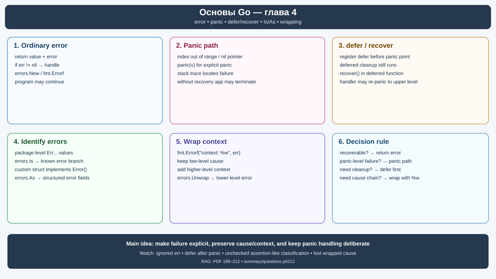

# Глава 4. Обработка ошибок и паник в Go

Status: `RAG_GROUNDED`

## Scope

Канонический источник содержимого: addressable RAG книги `go-basics-chernyshev-ru`.

- Source format: PDF
- RAG source-unit range: `p0199–p0212`
- RAG chunk boundary: `p0199:c01–p0212:c01`
- PDF page range: `199–212`
- Printed page range: `198–211`
- Chapter boundary: verified
- Chapter start: `p0199:c01`
- Chapter-end summary: `p0212:c01`
- Review questions: `p0212:c01`
- Next chapter starts at `p0213:c01`: «Работа с файлами и каталогами. Сборка приложения»
- Source SHA-256: `4053ecbf84c72e4f03756add8a03874e4caf928a5c3ed69b6a06ef06f21d60cd`

Внешние источники, model memory и прямое чтение `source/book.pdf` для содержимого главы не использовались.

## Chapter map

1. **Введение: `error` и `panic`**
   - Go не использует `try/catch` в source framing;
   - recoverable errors возвращаются через значение типа `error`;
   - panic рассматривается как аварийная ситуация, способная завершить приложение.
2. **4.1. Panic в Go**
   - index out of range;
   - nil pointer dereference;
   - stack trace.
3. **4.2. Пользовательская panic**
   - встроенная `panic(v any)`;
   - сообщение о причине.
4. **4.3. Panic и `defer`**
   - deferred functions выполняются при unwinding;
   - deferred call должен быть зарегистрирован до panic.
5. **4.4. Обработка panic**
   - `recover()` внутри deferred function;
   - возможность обработать panic;
   - повторная panic и обработка на более высоком уровне.
6. **4.5. Обработка errors**
   - `(value, error)`;
   - проверка `err != nil`;
   - `errors.New`;
   - `fmt.Errorf`.
7. **4.6. Sentinel-like пользовательские errors**
   - package-level variables;
   - prefix `Err`.
8. **4.7. Определение варианта error**
   - `errors.Is`;
   - разные branches обработки.
9. **4.8. Structured custom errors**
   - custom struct;
   - method `Error() string`;
   - `errors.As` для доступа к structured fields.
10. **4.9. Wrapped errors**
   - `fmt.Errorf(... %w ...)`;
   - error chain;
   - `errors.Unwrap`;
   - перенос context до уровня, где есть достаточно информации для обработки.
11. **Резюме и 12 вопросов для самопроверки**.

## Main principle

~~~text
operation
→ success?
   ├─ yes → value + nil error
   └─ no
       ├─ expected/recoverable → error
       └─ panic-level failure → panic / deferred cleanup / optional recover
~~~

Глава разделяет два механизма:
- **error** — значение, которое caller может проверить и обработать;
- **panic** — аварийная ситуация, которая без recovery может завершить приложение.

## The `error` interface

В начале главы source приводит:

~~~go
type error interface {
    Error() string
}
~~~

Это позволяет создавать собственные types ошибок, если они реализуют `Error() string`.

## Panic examples

Source показывает runtime panic при:
- обращении к несуществующему index slice;
- dereference/use через pointer со значением `nil`.

Output включает stack trace, по которому можно увидеть место возникновения ошибки.

## User-generated panic

Разработчик может явно вызвать:

~~~go
panic(value)
~~~

Source рекомендует передавать информативное message, объясняющее причину аварийного завершения.

## `defer` during panic

Deferred calls, зарегистрированные до panic, выполняются при выходе из function.

Chapter связывает это с освобождением ресурсов: files, sockets и т. п.

Deferred call, расположенный в коде после уже вызванного `panic`, не будет зарегистрирован и не поможет cleanup.

## `recover`

Source показывает recovery только внутри deferred function:

~~~go
defer func() {
    if err := recover(); err != nil {
        // handle panic
    }
}()
~~~

После обработки panic application в показанном example продолжает выполнение.

Chapter также показывает nested recovery levels: handler может снова вызвать panic, которая затем обрабатывается уровнем выше.

## Ordinary errors

Основной pattern:

~~~go
value, err := operation()
if err != nil {
    // handle
}
~~~

Функция может вернуть normal value и `nil` либо fallback/zero value и non-nil error.

## Creating errors

Chapter explicitly uses:

~~~go
errors.New("message")
fmt.Errorf("message")
~~~

Source отмечает, что error description должна быть информативной.

## Package-level custom errors

Пример:

~~~go
var ErrDivByZero = errors.New("divide by zero")
~~~

Chapter recommends prefix `Err` for developer-defined package-level errors.

## `errors.Is`

Когда function может вернуть разные known errors, chapter использует:

~~~go
switch {
case errors.Is(err, ErrDivByZero):
case errors.Is(err, ErrDivByOne):
default:
}
~~~

Это позволяет выбрать отдельную обработку для каждого known error.

## Structured custom errors and `errors.As`

Custom error struct:

~~~go
type DivError struct {
    Numerator   int
    Denominator int
    Msg         string
}

func (d *DivError) Error() string {
    return d.Msg
}
~~~

Преимущество: error несёт не только text, но и structured fields.

Extraction:

~~~go
var target *DivError
if errors.As(err, &target) {
    // use target fields
}
~~~

## Wrapped / nested errors

Source объясняет, что error не всегда разумно обрабатывать на уровне возникновения: нужный context может находиться выше.

Wrapping:

~~~go
return fmt.Errorf("DataBase error: %w", err)
~~~

Unwrap:

~~~go
errors.Unwrap(err)
~~~

Цель source framing: сохранить lower-level cause и одновременно добавить higher-level context.

## Risks / common mistakes supported by source

- unchecked slice index;
- nil pointer use;
- deferred cleanup declared after panic point;
- ignoring non-nil `error`;
- error message without useful description;
- comparing/branching errors without a reliable identification mechanism;
- using only text when structured diagnostic fields are needed;
- replacing original cause instead of wrapping it when higher-level context is added;
- recovering panic without deliberate decision about whether execution should continue.

## Artifacts

- [cheatsheet.md](./cheatsheet.md)
- [commands.md](./commands.md)
- [diagram.md](./diagram.md)
- [visual-cheatsheet.svg](./visual-cheatsheet.svg)
- [visual-cheatsheet-detailed.svg](./visual-cheatsheet-detailed.svg)
- [summary.md](./summary.md)
- [review-questions.md](./review-questions.md)
- [review-answers.md](./review-answers.md)

## RAG provenance used

- chapter framing: `p0199:c01`
- panic / custom panic / defer / recover: `p0200:c01–p0205:c01`
- ordinary and custom errors: `p0205:c01–p0209:c01`
- wrapped errors: `p0209:c01–p0211:c01`
- summary/questions: `p0212:c01`
- next chapter boundary: `p0213:c01`
