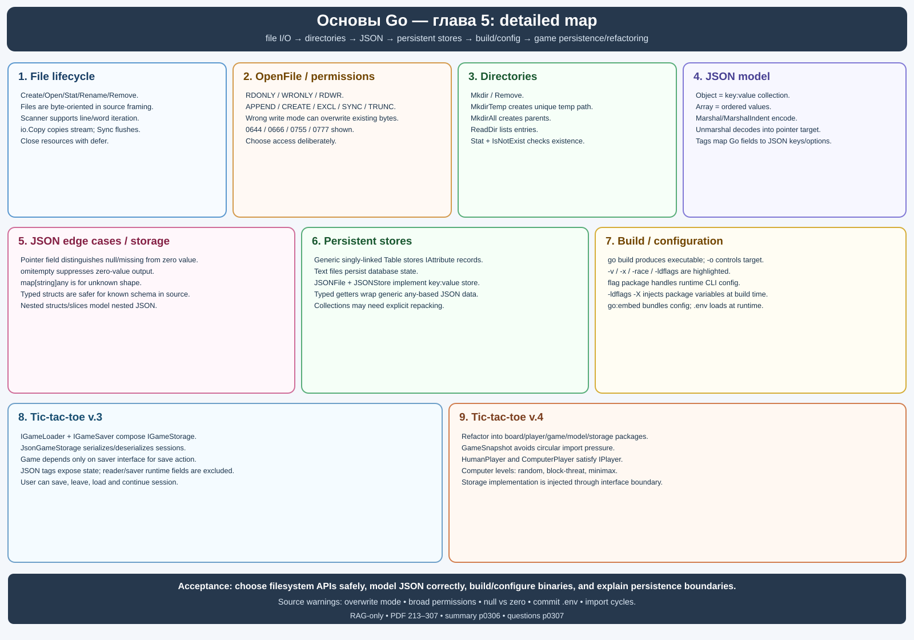
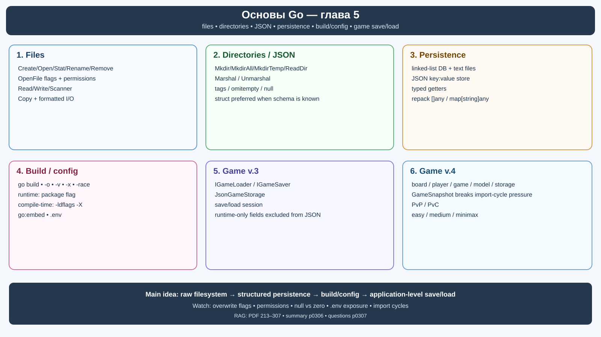

# Глава 5. Работа с файлами и каталогами. Сборка приложения

Status: `RAG_GROUNDED`

## Scope

Канонический источник содержимого: addressable RAG книги `go-basics-chernyshev-ru`.

- Source format: PDF
- RAG source-unit range: `p0213–p0307`
- RAG chunk boundary: `p0213:c01–p0307:c01`
- PDF page range: `213–307`
- Printed page range: `212–306`
- Chapter boundary: verified
- Chapter start: `p0213:c01`
- Project v.3: `p0281:c01–p0286:c01`
- Project v.4: `p0287:c01–p0305:c01`
- Chapter-end summary: `p0306:c01`
- Review questions: `p0307:c01`
- Next chapter starts at `p0308:c01`: «Работа с СУБД SQLite»
- Source SHA-256: `4053ecbf84c72e4f03756add8a03874e4caf928a5c3ed69b6a06ef06f21d60cd`

Внешние источники, model memory и прямое чтение `source/book.pdf` для содержимого главы не использовались.

## Chapter map

1. **5.1. Операции с файлами**
   - `os.Create`, `os.Open`, `os.Stat`, `os.Rename`, `os.Remove`;
   - byte-oriented read/write;
   - `bufio.Scanner`;
   - `os.OpenFile` и access flags;
   - permission bits;
   - `io.Copy`;
   - formatted file I/O через `fmt.Fprint/Fprintf/Fprintln` и `Fscan/Fscanf/Fscanln`.
2. **5.2. Работа с каталогами**
   - `os.Mkdir`, `os.Remove`;
   - `os.MkdirTemp`;
   - `os.MkdirAll`;
   - `os.ReadDir`;
   - current directory / traversal / rename;
   - existence checks.
3. **5.3. JSON**
   - objects and arrays;
   - serialization/deserialization;
   - `json.Marshal`, `MarshalIndent`, `Unmarshal`;
   - `null` and pointers;
   - struct tags;
   - `omitempty`;
   - `map[string]any` for unknown shape;
   - nested JSON objects.
4. **5.4. File-backed database + singly linked list**
   - generic `Node[T]` / `Table[T]`;
   - interface-constrained records;
   - file persistence;
   - menu-driven CRUD-like operations.
5. **5.5. JSON key:value store**
   - JSON-backed persistent map;
   - typed getters;
   - conversion of `[]any` / `map[string]any` into concrete types.
6. **5.6. Build and configuration**
   - `go build`;
   - `-o`, `-v`, `-x`, `-race`, `-ldflags`;
   - runtime flags through package `flag`;
   - compile-time values through `-ldflags -X`;
   - `//go:embed`;
   - `.env` configuration.
7. **Project v.3**
   - save/load game session in JSON;
   - `IGameLoader`, `IGameSaver`, `IGameStorage`;
   - JSON tags and excluded runtime-only fields.
8. **Project v.4**
   - package refactoring;
   - `board`, `player`, `game`, `model`, `storage`;
   - Human vs Computer;
   - difficulty levels including minimax;
   - `GameSnapshot` to avoid import cycles;
   - dependency injection for storage.
9. **Задания, резюме и 14 вопросов для самопроверки**.

## Main principle

~~~text
bytes/files
→ directories
→ structured JSON
→ persistent file-backed state
→ build/configuration
→ application persistence
→ package refactoring + injected storage
~~~

Глава переводит читателя от простых операций с файлами к application-level persistence и configuration.

## File operations

### Create / inspect / rename / remove

~~~go
file, err := os.Create("test.txt")
info, err := os.Stat("test.txt")
err = os.Rename("test.txt", "test2.txt")
err = os.Remove("test2.txt")
~~~

`os.Stat` возвращает информацию о name, size, permissions, modification time и directory flag.

Existence check в source строится вокруг `os.Stat` + `os.IsNotExist`.

### Read / write

Source подчёркивает byte representation файлов.

~~~go
file.WriteString(text)
file.Write([]byte(text))
~~~

Для line/word scanning используется `bufio.Scanner`.

## `os.OpenFile`

Signature in chapter:

~~~go
OpenFile(name string, flag int, perm FileMode) (*File, error)
~~~

Main flags:
- `O_RDONLY`;
- `O_WRONLY`;
- `O_RDWR`;
- `O_APPEND`;
- `O_CREATE`;
- `O_EXCL`;
- `O_SYNC`;
- `O_TRUNC`.

Source explicitly warns that write-only open without append starts writing from file beginning and can overwrite existing data.

### Permission bits

Chapter explains octal read/write/execute bits and examples such as `0644`, `0666`, `0755`, `0777`.

## Copy and formatted I/O

Copy:

~~~go
bytesWritten, err := io.Copy(dst, src)
err = dst.Sync()
~~~

Formatted output:
- `fmt.Fprint`;
- `fmt.Fprintf`;
- `fmt.Fprintln`.

Formatted input:
- `fmt.Fscan`;
- `fmt.Fscanf`;
- `fmt.Fscanln`.

Source notes that writer/reader format must remain consistent when using `Fprintf` / `Fscanf`.

## Directories

Main mechanisms introduced:

- `os.Mkdir` — one directory;
- `os.Remove` — remove empty directory in shown case;
- `os.MkdirTemp` — unique temporary directory;
- `os.MkdirAll` — directory chain;
- `os.ReadDir` — directory entries;
- `os.Rename` — rename/move;
- `os.Stat` + `os.IsNotExist` — existence check;
- `filepath.Join` — platform-aware path construction.

## JSON

Source defines JSON around two structures:
- unordered object: key:value pairs;
- ordered array/list.

Serialization:

~~~go
data, err := json.Marshal(value)
data, err := json.MarshalIndent(value, "", "  ")
~~~

Deserialization:

~~~go
err := json.Unmarshal(data, &target)
~~~

## JSON `null` and pointers

When a JSON field is absent or `null`, ordinary Go fields may receive zero values. Source uses pointers when it is important to distinguish “not present/null” from a real zero value.

## Struct tags

~~~go
type Actor struct {
    Name        string  `json:"name"`
    FilmsAmount int     `json:"films_amount,omitempty"`
    AboutActor  *string `json:",omitempty"`
}
~~~

Chapter also demonstrates `json:"-"` to exclude a field.

## Unknown JSON shape

For unknown schema source allows:

~~~go
map[string]any
~~~

but explicitly presents structs as safer/preferred when the schema is known.

## File-backed database

Section 5.4 builds a small database where records implement `IAttribute`, while a generic singly linked list stores them:

~~~go
type Node[T IAttribute] struct {
    Data T
    Next *Node[T]
}

type Table[T IAttribute] struct {
    head  *Node[T]
    tail  *Node[T]
    Title string
}
~~~

Persistence is backed by text files and exposed through a menu application.

## JSON key:value store

Section 5.5 builds `JSONFile` + `JSONStore` around a JSON object persisted to disk.

Source exposes:
- generic `GetValue` / `SetValue` / reset behavior;
- typed getters such as `GetBool`, `GetInt`, `GetFloat`, `GetString`, `GetList`, `GetMap`;
- explicit repacking from `[]any` and `map[string]any` to application-specific types.

## Build

Basic:

~~~bash
go build
go build -o new-app.exe
~~~

Important flags from chapter:
- `-v` — verbose build information;
- `-x` — internal commands;
- `-race` — race detector during build;
- `-ldflags` — linker/configuration options.

## Runtime configuration with `flag`

~~~go
myStr := flag.String("str", "value", "description")
myInt := flag.Int("int", 0, "description")
myBool := flag.Bool("bool", false, "description")
flag.Parse()
~~~

Source examples:

~~~bash
go run main.go -int=33 -bool
go run main.go -h
~~~

## Compile-time configuration: `-ldflags`

~~~bash
go build -ldflags "-X main.Version=1.2.3 -X main.VersionType=test"
go build -ldflags="-s -w"
~~~

Chapter uses `-X` to inject package variables and `-s -w` to remove symbol/debug information and reduce binary size.

## Embedded configuration

~~~go
//go:embed embed_config.json
var configData []byte
~~~

The embedded JSON is deserialized into a config struct.

## `.env`

Source builds a simple dotenv implementation with:
- local `.env` loading;
- optional OS environment merge;
- typed getters;
- parsing into int/bool/string.

Security note explicitly present in chapter: `.env` is not the safest place for private data and should be excluded from remote repository using `.gitignore`.

## Tic-tac-toe v.3

Adds persistence of game sessions:

~~~text
Game
→ IGameSaver
→ JsonGameStorage
→ JSON file

main
→ IGameLoader
→ restored Game
~~~

Runtime-only fields use `json:"-"`; serializable state receives JSON tags.

## Tic-tac-toe v.4

Major refactor:

~~~text
board   → board state/rules
player  → HumanPlayer / ComputerPlayer / IPlayer
game    → core loop/setup/serialization/state
model   → GameSnapshot
storage → load/save implementation
~~~

`model.GameSnapshot` is introduced to avoid circular imports between game/storage-related packages.

Computer player levels include:
- easy: random moves;
- medium: blocks winning combinations;
- hard: minimax.

Storage is injected into game logic through interfaces.

## Project improvement tasks

1. Save sessions into `data/`, creating directory automatically, and use `.json` extension.
2. Let user discover saved filenames without restarting.
3. Let user select a session from a list.
4. Cover added/changed code with tests.
5. Design and implement a custom text session format.

## Risks / common mistakes supported by source

- forgetting to close files;
- overwriting data because append/truncate mode is wrong;
- unsafe/overly broad permissions;
- reading full files when streaming would be more suitable;
- assuming absent JSON field differs automatically from zero value;
- using `map[string]any` when a known typed struct would be safer;
- failing to keep formatted read/write layouts aligned;
- hardcoding configuration that forces rebuild;
- committing `.env` secrets;
- creating import cycles during package decomposition;
- coupling storage implementation directly to game logic instead of interface boundary.

## Artifacts

- [cheatsheet.md](./cheatsheet.md)
- [commands.md](./commands.md)
- [diagram.md](./diagram.md)
- [visual-cheatsheet.svg](./visual-cheatsheet.svg)
- [visual-cheatsheet-detailed.svg](./visual-cheatsheet-detailed.svg)
- [summary.md](./summary.md)
- [review-questions.md](./review-questions.md)
- [review-answers.md](./review-answers.md)

## RAG provenance used

- files: `p0213:c01–p0229:c01`
- directories: `p0230:c01–p0238:c01`
- JSON: `p0239:c01–p0249:c01`
- file-backed DB: `p0249:c01–p0263:c01`
- JSON key:value store: `p0264:c01–p0271:c01`
- build/config: `p0271:c01–p0280:c01`
- project v.3: `p0281:c01–p0286:c01`
- project v.4: `p0287:c01–p0305:c01`
- summary/questions: `p0306:c01–p0307:c01`
- next chapter boundary: `p0308:c01`
