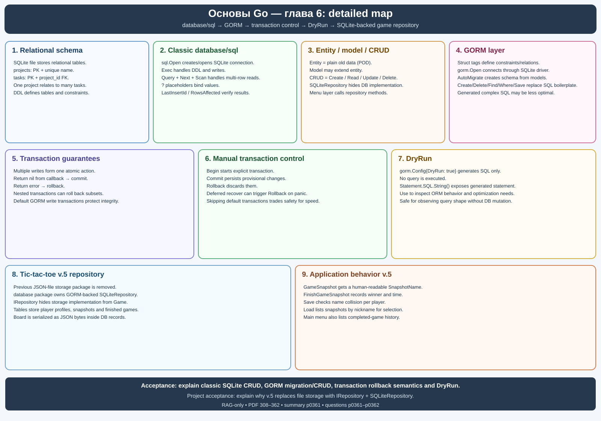
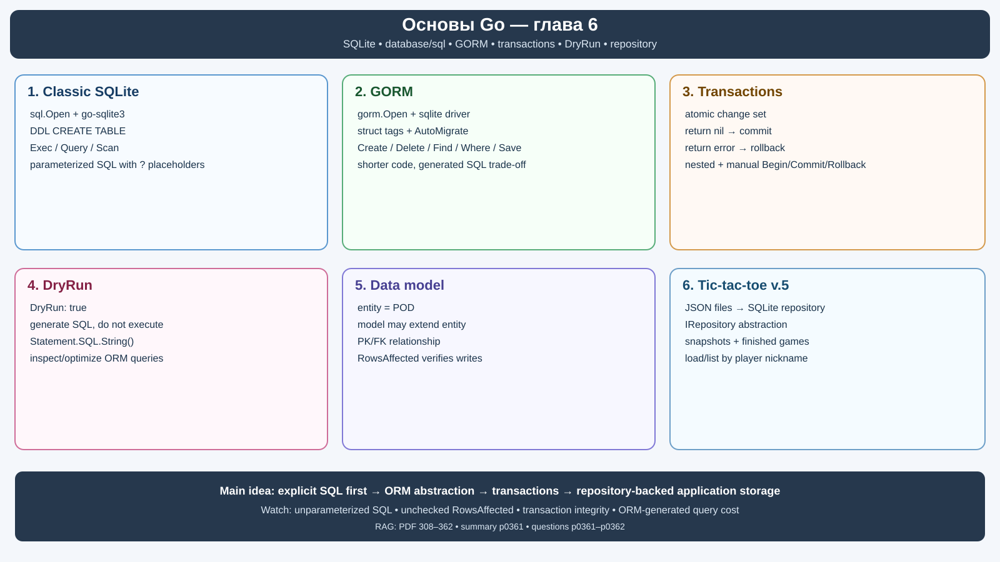

# Глава 6. Работа с СУБД SQLite

Status: `RAG_GROUNDED`

## Scope

Канонический источник содержимого: addressable RAG книги `go-basics-chernyshev-ru`.

- Source format: PDF
- RAG source-unit range: `p0308–p0362`
- RAG chunk boundary: `p0308:c01–p0362:c01`
- PDF page range: `308–362`
- Printed page range: `307–361`
- Chapter boundary: verified
- Chapter start: `p0308:c01`
- Project v.5: `p0343:c01–p0360:c01`
- Chapter-end summary: `p0361:c01`
- Review questions: `p0361:c01–p0362:c01`
- Next chapter starts at `p0363:c01`: «Конкурентность в Go»
- Source SHA-256: `4053ecbf84c72e4f03756add8a03874e4caf928a5c3ed69b6a06ef06f21d60cd`

Внешние источники, model memory и прямое чтение `source/book.pdf` для содержимого главы не использовались.

## Chapter map

1. **6.1. ToDo-list + go-sqlite3**
   - `database/sql` + driver `github.com/mattn/go-sqlite3`;
   - SQLite file database;
   - DDL for `projects` and `tasks`;
   - `SQLiteRepository` as wrapper over `*sql.DB`;
   - entity/model representation;
   - CRUD;
   - parameterized SQL through `?` placeholders;
   - menu-driven console application.
2. **6.2. ToDo-list + GORM**
   - ORM framing and trade-offs;
   - `gorm.io/gorm` + `gorm.io/driver/sqlite`;
   - model tags;
   - `gorm.Open`;
   - `AutoMigrate`;
   - CRUD through `Create`, `Delete`, `Find`, `Where`, `Save`.
3. **6.3. Transactions**
   - atomic change set;
   - automatic rollback on returned error;
   - nested transactions;
   - manual `Begin` / `Commit` / `Rollback`;
   - panic-aware rollback with `defer`/`recover`;
   - warning around `SkipDefaultTransaction`.
4. **6.4. DryRun**
   - generate SQL without executing it;
   - inspect ORM-generated statements.
5. **Project v.5**
   - file storage removed;
   - SQLite/GORM repository introduced;
   - `IRepository` as storage abstraction;
   - `GameSnapshot` + `FinishGameSnapshot`;
   - player/snapshot/finished-game tables;
   - save/load and finished-game history by nickname.
6. **Задания, резюме и 14 вопросов для самопроверки**.

## Source framing

SQLite is presented as a file-backed relational DBMS suitable for education, prototyping and small applications. The source explicitly cautions against treating it as a universal enterprise replacement for larger DBMS solutions.

The chapter compares two data-access styles:

~~~text
classic SQL
→ explicit queries
→ more manual code
→ more direct query control

ORM / GORM
→ shorter application code
→ higher abstraction
→ generated complex queries may be less optimal
~~~

## go-sqlite3 architecture

Project split:

~~~text
todo/
├─ db/    → DB creation, models, CRUD
├─ menu/  → terminal UI / handlers
└─ main.go
~~~

Driver dependency:

~~~bash
go get github.com/mattn/go-sqlite3
~~~

Source notes that this module requires a C compiler such as GCC; Windows example mentions MinGW/TDM-GCC.

## Database schema

Two tables:

### `projects`
- auto-increment integer primary key;
- unique name;
- description.

### `tasks`
- auto-increment integer primary key;
- name;
- description;
- priority;
- boolean completion flag;
- `project_id` foreign key.

The relationship is one project → many tasks.

## DDL

Chapter stores `CREATE TABLE IF NOT EXISTS ...` definitions as Go string constants and executes them when a new DB is created.

## `SQLiteRepository`

Classic implementation wraps `*sql.DB`:

~~~go
type SQLiteRepository struct {
    db *sql.DB
}
~~~

Creation/open path:

~~~go
db, err := sql.Open("sqlite3", pathToDB)
db.Exec(ProjectTabelDefinition)
db.Exec(TaskTabelDefinition)
~~~

The repository hides lower-level database implementation details from menu/application code.

## Entity / model / POD

Source distinguishes:
- **entity** — simple data structure, “plain old data” (POD);
- **model** — may extend an entity and contain additional behavior/structure.

Example: `Task` is an entity; `ProjectTask` embeds/extends it with `ProjectID`, so source calls it a model.

## CRUD

Chapter defines CRUD as:
- Create;
- Read;
- Update;
- Delete.

Classic examples use:
- `db.Exec` for insert/delete/update;
- `db.Query` for multi-row reads;
- `rows.Scan` for mapping result columns to Go fields;
- `LastInsertId` / `RowsAffected` for result metadata.

Parameterized query example:

~~~go
s.db.Exec(
    "INSERT INTO projects(name, description) values(?,?)",
    project.Name, project.Description,
)
~~~

Source explicitly connects placeholders with preventing SQL injection in the shown insert.

## GORM

Dependencies:

~~~bash
go get -u gorm.io/gorm
go get -u gorm.io/driver/sqlite
~~~

Source describes GORM as an ORM wrapper over `database/sql` supporting SQLite and other DBMSs.

## GORM models

Table properties are expressed through `gorm` struct tags:

~~~go
type Project struct {
    ID   int    `gorm:"primary_key;autoIncrement:true;not null"`
    Name string `gorm:"unique;not null"`
}
~~~

Relationships are expressed with foreign-key/reference tags.

## GORM DB creation and migration

~~~go
db, err := gorm.Open(sqlite.Open(dbName), &gorm.Config{})
db.AutoMigrate(&Project{}, &ProjectTask{})
~~~

`AutoMigrate` creates tables from model structures in the chapter example.

## GORM CRUD

Main methods shown:
- `Create`;
- `Delete`;
- `Find`;
- `Where`;
- `Save`.

GORM result object provides:
- `Error`;
- `RowsAffected`.

The chapter emphasizes that the GORM implementation reduces code volume compared with explicit SQL.

## Transactions

Source defines transaction as grouping multiple DB operations into one atomic action.

Core behavior:

~~~text
transaction begins
→ changes are provisional
→ success → commit
→ error → rollback
~~~

GORM callback form:

~~~go
db.Transaction(func(tx *gorm.DB) error {
    ...
    return nil // commit
})
~~~

Returning an error causes rollback in the shown examples.

### Default write transactions

Source says GORM performs create/delete/update inside transactions by default.

It shows:

~~~go
db.Session(&Session{SkipDefaultTransaction: true})
~~~

and warns that disabling default transactions can improve performance but may reduce data integrity.

## Nested transactions

GORM supports nested `Transaction` calls. The chapter demonstrates rolling back a subset of operations while retaining outer transaction changes.

## Manual transaction control

~~~go
tx := db.Begin()
...
tx.Commit()

tx = db.Begin()
...
tx.Rollback()
~~~

Panic-aware pattern in source:

~~~go
defer func() {
    if r := recover(); r != nil {
        tx.Rollback()
    }
}()
~~~

## DryRun

~~~go
db, _ := gorm.Open(
    sqlite.Open(dbName),
    &gorm.Config{DryRun: true},
)
~~~

In this mode SQL statements are generated but not executed. The chapter uses `Statement.SQL.String()` to inspect them.

## Tic-tac-toe v.5

The storage model changes from JSON files to SQLite.

Final package structure keeps `board`, `player`, `game`, `model`, adds `database`, and removes the previous `storage` package.

### Model changes

`GameSnapshot` gains `SnapshotName`.

New `FinishGameSnapshot` stores:
- board;
- player figure;
- winner;
- player nickname;
- timestamp.

### Repository abstraction

~~~go
type IRepository interface {
    SaveSnapshot(...) error
    GetSnapshots(...) (...)
    IsSnapshotExist(...) (...)
    SaveFinishedGame(...) error
    GetFinishedGames(...) (...)
}
~~~

`SQLiteRepository` wraps `*gorm.DB` and implements this interface.

### DB models

Source creates:
- `Player`;
- `GameSnapshot` DB model;
- `PlayerFinishGame` DB model.

Board state is serialized into JSON bytes inside DB records.

### Game refactor

`Game` receives `database.IRepository` instead of file-oriented saver interface.

Game save flow now:

~~~text
command save <name>
→ nickname
→ IsSnapshotExist
→ GameSnapshot
→ SaveSnapshot
→ SQLite
~~~

Completed games are also stored and later listed by nickname.

### Main menu

Adds:
- saved-game selection by nickname and snapshot list;
- viewing finished games;
- detailed finished-game board/result output.

## Project improvement tasks

1. Rewrite project using raw SQLite instead of GORM.
2. Add step-by-step game replay with move history, navigation, timestamps and text export.
3. Add player statistics across games.

## Risks / common mistakes supported by source

- string-building SQL instead of parameterized values;
- ignoring `RowsAffected` and assuming delete/update succeeded;
- not closing `rows`/DB resources;
- relying on ORM without understanding generated SQL;
- disabling default GORM transactions without integrity trade-off;
- failing to return an error when transaction should roll back;
- forgetting explicit `Commit`/`Rollback` in manual transaction flow;
- creating repository implementation details directly inside game logic instead of depending on `IRepository`.

## Artifacts

- [cheatsheet.md](./cheatsheet.md)
- [commands.md](./commands.md)
- [diagram.md](./diagram.md)
- [visual-cheatsheet.svg](./visual-cheatsheet.svg)
- [visual-cheatsheet-detailed.svg](./visual-cheatsheet-detailed.svg)
- [summary.md](./summary.md)
- [review-questions.md](./review-questions.md)
- [review-answers.md](./review-answers.md)

## RAG provenance used

- go-sqlite3 ToDo: `p0308:c01–p0329:c01`
- GORM ToDo: `p0330:c01–p0334:c01`
- transactions: `p0335:c01–p0342:c01`
- DryRun: `p0343:c01`
- project v.5: `p0343:c01–p0360:c01`
- summary/questions: `p0361:c01–p0362:c01`
- next chapter boundary: `p0363:c01`
