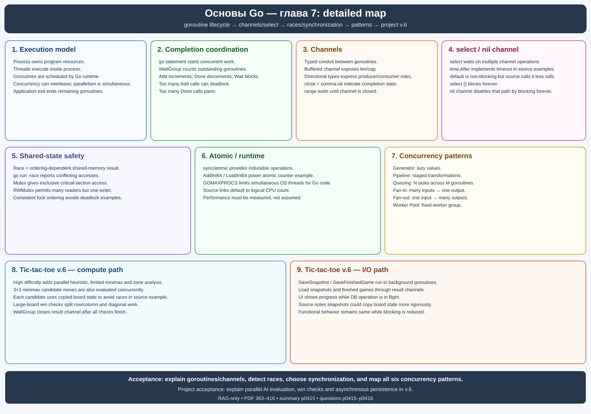
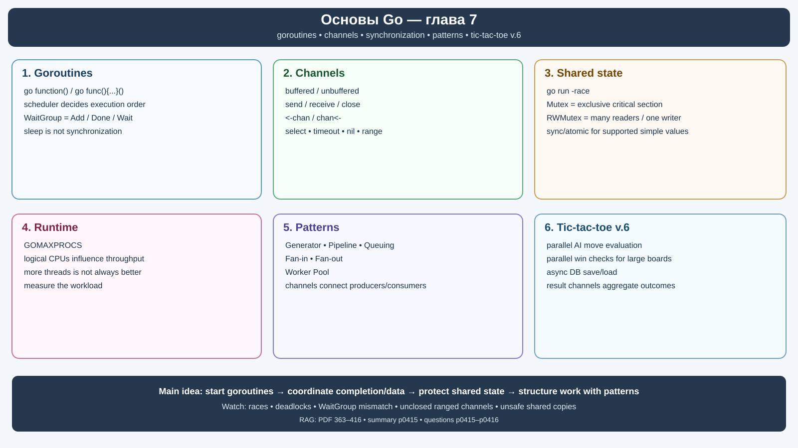

# Глава 7. Конкурентность в Go

Status: `RAG_GROUNDED`

## Scope

Канонический источник содержимого: addressable RAG книги `go-basics-chernyshev-ru`.

- Source format: PDF
- RAG source-unit range: `p0363–p0416`
- RAG chunk boundary: `p0363:c01–p0416:c01`
- PDF page range: `363–416`
- Printed page range: `362–415`
- Chapter boundary: verified
- Chapter start: `p0363:c01`
- Project v.6: `p0401:c01–p0414:c01`
- Chapter-end summary: `p0415:c01`
- Review questions: `p0415:c01–p0416:c01`
- Next chapter starts at `p0417:c01`: «Сетевое программирование»
- Source SHA-256: `4053ecbf84c72e4f03756add8a03874e4caf928a5c3ed69b6a06ef06f21d60cd`

Внешние источники, model memory и прямое чтение `source/book.pdf` для содержимого главы не использовались.

## Chapter map

1. **7.1–7.3. Process, thread, goroutine; concurrency vs parallelism**
   - process/thread/goroutine hierarchy;
   - Go scheduler;
   - `go` statement;
   - lack of execution-order guarantees;
   - goroutines end when application exits.
2. **7.4. Waiting for goroutines**
   - `sync.WaitGroup`;
   - `Add`, `Done`, `Wait`;
   - deadlock / negative counter failure modes.
3. **7.5. Channels**
   - typed channels;
   - unbuffered/buffered channels;
   - send/receive;
   - `close` and comma-ok receive;
   - directional channels;
   - `len` / `cap`;
   - user-defined element types;
   - `select`;
   - timeout/default branches;
   - empty `select {}`;
   - nil channel;
   - `for range` over channels.
4. **7.6. Race condition**
   - shared memory;
   - critical section;
   - `go run -race`.
5. **7.7. Mutexes**
   - `sync.Mutex`;
   - `sync.RWMutex`;
   - `Lock`/`Unlock`;
   - `RLock`/`RUnlock`;
   - dining philosophers / deadlock avoidance.
6. **7.8. Atomic operations**
   - `sync/atomic`;
   - `AddInt64`;
   - `LoadInt64`;
   - atomic counter.
7. **7.9. GOMAXPROCS**
   - limit on OS threads executing Go code simultaneously;
   - relation to logical CPUs;
   - performance experiment.
8. **7.10. Concurrency patterns**
   - Generator;
   - Pipeline;
   - Queuing;
   - Fan-in;
   - Fan-out;
   - Worker Pool.
9. **Project v.6**
   - parallel AI strategies;
   - parallel win checks;
   - async DB save/load;
   - channel-based result collection.
10. **Задания, резюме и 18 вопросов для самопроверки**.

## Source framing: process, thread, goroutine

The chapter describes:
- process as a running program instance with code/data/resources;
- thread as a lighter execution entity inside a process;
- goroutine as a Go-managed lightweight concurrent execution entity scheduled by the Go runtime rather than directly by the OS.

## Concurrency vs parallelism

Source distinction:

~~~text
concurrency
→ tasks are structured so execution can interleave

parallelism
→ multiple computations execute simultaneously
~~~

The chapter uses the morning-routine analogy: one person switching between tasks is concurrency; another independent actor such as a coffee machine makes part of the work truly parallel.

## Creating goroutines

~~~go
go namedFunction()

go func() {
    ...
}()
~~~

Source highlights two constraints:
- application exit terminates still-running goroutines;
- execution order is not controllable without additional synchronization mechanisms.

The chapter also demonstrates that a goroutine invocation itself is not used as an expression returning a value.

## WaitGroup

~~~go
var wg sync.WaitGroup
wg.Add(1)
go func() {
    defer wg.Done()
    ...
}()
wg.Wait()
~~~

Failure modes shown:
- more `Add` than matching `Done` → wait can deadlock;
- extra `Done` → negative WaitGroup counter panic.

## Channels

Source presents channels as the mechanism for communication and data exchange between goroutines.

Declaration:

~~~go
ch := make(chan int)
buffered := make(chan int, 3)
~~~

Send / receive:

~~~go
ch <- value
value := <-ch
value, ok := <-ch
~~~

Close:

~~~go
close(ch)
~~~

Source rules include:
- each channel carries one element type;
- channel communication needs producer and consumer roles;
- closed-channel receive can be detected through the `ok` result;
- chapter examples explicitly close channels when range-based consumption must terminate.

## Directional channels

~~~go
func reader(in <-chan int) { ... }
func writer(out chan<- int) { ... }
~~~

The source connects directional channels with pipeline-style design.

## Buffered channel state

For buffered channels the chapter uses:

~~~go
len(ch)
cap(ch)
~~~

to inspect queued elements and buffer capacity.

## `select`

`select` is presented as switch-like control specifically for channel operations.

~~~go
select {
case v := <-ch1:
    ...
case v := <-ch2:
    ...
}
~~~

Source behavior:
- if no case is ready, `select` blocks;
- if multiple cases are ready, the runtime chooses one;
- timeout can be implemented with `time.After`;
- `default` can make a non-blocking branch but source calls this less safe in timing-sensitive situations;
- empty `select {}` blocks forever.

## Nil channel

The chapter defines a nil channel as one assigned `nil`. Such a channel blocks permanently and effectively stops participating in `select` cases.

## `for range` over channel

Source uses:

~~~go
for value := range ch {
    ...
}
~~~

and explicitly warns that a range over a channel that is never closed can lead to deadlock because the loop has no termination signal.

## Race condition

Source definition: when multiple goroutines access shared memory and at least one write makes the result depend on execution ordering.

Critical section: code that mutates shared resources and must not be concurrently entered by multiple goroutines.

Race detector command:

~~~bash
go run -race .\main.go
~~~

The source also notes that the race detector requires cgo/GCC in the shown Windows setup.

## Mutex

~~~go
mutex.Lock()
defer mutex.Unlock()
~~~

`sync.Mutex` gives one goroutine exclusive access to the critical section.

The chapter explicitly says using a channel as a mutex-like write lock is an old pattern and treats proper mutex use as the correct mechanism for protecting shared writes.

## RWMutex

`sync.RWMutex` adds:

~~~go
RLock()
RUnlock()
~~~

Source framing:
- multiple readers can hold read locks concurrently;
- write lock remains exclusive;
- active writer blocks new readers/writers.

## Deadlock example

The dining-philosophers example models forks as mutexes and avoids a circular lock ordering by making even/odd philosophers acquire left/right forks in different order.

## Atomic operations

The chapter defines an atomic operation as one that cannot be interrupted midway.

Example:

~~~go
atomic.AddInt64(&value, 1)
value := atomic.LoadInt64(&counter)
~~~

Source recommendation: for built-in data types, check whether `sync/atomic` supports the required operation before defaulting to a mutex.

## GOMAXPROCS

Source describes GOMAXPROCS as controlling how many OS threads may execute Go code simultaneously.

The chapter relates its default to the number of logical CPUs and demonstrates that forcing the value to 1 made the sample atomic-counter workload slower.

The exact function spelling in the extracted RAG text is noisy, so this artifact preserves the verified concept rather than normalizing the code token from model memory.

## Concurrency patterns

### Generator

Lazy value production on demand through a channel.

### Pipeline

Series of stages connected by channels. Each stage receives from the previous stage, transforms data and sends to the next.

### Queuing

Distributes N tasks among M goroutines; source commonly uses a buffered channel whose capacity limits concurrent in-flight work.

### Fan-in

Merges multiple input channels into one output channel. Ordering is not guaranteed.

### Fan-out

Splits one input channel into multiple output channels.

### Worker Pool

Distributes work among several worker goroutines and collects results through a single output channel. Source says the ideal worker count is tied to logical CPU count.

## Tic-tac-toe v.6

Version v.6 adds concurrency in three areas.

### 1. Parallel computer strategies

For high difficulty and large boards the source adds:
- parallel heuristic evaluation;
- limited-depth parallel minimax;
- zone-based parallel analysis.

For 3×3 it also parallelizes evaluation of candidate moves with minimax.

Each candidate/zone can be evaluated in its own goroutine and results are aggregated through channels.

### 2. Parallel win checks

For board sizes from 5×5, rows/columns and both diagonals are checked concurrently.

Pattern:

~~~text
3 goroutines
→ row/column check
→ main diagonal
→ anti-diagonal
→ result channel
→ WaitGroup closes result channel
→ range until closed
~~~

### 3. Background DB operations

Save operations are moved into goroutines so they do not block the game UI.

Load operations use goroutines + result channels; while waiting, the source displays a loading indicator.

Source explicitly notes that a more rigorous implementation could snapshot/copy board state rather than retain a reference to the original board.

## Project improvement tasks

1. Add match statistics: move counts and total duration.
2. Add persistent player statistics and leaderboard.
3. Add persistent game settings for board size/difficulty.
4. Add computer-vs-computer mode with strategy selection for hard/large boards.
5. Add undo/redo of several moves on easy difficulty.

## Risks / common mistakes supported by source

- using sleep instead of synchronization to wait for goroutines;
- assuming goroutine execution order;
- mismatching `WaitGroup.Add` and `Done`;
- leaving a ranged channel open and deadlocking;
- empty `select {}` without an intentional termination design;
- shared writes without synchronization;
- treating channel-as-lock as preferred over mutex;
- forgetting `RLock/RUnlock` semantics for concurrent reads;
- inconsistent mutex acquisition order;
- using non-atomic read/modify/write on shared built-in values;
- assuming more GOMAXPROCS always improves performance;
- parallelizing stateful work without making independent copies where needed.

## Artifacts

- [cheatsheet.md](./cheatsheet.md)
- [commands.md](./commands.md)
- [diagram.md](./diagram.md)
- [visual-cheatsheet.svg](./visual-cheatsheet.svg)
- [visual-cheatsheet-detailed.svg](./visual-cheatsheet-detailed.svg)
- [summary.md](./summary.md)
- [review-questions.md](./review-questions.md)
- [review-answers.md](./review-answers.md)

## RAG provenance used

- foundations / goroutines / WaitGroup: `p0363:c01–p0367:c01`
- channels/select/nil/range: `p0368:c01–p0378:c01`
- race/mutexes: `p0379:c01–p0387:c01`
- atomic / GOMAXPROCS: `p0387:c01–p0390:c01`
- patterns: `p0390:c01–p0400:c01`
- project v.6: `p0401:c01–p0414:c01`
- summary/questions: `p0415:c01–p0416:c01`
- next chapter boundary: `p0417:c01`
