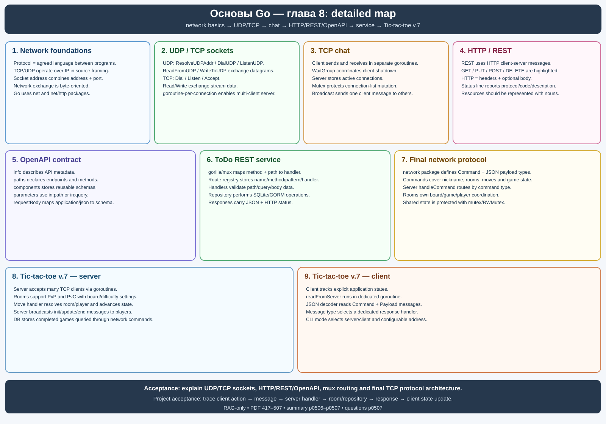
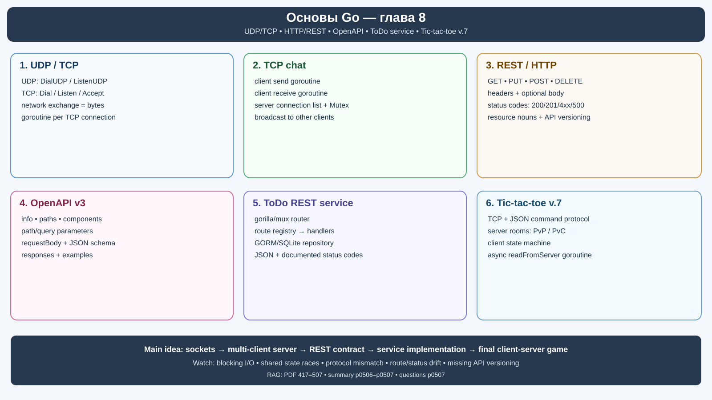

# Глава 8. Сетевое программирование

Status: `RAG_GROUNDED`

## Scope

Канонический источник содержимого: addressable RAG книги `go-basics-chernyshev-ru`.

- Source format: PDF
- RAG source-unit range: `p0417–p0507`
- RAG chunk boundary: `p0417:c01–p0507:c01`
- PDF page range: `417–507`
- Printed page range: `416–506`
- Chapter boundary: verified
- Chapter start: `p0417:c01`
- Project v.7: `p0467:c01–p0506:c01`
- Chapter-end summary: `p0506:c01–p0507:c01`
- Review questions: `p0507:c01`
- Next source section: conclusion starts at `p0508:c01`
- Source SHA-256: `4053ecbf84c72e4f03756add8a03874e4caf928a5c3ed69b6a06ef06f21d60cd`

Внешние источники, model memory и прямое чтение `source/book.pdf` для содержимого главы не использовались.

## Chapter map

1. **8.1. Network basics**
   - protocol as agreed language between programs;
   - TCP/IP stack in source framing;
   - TCP vs UDP;
   - IPv4/IPv6 socket-address concepts;
   - byte-oriented network exchange;
   - client-server architecture;
   - built-in `net` and `net/http` packages.
2. **8.2. UDP echo client/server**
   - `ResolveUDPAddr`;
   - `DialUDP`;
   - `ListenUDP`;
   - `ReadFromUDP` / `WriteToUDP`;
   - client/server mode selected through `os.Args`.
3. **8.3. TCP client/server**
   - `net.Dial`;
   - `net.Listen`;
   - `Accept`;
   - `Read` / `Write`;
   - one connection at a time in the basic version;
   - goroutine-per-connection server refinement.
4. **8.4. TCP chat**
   - independent send/receive goroutines on client;
   - shared connections list on server;
   - mutex protection;
   - broadcast messages to all other clients.
5. **8.5. REST API**
   - REST / API / REST API framing;
   - HTTP request/response structure;
   - GET / PUT / POST / DELETE;
   - status codes;
   - REST URL resource design;
   - path parameters and query strings;
   - API versioning.
6. **OpenAPI v3**
   - `info`, `paths`, `components`;
   - schemas;
   - request body;
   - path/query parameters;
   - response descriptions and examples;
   - Swagger-based visualization.
7. **ToDo REST service**
   - `gorilla/mux`;
   - SQLite/GORM reuse;
   - route registry;
   - request handlers;
   - JSON responses;
   - API validation/testing tooling mentioned by source.
8. **Project v.7**
   - final client-server Tic-tac-toe;
   - TCP protocol;
   - package `network` with commands/payloads;
   - rooms and PvP/PvC;
   - server command routing;
   - client finite-state flow;
   - asynchronous message handling;
   - simplified DB: completed games only.
9. **Задания, резюме и 14 вопросов для самопроверки**.

## Network model in source

The chapter splits network interaction into two categories:
- connection-oriented;
- connectionless.

It maps these primarily to TCP and UDP.

### TCP

Source analogy: telephone conversation.

Properties emphasized:
- client initiates connection;
- a communication channel is established between processes;
- the connection persists until the session ends;
- communication problems can be detected;
- server-side socket operations can block, so multiple clients require asynchronous/concurrent handling.

### UDP

Source analogy: postal delivery.

Properties emphasized:
- no persistent connection;
- messages are handled independently;
- delivery is not guaranteed in the source framing;
- useful for short/stateless exchanges such as DNS or network bootstrap examples.

## TCP/IP and socket addressing

Source says TCP and UDP operate over IP and treats this combination plus application protocols as the TCP/IP stack.

IPv4 socket address is presented as:

~~~text
(address, port)
~~~

with port range `1–65535` in the source.

Network exchange is byte-oriented: text must be encoded into bytes and decoded by the receiver.

## UDP echo example

Client:

~~~go
addr, _ := net.ResolveUDPAddr("udp4", "localhost:8081")
conn, err := net.DialUDP("udp4", nil, addr)
_, err = conn.Write(data)
n, _, err := conn.ReadFromUDP(buffer)
~~~

Server:

~~~go
addr, err := net.ResolveUDPAddr("udp4", ":8081")
conn, err := net.ListenUDP("udp4", addr)
n, clientAddr, err := conn.ReadFromUDP(buffer)
_, err = conn.WriteToUDP(buffer, clientAddr)
~~~

The source uses a `STOP` message to terminate the sample server.

## TCP echo example

Client:

~~~go
conn, err := net.Dial("tcp", "localhost:8081")
fmt.Fprint(conn, "Hello!\n")
message, err := bufio.NewReader(conn).ReadString('\n')
~~~

Server:

~~~go
listener, err := net.Listen("tcp", ":8081")
conn, err := listener.Accept()
n, err := conn.Read(buffer)
_, err = conn.Write(buffer)
~~~

The refined server accepts connections in a loop and hands each one to:

~~~go
go handleConnection(connection)
~~~

so the listener can continue accepting new clients.

## TCP chat

Client uses separate goroutines for:
- reading stdin and sending messages;
- receiving messages from the server.

`sync.WaitGroup` coordinates client shutdown.

Server:
- stores active `net.Conn` values;
- protects the connections slice with `sync.Mutex` during modifications;
- broadcasts each client message to all other connections;
- removes disconnected clients.

## REST API framing

Source defines REST as a software architectural style using HTTP advantages for client-server interaction.

REST API is framed as an application interface using HTTP requests to obtain, create/place, modify and delete resources.

HTTP methods highlighted:
- `GET` — get resources;
- `PUT` — create/write or update in source framing;
- `POST` — create/write;
- `DELETE` — delete.

## HTTP message structure

Source divides HTTP message into:
- header;
- body.

Headers are key:value metadata.

Request header groups in source:
- general headers;
- request headers;
- entity headers.

Response header groups:
- general headers;
- response headers;
- entity headers.

Body format is indicated by `Content-Type`, for example:

~~~text
Content-Type: application/json
~~~

## HTTP response status line

Example:

~~~text
HTTP/1.1 404 Not Found
~~~

Contains:
1. protocol version;
2. numeric status code;
3. textual description.

Common codes listed by source:
- `200 OK`;
- `201 Created`;
- `400 Bad Request`;
- `401 Unauthorized`;
- `404 Not Found`;
- `405 Method Not Allowed`;
- `409 Conflict`;
- `500 Internal Server Error`.

## REST URLs

Primary abstraction: resource.

Source examples:

~~~text
/api/v1/todo/projects/3/tasks/1
/api/v1/todo/projects/3/tasks?id=1
/api/v1/todo/projects/tasks?projID=3&taskID=1
~~~

Rules emphasized:
- prefer nouns for resources instead of verbs;
- let HTTP method describe action;
- support API versioning;
- path parameters and query parameters are both demonstrated.

## OpenAPI v3

The chapter uses OpenAPI/Swagger tooling to design an API specification before implementation.

Source says OpenAPI provides a language-independent interface description that lets humans and programs inspect service capabilities without reading implementation code.

Main sections:
- `info`;
- `paths`;
- `components`.

Example server URL:

~~~yaml
servers:
  - url: http://127.0.0.1:8080/api/v1/todo
~~~

## OpenAPI path parameter

~~~yaml
/project/del/{id}:
  delete:
    parameters:
      - in: path
        name: id
        required: true
        schema:
          type: integer
~~~

## OpenAPI query parameter

~~~yaml
/task:
  get:
    parameters:
      - in: query
        name: projectID
        schema:
          type: integer
~~~

## OpenAPI request body

~~~yaml
/project:
  post:
    requestBody:
      content:
        application/json:
          schema:
            $ref: "#/components/schemas/Project"
~~~

## ToDo REST service

Dependencies explicitly installed in source:

~~~bash
go get github.com/gorilla/mux
go get github.com/mattn/go-sqlite3
go get gorm.io/gorm
go get gorm.io/driver/sqlite
~~~

Basic server:

~~~go
router := mux.NewRouter()
router.HandleFunc("/api/v1/todo", home)
log.Fatal(http.ListenAndServe(":8080", router))
~~~

Source evolves this into a route registry containing:
- route name;
- HTTP method;
- path pattern;
- handler function.

Handlers work with `http.ResponseWriter` and `*http.Request`, interact with the repository and return JSON/status codes.

## Tic-tac-toe v.7

Final version changes the application from local/menu-driven storage-centric software into a TCP client-server application.

### Package changes

Source refactors data/network responsibilities and introduces/uses:
- `network` — protocol commands and payload structures;
- `server` — connections, rooms, routing and repository access;
- `client` — user flow, client state and incoming-message handlers;
- `player` — socket-aware human player plus computer player;
- `database` — simplified finished-game persistence;
- existing board/game/model responsibilities as needed.

### Network protocol

Messages contain a command plus payload.

Source defines command types for operations such as:
- nickname registration;
- make move;
- list rooms;
- join/leave room;
- initialize/update/end game;
- finished-games queries;
- error responses.

Payloads are JSON-encoded/decoded.

### Rooms

Server manages game rooms and supports:
- PvP;
- PvC;
- board size;
- computer difficulty;
- player join/leave;
- current game state;
- broadcasting state changes.

### Server

Server routes incoming messages with a command switch:

~~~text
Message.Cmd
→ nickname handler
→ move handler
→ room list/join/leave
→ finished-game handlers
→ error/unknown command path
~~~

Server uses goroutines to handle multiple connected clients and mutex/RWMutex protection for shared state.

### Client

Client maintains a finite set of states such as:
- waiting for nickname confirmation;
- main menu;
- player move;
- opponent move;
- game end;
- waiting for opponent;
- waiting for server response.

Client starts a dedicated goroutine:

~~~go
go c.readFromServer()
~~~

which continuously decodes messages and routes them to command-specific handlers.

### Final startup

Source uses package `flag`:

~~~bash
go run .\main.go
go run .\main.go -mode=client
~~~

and supports address configuration through `-addr`.

## Project improvement tasks

1. Improve terminal UI with ANSI colors.
2. Add per-turn timer.
3. Add custom game rules.
4. Let users create rooms.
5. Add spectator clients.
6. Add multi-move undo/redo on easy difficulty.
7. Add step-by-step replay.
8. Rewrite networking with WebSockets.
9. Rewrite client/server interaction through REST API.

## Risks / common mistakes supported by source

- forgetting that network I/O is byte-oriented;
- blocking server on one client instead of handling connections concurrently;
- failing to close network connections/listeners;
- unsynchronized mutation of shared connection/room state;
- mixing protocol definition with concrete server/client handlers;
- using verbs rather than resource-oriented URL design in the source REST guidance;
- missing status/error responses in API design;
- implementing service before clarifying the API contract;
- not versioning API;
- client state changes without synchronization;
- long blocking client/server I/O without a dedicated goroutine where source architecture expects asynchronous handling.

## Artifacts

- [cheatsheet.md](./cheatsheet.md)
- [commands.md](./commands.md)
- [diagram.md](./diagram.md)
- [visual-cheatsheet.svg](./visual-cheatsheet.svg)
- [visual-cheatsheet-detailed.svg](./visual-cheatsheet-detailed.svg)
- [summary.md](./summary.md)
- [review-questions.md](./review-questions.md)
- [review-answers.md](./review-answers.md)

## RAG provenance used

- network foundations / UDP / TCP: `p0417:c01–p0425:c01`
- TCP chat: `p0426:c01–p0428:c01`
- REST/HTTP/URLs/OpenAPI: `p0429:c01–p0447:c01`
- ToDo REST service: `p0448:c01–p0466:c01`
- project v.7: `p0467:c01–p0505:c01`
- project tasks + summary: `p0506:c01–p0507:c01`
- review questions: `p0507:c01`
- conclusion boundary: `p0508:c01`
