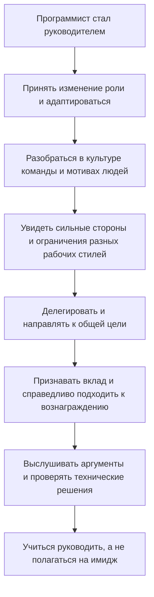

# Глава 1 — концептуальная схема

Только RAG книги, PDF p. 26–45. Диаграмма описывает логику автора, а не универсальный HR-процесс.

**Привязки:** адаптация/новая роль — p. 26–30; индивидуальные особенности — p. 31–38; мотивация и признание — p. 38–42; мышление и технический диалог — p. 42–44; итог — p. 44–45.

Оговорка: «породы» — авторская метафора, а не объективные категории для оценки персонала. Формальный алгоритм кадрового решения в главе отсутствует.
