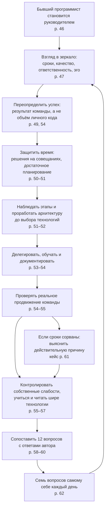

# Глава 2 — схема авторской логики

PDF p. 46–62. Концептуальная модель **с источниковой привязкой**; не универсальная инструкция по HR или управлению организацией.

### Ограничения
- Числа 45 минут для обычной встречи и ориентир одной еженедельной встречи — авторское предложение (p. 51), не утверждённый SLA.
- На p. 60 автор также обсуждает искусственно более ранний внутренний срок; без формальной политики применимость и последствия: [Needs confirmation].
- В тексте нет CLI-команд или утверждённого производственного runbook.
