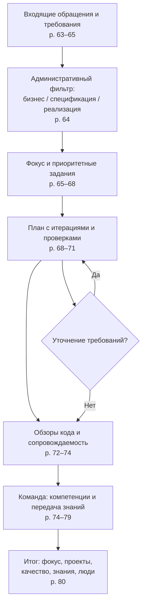

# Глава 3 — схема взаимодействия задач руководителя

Основа: RAG `p0063-c01`–`p0080-c01`. Концептуальная схема аргументации, а не корпоративная процедура.

Усложнение проекта в книге иллюстрируют таблицы 3.3–3.4, а влияние изоляции специалиста — кейс p. 76. Кадровые решения требуют отдельных правил: [Needs confirmation].
