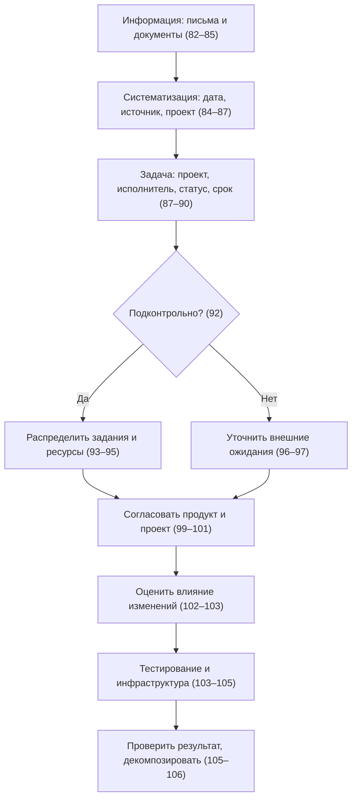

# Глава 4 — концептуальная схема

Источник: RAG PDF p. 81–106. Это объясняющая схема, а не репродукция рисунков 4.1–4.3.

Требования к правам доступа, KPI и rollback для конкретной компании: [Needs confirmation].
