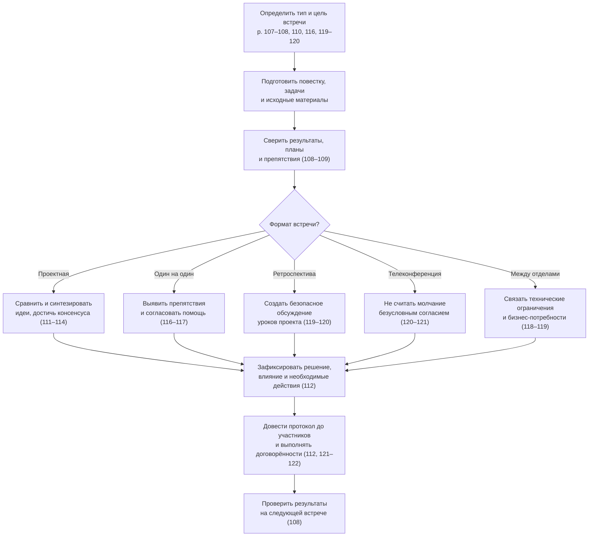

# Глава 5 — логика совещания (Mermaid)

RAG-only: PDF p. 107–123. Это концептуальная схема на основе текста, а не рис. 5.1 или 5.2.

Ограничения: формальные KPI, автоматизация рассылки и механизм rollback отсутствуют в RAG: [Needs confirmation]. Рис. 5.1 — форма записей проектного совещания, но изображение не извлечено как отдельный объект.
