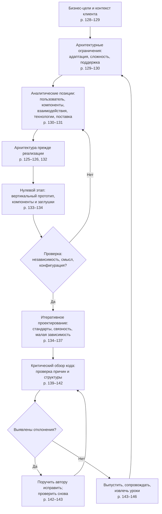

# Глава 6 — концептуальная схема технического лидерства

Источник: RAG PDF 124–146. Схема составляет аналитическую последовательность положений главы, а не авторский рисунок.

Цикл условен: автор не предлагает готовой методологии Git/CI или детальных команд выпуска и rollback. Решения о внедрении в конкретной компании — [Needs confirmation].
