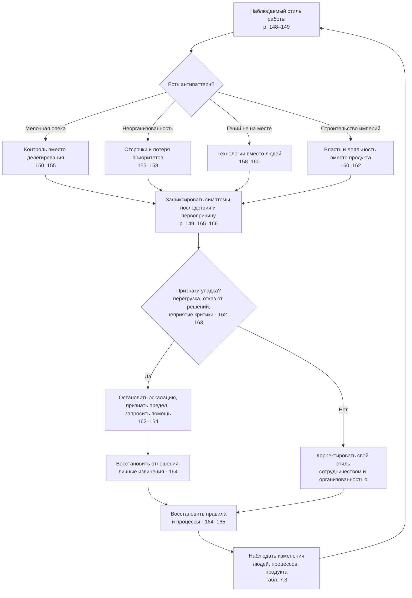

# Глава 7 — концептуальная карта «Закат лидера»

RAG-only: PDF 147–166. Схема синтезирует текст, **не воспроизводит** табл. 7.1–7.3 графически.

Глава не формализует диагностику сотрудников, организационные метрики и rollback: [Needs confirmation]. Исключения, названные автором, не заменяют политику компании.
