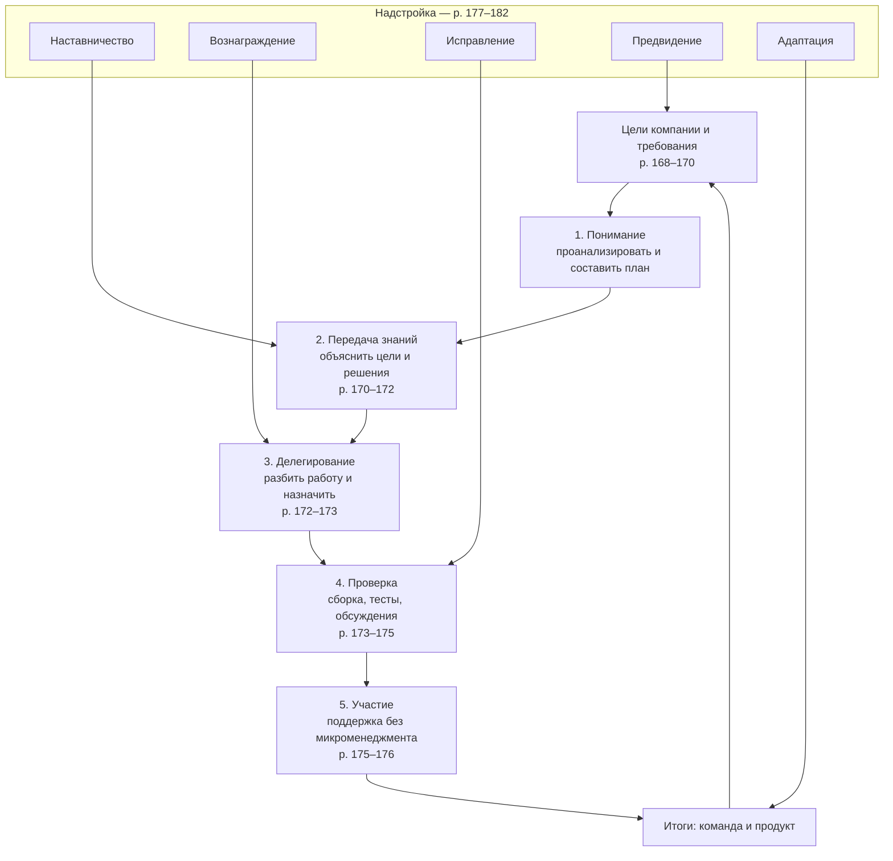

# Глава 8 — карта развития лидерства

Источник: RAG PDF 167–192, `p0167-c01`…`p0192-c01`. Эта Mermaid-диаграмма — **редакционный синтез**, не репродукция авторского рисунка 8.1 на p. 168.

Граф отражает авторское различие **пяти фундаментальных принципов** и **пяти элементов надстройки**, подтверждённое явным резюме p. 191. Возвратные связи добавлены как пояснение и не заявляются точным расположением стрелок на рис. 8.1. Метрики и технические команды не заданы: [Needs confirmation].
