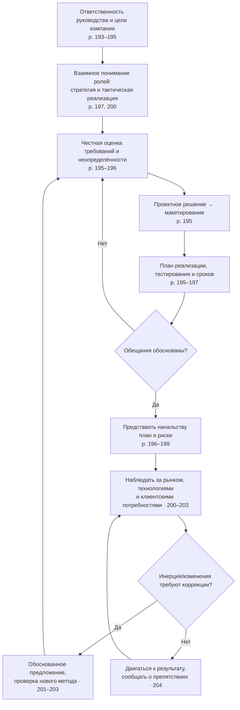

# Глава 9 — контур совместного планирования с начальством

Режим: RAG-only, PDF p. 193–204. **Редакционная диаграмма**, не авторский рисунок; сохраняет причинно-следственные связи разделов.

Примечание: в книге нет предписанного формата плана, CI-процедуры, полномочий изменения релиза или технического rollback. Схема не является утверждённым регламентом организации: [Needs confirmation].
