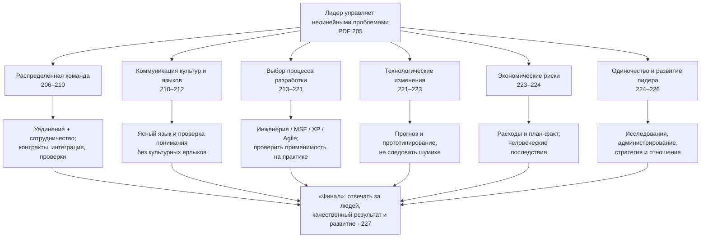

# Глава 10 — карта нелинейных задач лидера

RAG-only: p0205-c01…p0227-c01, PDF 205–227. Схема — редакционная концептуальная модель по тематическим разделам, а не авторская иллюстрация.

Ограничения: никакой из путей не является готовым регламентом для компании, источником измеренных KPI или одобрением электронного наблюдения сотрудников. Такие решения — [Needs confirmation].
