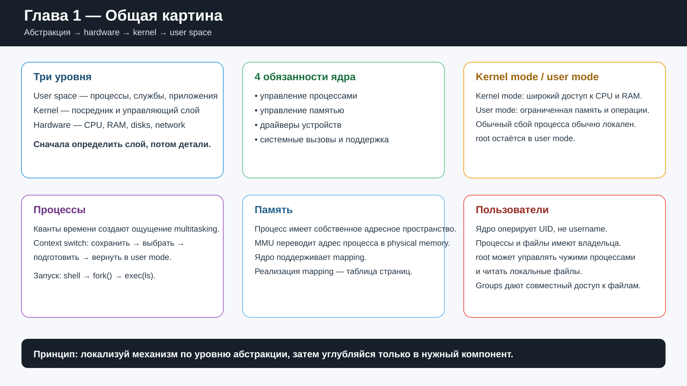
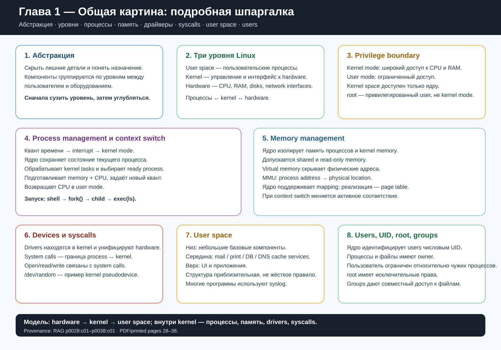

# Глава 1 — Общая картина

Практические и концептуальные заметки по главе 1 книги «Внутреннее устройство Linux», 3-е издание.

## Идентификация

- Book ID: <code>how-linux-works-3e-ru-2022</code>
- Глава: 1
- Название: «Общая картина»
- Slug: <code>big-picture</code>
- Source policy: <code>rag_only</code>
- Request contract: `BIBLIOTEKA-VSP-CHAPTER-ANALYSIS-REQUEST v1.2`
- Readiness contract: `BIBLIOTEKA-VSP-BOOK-READINESS v1.2`
- Artifact contract: `BIBLIOTEKA-VSP-CHAPTER-ARTIFACT-COLLECTION v1.6`
- External sources: запрещены
- Model memory: запрещена
- Прямой доступ к PDF: не использовался

## Provenance

- RAG chunk range: <code>p0028:c01</code>–<code>p0038:c01</code>
- Source format: `pdf`
- Source locator range: `pdf_page 28–38`
- EPUB spine range: `Not applicable`
- PDF page range: 28–38
- Printed page range: 28–38
- Оглавление в <code>p0006:c01</code> задаёт начало главы 1 на странице 28 и начало главы 2 на странице 39.
- <code>p0028:c01</code> начинается заголовком «1 Общая картина».
- Следующий чанк <code>p0039:c01</code> начинается главой 2 «Основные команды и иерархия каталогов».
- Chapter boundary verified: yes
- Completion status: `ACCEPTED`
- Source SHA-256: <code>60bb698fc2ff849a9814f099c12ca56e8f40c11b0518436f3ce3c44e96152df9</code>

## Содержимое

- [cheatsheet.md](cheatsheet.md) — концептуальная шпаргалка по слоям Linux и границам ответственности.
- [commands.md](commands.md) — команды, системные вызовы и интерфейсы, явно упомянутые в главе.
- [diagram.md](diagram.md) — Mermaid-карта взаимодействия hardware → kernel → user space и запуска процесса.
- [visual-cheatsheet.svg](visual-cheatsheet.svg) — компактный обзор.
- [visual-cheatsheet-detailed.svg](visual-cheatsheet-detailed.svg) — подробный обзор всей главы.

Conditional artifacts <code>summary.md</code>, <code>review-questions.md</code> и <code>review-answers.md</code> не создавались: в проверенной границе главы нет отдельного раздела с контрольными вопросами/упражнениями и нет отдельного явно обозначенного chapter-end summary. Раздел 1.6 «Что дальше?» учтён в анализе как заключительный переход к главе 2.

## Карта главы

1. Абстракция как способ понимать сложную систему.
2. Три основных уровня Linux: оборудование, ядро, пользовательское пространство.
3. Различие kernel mode / user mode и граница kernel space / user space.
4. Оперативная память и состояние.
5. Четыре основные области ответственности ядра:
   - процессы;
   - память;
   - драйверы устройств;
   - системные вызовы и поддержка.
6. Планирование процессов и переключение контекста.
7. Виртуальная память, MMU и таблицы страниц.
8. Драйверы как единый интерфейс к различающемуся оборудованию.
9. Системные вызовы, включая <code>fork()</code> и семейство <code>exec()</code>.
10. Пользовательское пространство и примерная иерархия служб/приложений.
11. Пользователи, UID, владельцы процессов/файлов, root и группы.

## Краткий анализ главы

Главная задача главы — не научить набору команд, а дать модель системы, которая позволяет не утонуть в деталях. Автор начинает с абстракции: сложную систему следует делить на компоненты и уровни, рассматривая сначала назначение и связи между ними, а затем углубляясь в нужную часть.

Для Linux вводится базовая трёхуровневая модель. Внизу находится оборудование: процессоры, оперативная память, диски и сетевые интерфейсы. Над ним работает ядро — посредник между оборудованием и выполняющимися программами. Верхний уровень образуют пользовательские процессы, то есть запущенные программы в пользовательском пространстве.

Ключевая граница проходит между режимом ядра и пользовательским режимом. Код ядра имеет широкий доступ к процессору и памяти, поэтому ошибка в этой области способна затронуть всю систему. Пользовательские процессы работают с ограничениями; типичный сбой процесса локализуется ядром, хотя процессы с особыми привилегиями всё равно могут причинить существенный ущерб данным.

Ядро описывается через четыре основные обязанности: управление процессами, памятью, драйверами устройств и интерфейсом системных вызовов. Для процессов глава объясняет кванты времени и переключение контекста: ядро сохраняет состояние одного процесса, выбирает следующий, подготавливает для него процессор и память и возвращает выполнение в пользовательский режим.

Для памяти вводятся виртуальная память и MMU. Процесс работает с собственным представлением адресного пространства, а MMU вместе с поддерживаемыми ядром таблицами соответствий переводит адреса процесса в физическую память. Реализация такой таблицы названа таблицей страниц.

Системные вызовы показаны как нормальная граница взаимодействия пользовательского процесса с ядром. На примере запуска <code>ls</code> книга демонстрирует связку: оболочка вызывает <code>fork()</code>, получает почти идентичный процесс, после чего дочерний процесс через <code>exec(ls)</code> заменяет свой образ программой <code>ls</code>.

Пользовательское пространство также разбирается по уровням обслуживания: небольшие базовые компоненты ниже, более крупные службы — выше, пользовательские приложения — ближе всего к пользователю. При этом автор прямо подчёркивает, что это приблизительная схема, а не жёсткое правило.

В конце вводится Unix-модель пользователей. Ядро идентифицирует пользователя числовым UID; процессы выполняются от имени владельца, а файлы могут принадлежать пользователям. Root — исключительный пользователь с широкими полномочиями в пользовательском режиме; при этом даже root не становится кодом режима ядра.

## Основной принцип

При анализе Linux сначала определите уровень абстракции и границу ответственности:

<code>hardware → kernel → user space</code>.

После этого углубляйтесь только в тот компонент, где находится интересующий механизм или проблема. Для ядра полезно держать в голове четыре базовых направления: процессы, память, устройства и системные вызовы.

## Ограничения

- Глава концептуальная и не задаёт полноценную методологию эксплуатационной диагностики.
- Из командной строки явно используется только <code>ls</code> как пример запуска программы; остальные важные элементы главы — системные вызовы, процессы и интерфейсы.
- Рисунки 1.1–1.3 представлены в RAG только заголовками и окружающим текстом; отдельные графические объекты RAG не кодирует.
