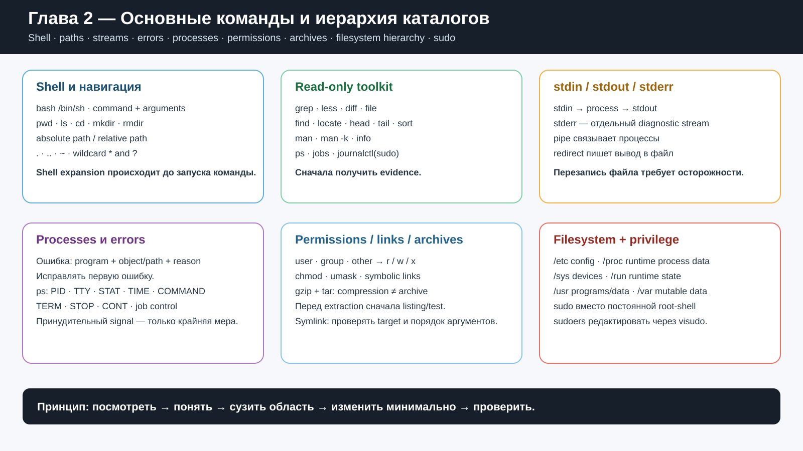
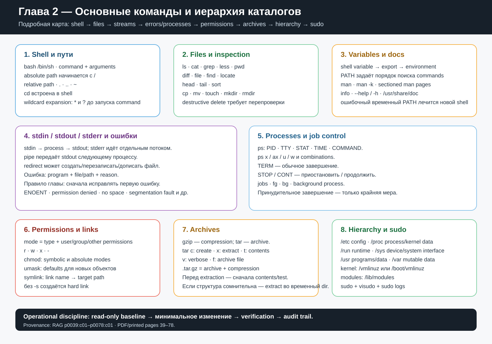

# Глава 2 — Основные команды и иерархия каталогов

Практические заметки по главе 2 книги «Внутреннее устройство Linux», 3-е издание.

## Идентификация

- Book ID: <code>how-linux-works-3e-ru-2022</code>
- Глава: 2
- Название: «Основные команды и иерархия каталогов»
- Slug: <code>basic-commands-and-directory-hierarchy</code>
- Source policy: <code>rag_only</code>
- External sources: запрещены
- Model memory: запрещена
- Прямой доступ к PDF: не использовался

## Provenance

- RAG chunks: <code>p0039:c01</code>–<code>p0078:c01</code>
- PDF pages: 39–78
- Printed pages: 39–78
- Оглавление в <code>p0006:c01</code>–<code>p0008:c01</code> задаёт границы и структуру главы.
- <code>p0039:c01</code> начинается заголовком главы 2.
- Следующий чанк <code>p0079:c01</code> начинается главой 3 «Устройства».
- Chapter boundary verified: yes
- Source SHA-256: <code>60bb698fc2ff849a9814f099c12ca56e8f40c11b0518436f3ce3c44e96152df9</code>

## Содержимое

- [cheatsheet.md](cheatsheet.md) — operational-шпаргалка по shell, файлам, процессам, правам, архивам и sudo.
- [commands.md](commands.md) — команды и сочетания клавиш, явно подтверждённые RAG главы.
- [diagram.md](diagram.md) — Mermaid-карта безопасного рабочего цикла по материалам главы.
- [visual-cheatsheet.svg](visual-cheatsheet.svg) — компактный обзор.
- [visual-cheatsheet-detailed.svg](visual-cheatsheet-detailed.svg) — подробный обзор всей главы.

Conditional artifacts <code>summary.md</code>, <code>review-questions.md</code> и <code>review-answers.md</code> не создавались: в проверенной границе нет отдельного блока контрольных вопросов/упражнений и нет отдельно обозначенного chapter-end summary. Раздел 2.21 «Что дальше?» является переходом к последующим главам.

## Карта главы

1. Bash и базовая модель shell.
2. Аргументы команд, stdin/stdout/stderr и EOF.
3. Базовые файловые команды: <code>ls</code>, <code>cp</code>, <code>mv</code>, <code>touch</code>, <code>rm</code>, <code>echo</code>.
4. Абсолютные/относительные пути, <code>.</code>, <code>..</code>, <code>cd</code>, <code>mkdir</code>, <code>rmdir</code>.
5. Globbing: <code>*</code> и <code>?</code>, порядок shell expansion.
6. Команды среднего уровня: <code>grep</code>, <code>less</code>, <code>pwd</code>, <code>diff</code>, <code>file</code>, <code>find</code>, <code>locate</code>, <code>head</code>, <code>tail</code>, <code>sort</code>.
7. Пароль, shell, dotfiles, shell/environment variables и <code>PATH</code>.
8. Специальные символы и редактирование командной строки.
9. Man/info и локальная документация.
10. Перенаправление потоков и pipelines.
11. Структура Unix error messages и распространённые ошибки.
12. Процессы, PID, <code>ps</code>, signals, job control и background processes.
13. Права доступа, <code>chmod</code>, <code>umask</code> и symbolic links.
14. <code>gzip</code>/<code>tar</code> и безопасная распаковка архивов.
15. Базовая иерархия каталогов Linux.
16. <code>sudo</code>, <code>/etc/sudoers</code>, <code>visudo</code> и журналы sudo.

## Краткий анализ главы

Глава 2 формирует минимальный рабочий инструментарий для дальнейшего изучения Linux. Автор сознательно опирается на устойчивые Unix-механизмы, а не на специфические расширения конкретных дистрибутивов. Shell рассматривается одновременно как интерфейс запуска программ и как среда композиции: команды получают аргументы, работают с потоками, связываются конвейерами и используют shell expansion.

Вторая линия главы — файловая модель. Читатель осваивает пути, текущий каталог, базовые операции с файлами и каталогами, поиск, просмотр, сравнение и определение типа файла. Отдельно подчёркивается, что shell расширяет шаблоны до запуска команды; это важно для безопасной работы с wildcard и особенно для рекурсивного удаления.

Третья линия — наблюдаемость. <code>man</code>, <code>info</code>, <code>ps</code>, stderr и структура сообщений об ошибках дают способ сначала получить данные, а уже потом менять состояние. Для ошибок автор советует начинать с первой ошибки, потому что последующие сообщения могут быть каскадным следствием.

Четвёртая линия — управление состоянием. Глава вводит сигналы процессов, job control, права доступа, символические ссылки, архивирование и привилегированные команды. Здесь же появляются явные safety boundaries: <code>rm -r</code> может нанести серьёзный ущерб; <code>KILL</code> следует использовать только в крайнем случае; права world-writable опасны; перед распаковкой tar-архива рекомендуется проверить его содержимое; символические ссылки нужно создавать после перепроверки порядка аргументов.

Иерархия каталогов связывает команды с устройством системы. В корне выделяются <code>/bin</code>, <code>/dev</code>, <code>/etc</code>, <code>/home</code>, <code>/lib</code>, <code>/proc</code>, <code>/run</code>, <code>/sys</code>, <code>/sbin</code>, <code>/tmp</code>, <code>/usr</code>, <code>/var</code>, а также <code>/boot</code>, <code>/media</code> и <code>/opt</code>. Для <code>/usr</code> отдельно рассматриваются <code>/usr/include</code>, <code>/usr/local</code>, <code>/usr/man</code> и <code>/usr/share</code>. Ядро обычно находится в <code>/vmlinuz</code> или <code>/boot/vmlinuz</code>, а загружаемые модули — в <code>/lib/modules</code>.

Финальный operational boundary — работа от root. Автор рекомендует <code>sudo</code> вместо постоянной root-shell: действие регистрируется, сохраняется связь с пользователем и не требуется постоянно работать в привилегированном окружении. Для изменения <code>/etc/sudoers</code> прямо рекомендуется <code>visudo</code>, потому что оно проверяет синтаксис после сохранения.

## Основной принцип

Работать в порядке:

<code>посмотреть → понять → сузить область → изменить минимально → проверить</code>.

Глава 2 уже даёт для этого основу: read-only discovery, локальную документацию, обработку ошибок, process inspection, права, потоки и контролируемое повышение привилегий.

## Ограничения

- Это базовая глава: многие команды показаны только в минимальном синтаксисе.
- Детали <code>top</code>, <code>lsof</code>, загрузки, устройств, файловых систем и пользователей вынесены в последующие главы.
- Rollback для многих destructive/state-changing операций в самой главе не описан; такие случаи помечены <code>[Needs confirmation]</code>.
