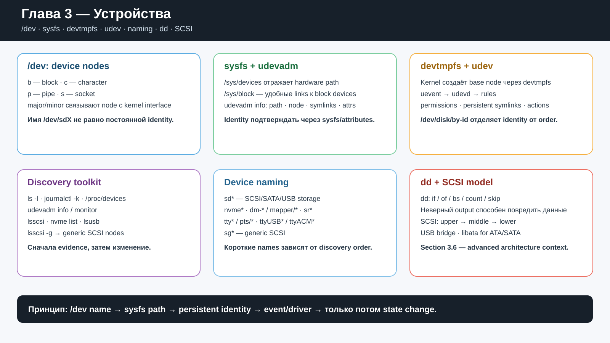
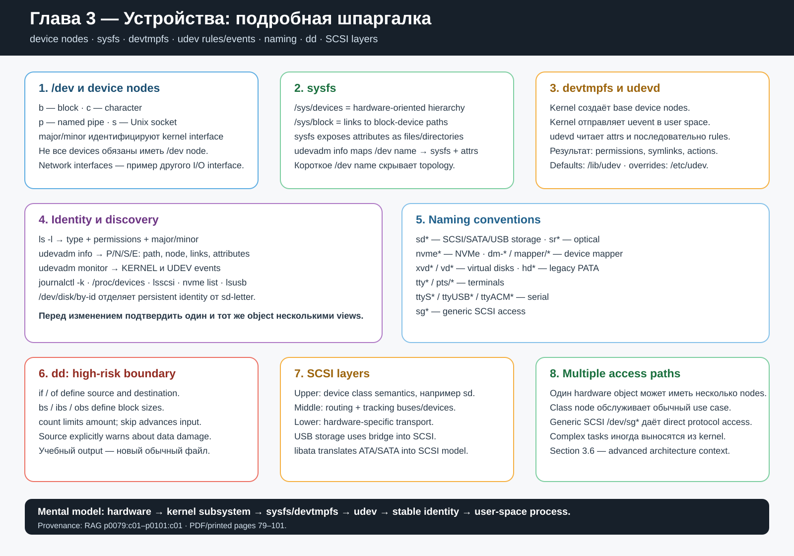

# Глава 3 — Устройства

Практические и концептуальные заметки по главе 3 книги «Внутреннее устройство Linux», 3-е издание.

## Идентификация

- Book ID: <code>how-linux-works-3e-ru-2022</code>
- Глава: 3
- Название: «Устройства»
- Slug: <code>devices</code>
- Source policy: <code>rag_only</code>
- External sources: запрещены
- Model memory: запрещена
- Прямой доступ к PDF: не использовался

## Provenance

- RAG chunks: <code>p0079:c01</code>–<code>p0101:c01</code>
- PDF pages: 79–101
- Printed pages: 79–101
- <code>p0079:c01</code> начинается заголовком главы 3 «Устройства».
- Следующий чанк <code>p0102:c01</code> начинается главой 4 «Диски и файловые системы».
- Chapter boundary verified: yes
- Source SHA-256: <code>60bb698fc2ff849a9814f099c12ca56e8f40c11b0518436f3ce3c44e96152df9</code>

## Содержимое

- [cheatsheet.md](cheatsheet.md) — operational-шпаргалка по идентификации устройств, sysfs, udev/devtmpfs и безопасной работе с device nodes.
- [commands.md](commands.md) — команды и интерфейсы, явно подтверждённые RAG главы.
- [diagram.md](diagram.md) — Mermaid-карта пути от hardware к device node и udev event flow.
- [visual-cheatsheet.svg](visual-cheatsheet.svg) — компактный обзор.
- [visual-cheatsheet-detailed.svg](visual-cheatsheet-detailed.svg) — подробный обзор всей главы.

Conditional artifacts <code>summary.md</code>, <code>review-questions.md</code> и <code>review-answers.md</code> не создавались: в проверенной границе главы нет отдельного блока контрольных вопросов/упражнений и нет отдельно обозначенного chapter-end summary.

## Карта главы

1. Файлы устройств в <code>/dev</code>.
2. Типы device nodes: block, character, pipe, socket.
3. Major/minor numbers как идентификаторы устройств ядром.
4. Sysfs и аппаратно-ориентированное представление в <code>/sys</code>.
5. <code>dd</code> как низкоуровневый инструмент потокового копирования.
6. Соглашения имён устройств: <code>/dev/sd*</code>, <code>/dev/nvme*</code>, <code>/dev/dm-*</code>, <code>/dev/sr*</code>, <code>/dev/tty*</code> и др.
7. Создание device node через <code>mknod</code> и современная роль <code>devtmpfs</code>/<code>udev</code>.
8. Uevent: kernel → udevd → rules → permissions/symlinks/actions.
9. <code>udevadm info</code> и <code>udevadm monitor</code>.
10. Persistent symlinks, в частности <code>/dev/disk/by-id</code>.
11. Архитектура SCSI в Linux: upper / middle / lower layers.
12. USB mass storage через SCSI bridge.
13. ATA/SATA через <code>libata</code>.
14. Generic SCSI devices <code>/dev/sg*</code> и несколько способов доступа к одному hardware device.

## Краткий анализ главы

Глава 3 показывает, что «устройство» в Linux — это не одно имя в <code>/dev</code>, а набор представлений одного аппаратного объекта на разных уровнях системы. Самый простой интерфейс — device node, через который процесс может читать или писать как в файл. Но этого представления недостаточно для понимания происхождения устройства, его аппаратного пути и событий подключения, поэтому рядом существуют sysfs и udev.

Первый важный слой — <code>/dev</code>. Ядро и пользовательское пространство представляют многие устройства как специальные файлы. В выводе <code>ls -l</code> первый символ указывает тип: <code>b</code> для block device, <code>c</code> для character device, <code>p</code> для named pipe и <code>s</code> для Unix-domain socket. Для block/character devices major/minor numbers связывают node с соответствующим kernel interface.

Второй слой — sysfs. Путь в <code>/sys/devices</code> отражает аппаратную иерархию намного точнее, чем короткое имя вроде <code>/dev/sda</code>. Каталог <code>/sys/block</code> даёт удобные ссылки на block devices, а <code>udevadm info</code> помогает связать device node с sysfs path и набором атрибутов.

Третий слой — динамическое управление устройствами. Ядро через <code>devtmpfs</code> создаёт базовые device nodes и отправляет событие uevent в user space. Демон udevd получает событие, загружает атрибуты, прогоняет его через правила и выполняет действия: настройку permissions, создание persistent symlinks и уведомление других процессов. Правила по умолчанию находятся в <code>/lib/udev/rules.d</code>, локальные overrides — в <code>/etc/udev/rules.d</code>.

Особенно полезен operational вывод главы: короткое имя устройства не всегда является устойчивой идентичностью. Устройства семейства <code>/dev/sd*</code> получают буквы в порядке обнаружения, поэтому физически тот же диск после изменения hardware topology может получить другое имя. Для устойчивой идентификации Linux использует дополнительные ссылки, например <code>/dev/disk/by-id</code>.

Раздел о <code>dd</code> вводит низкоуровневую работу с данными блоками фиксированного размера. Автор отдельно предупреждает, что ошибка в source/output parameters может повредить файлы или данные на устройствах. Практический safety boundary главы — сначала точно идентифицировать объект и, если задача учебная, направлять output в новый обычный файл, а не в реальное device storage.

В расширенной части глава разбирает SCSI как архитектурный пример ядра. Подсистема SCSI разделена на upper, middle и lower layers. Upper layer знает семантику класса устройства, middle layer маршрутизирует и отслеживает устройства, lower layer взаимодействует с конкретным host adapter или bridge. USB mass storage и SATA показывают, как несколько подсистем соединяются через переводчики и мосты: USB storage переупаковывает SCSI commands, а <code>libata</code> согласует ATA/SATA с SCSI layer.

Последняя идея — один hardware device может иметь несколько точек доступа. Например, оптическое устройство может быть представлено обычным class device и generic SCSI node <code>/dev/sg*</code>. Это демонстрирует общий принцип Linux: kernel предоставляет несколько abstractions одного объекта в зависимости от того, какую задачу должен решить user-space process.

## Основной принцип

Для анализа устройства использовать цепочку:

<code>hardware → kernel driver/subsystem → sysfs → devtmpfs/udev → /dev node / persistent symlink → user-space process</code>.

Если короткое имя устройства вызывает сомнения, сначала установить его sysfs path и persistent identity, а уже затем выполнять любые state-changing операции.

## Ограничения

- Раздел 3.6 прямо обозначен автором как более продвинутый и менее практический; для базовой эксплуатации его можно читать как архитектурный контекст.
- Глава не рассматривает файловые системы и разделы диска — это начинается в главе 4.
- Сетевые интерфейсы приведены как пример устройств, которые не обязаны иметь device node в <code>/dev</code>.
- RAG содержит текст и подписи рисунков, но не отдельные графические объекты схем 3.1–3.3.
