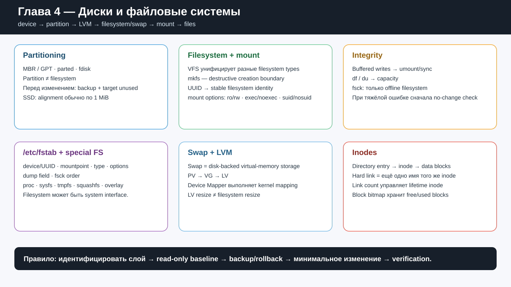
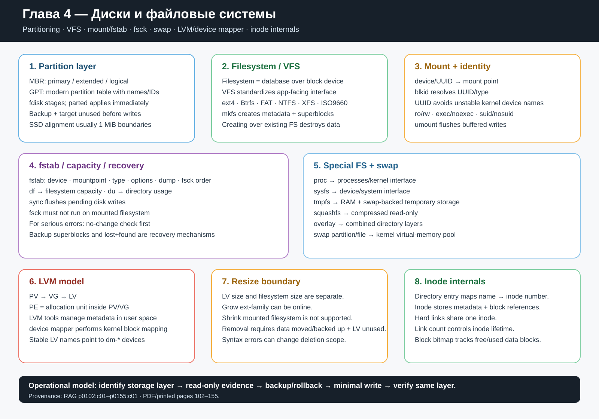

# Глава 4 — Диски и файловые системы

Практические и концептуальные заметки по главе 4 книги «Внутреннее устройство Linux», 3-е издание.

## Идентификация

- Book ID: `how-linux-works-3e-ru-2022`
- Глава: 4
- Название: «Диски и файловые системы»
- Slug: `disks-and-filesystems`
- Source policy: `rag_only`
- Request contract: `BIBLIOTEKA-VSP-CHAPTER-ANALYSIS-REQUEST v1.2`
- Readiness contract: `BIBLIOTEKA-VSP-BOOK-READINESS v1.2`
- Artifact contract: `BIBLIOTEKA-VSP-CHAPTER-ARTIFACT-COLLECTION v1.6`
- External sources: запрещены
- Model memory: запрещена
- Прямой доступ к PDF: не использовался

## Provenance

- RAG chunk range: `p0102:c01`–`p0155:c01`
- Source format: `pdf`
- Source locator range: `pdf_page 102–155`
- EPUB spine range: `Not applicable`
- PDF page range: 102–155
- Printed page range: 102–155
- Оглавление в `p0009:c01`–`p0010:c01` задаёт структуру главы 4.
- `p0102:c01` начинается заголовком «4 Диски и файловые системы».
- Следующий чанк `p0156:c01` начинается главой 5 «Загрузка ядра Linux».
- Chapter boundary verified: yes
- Completion status: `ACCEPTED`
- Source SHA-256: `60bb698fc2ff849a9814f099c12ca56e8f40c11b0518436f3ce3c44e96152df9`

## Содержимое

- [cheatsheet.md](cheatsheet.md) — operational-шпаргалка по partitioning, filesystems, mount/fstab, fsck, swap и LVM.
- [commands.md](commands.md) — команды и интерфейсы, явно подтверждённые RAG главы.
- [diagram.md](diagram.md) — Mermaid-карта слоёв storage stack и безопасного workflow.
- [visual-cheatsheet.svg](visual-cheatsheet.svg) — компактный обзор.
- [visual-cheatsheet-detailed.svg](visual-cheatsheet-detailed.svg) — подробный обзор всей главы.

Conditional artifacts `summary.md`, `review-questions.md` и `review-answers.md` не создавались: в проверенной границе главы нет отдельного блока контрольных вопросов/упражнений и нет отдельно обозначенного chapter-end summary.

## Карта главы

1. Разделы и таблицы разделов: MBR и GPT.
2. Просмотр и изменение partition table через `parted` и `fdisk`.
3. Геометрия дисков, LBA и выравнивание SSD-разделов.
4. Файловые системы и VFS.
5. Типы файловых систем: ext2/3/4, Btrfs, FAT, NTFS, XFS, HFS+, ISO9660.
6. Создание файловой системы через семейство `mkfs.*`.
7. Mount/umount, mount options, UUID и `/etc/fstab`.
8. Buffering/cache, `sync`, capacity через `df` и `du`.
9. Проверка и восстановление файловых систем через `fsck`/e2fsck.
10. Special-purpose filesystems: proc, sysfs, tmpfs, squashfs, overlay.
11. Swap partitions и swap files.
12. LVM: PV → VG → LV.
13. Изменение размеров LVM и связь с filesystem resize.
14. Device Mapper как kernel layer под LVM.
15. Внутренности традиционной файловой системы: inode, link count, block bitmap.
16. Абстракция user space через системные вызовы и VFS.

## Краткий анализ главы

Глава 4 превращает представление о диске из «одного устройства» в многоуровневый storage stack. Автор начинает с физического или виртуального block device, затем показывает таблицу разделов, файловую систему, mount point и, при наличии, LVM как дополнительный слой между физическим хранением и файловой системой.

Первый operational boundary — разделение диска и filesystem. Partition table задаёт лишь границы областей на block device; filesystem — отдельная структура данных, которая превращает блоки в иерархию файлов и каталогов. Поэтому инструменты разделения и создания filesystem должны рассматриваться как разные операции и разные точки риска.

Для partitioning глава противопоставляет `fdisk` и `parted`. `fdisk` позволяет подготовить изменения в user space и записывает их на диск только после явного сохранения, тогда как `parted` применяет изменения по мере выполнения команд. Перед изменением partition table источник требует иметь backup важных данных и убедиться, что разделы целевого диска не используются.

Для SSD вводится отдельная идея выравнивания. Современные partitioning tools обычно выравнивают разделы по границам 1 MiB, что согласуется с распространёнными размерами страниц SSD. Проверить стартовый сектор раздела можно через sysfs.

Следующий слой — filesystem. VFS унифицирует доступ приложений к разным реализациям. Файловые системы могут быть как хранилищем данных, так и системным интерфейсом; поэтому `proc`, `sysfs`, `tmpfs`, `squashfs` и `overlay` рассматриваются в той же общей модели.

Создание filesystem через `mkfs` — destructive boundary. Источник прямо предупреждает: filesystem создаётся один раз для нового/очищаемого раздела; создание поверх существующей структуры уничтожает прежние данные. После создания filesystem mount связывает её с mount point, а UUID позволяет отказаться от нестабильных device names.

Буферизация записи означает, что успешное завершение пользовательской операции не обязательно совпадает с немедленной записью всех данных на физический носитель. `umount` синхронизирует данные перед отключением filesystem, а `sync` позволяет принудительно сбросить buffers.

Раздел `/etc/fstab` связывает persistent storage configuration с boot-time mount. Шесть полей описывают device/UUID, mount point, filesystem type, options, устаревший dump flag и порядок проверки fsck. Здесь же появляется важная security surface: `exec/noexec`, `suid/nosuid`, `ro/rw`, а пользовательский mount автоматически связан с дополнительными ограничениями.

Проверка файловой системы — ещё один safety boundary. Источник прямо запрещает запуск `fsck` на смонтированной filesystem, кроме специального случая read-only root в single-user mode. При подозрении на серьёзное повреждение сначала рекомендуется read-only проверка без изменений, а затем устранение аппаратной/конфигурационной причины до попытки ремонта.

Swap рассматривается как отдельный тип disk-backed virtual-memory storage, не как обычная filesystem. Swap может быть partition или обычным файлом; активация происходит через `swapon`, деактивация — через `swapoff`, при условии достаточного оставшегося объёма памяти.

LVM добавляет слой виртуализации block storage. Physical Volumes объединяются в Volume Group, из неё выделяются Logical Volumes. Пользовательские утилиты LVM управляют metadata и формируют mapping, а kernel device mapper маршрутизирует I/O логического тома к физическим block devices. В главе отдельно подчёркивается, что resize LV и resize filesystem — две разные операции, которые необходимо координировать.

Финальная часть главы объясняет inode model. Имя файла — запись каталога, указывающая на inode; hard link — дополнительная запись каталога на тот же inode. Link count определяет, сколько directory entries указывают на inode. Освобождение inode/data происходит, когда link count достигает нуля. Block bitmap отражает свободные/занятые blocks, а fsck восстанавливает согласованность между inode table, directory structure, link counts и block allocation.

## Основной принцип

Для storage-задачи сначала определить слой:

`device → partition table → partition/PV → LVM mapping → filesystem/swap → mount point → user-space files`.

Не выполнять state-changing команду, пока не подтверждены:
- точный block device;
- активные mounts/usage;
- нужный слой изменения;
- backup/rollback point;
- verification после изменения.

## Ограничения

- Глава содержит реальные destructive storage operations; в артефактах они отделены от read-only checks и снабжены risk notes.
- Раздел 4.6 обозначен автором как более продвинутый и необязательный для продолжения книги.
- Конкретные recovery outcomes зависят от состояния носителя; там, где источник не гарантирует обратимость, указан `[Needs confirmation]`.
- Рисунки 4.1–4.10 присутствуют в RAG только как подписи и окружающий текст; отдельные графические объекты не извлечены.
