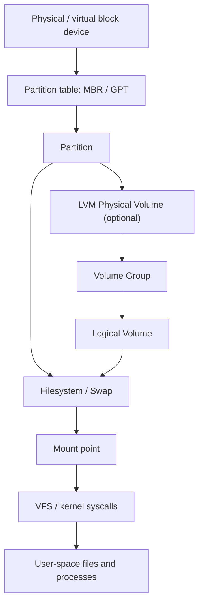
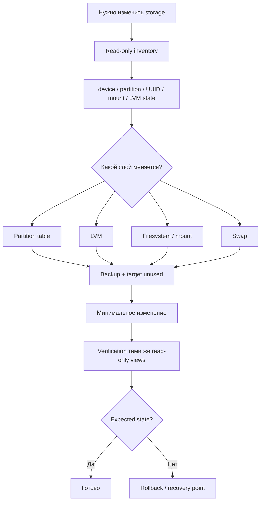
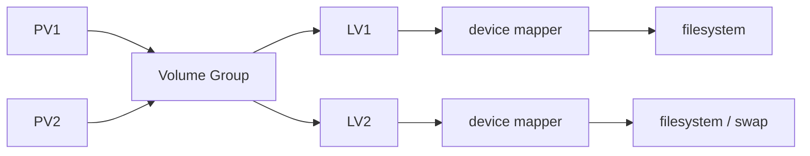
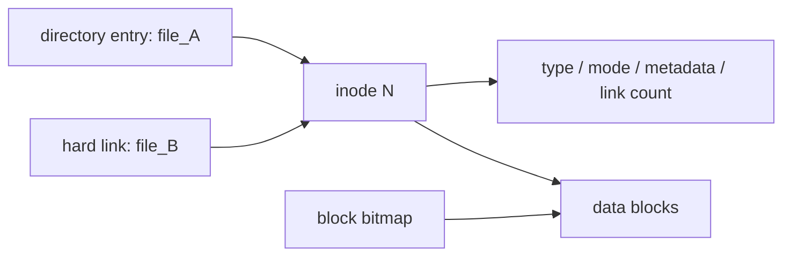
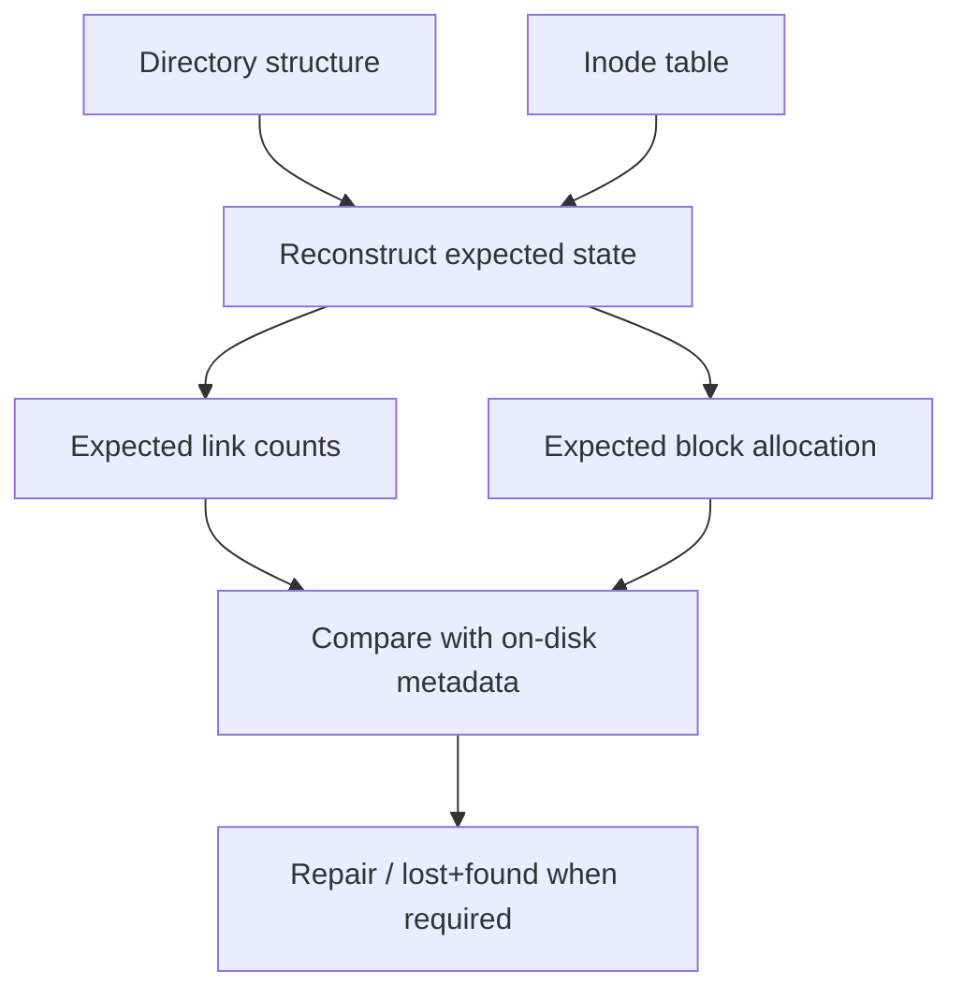

# Диаграмма: storage stack по главе 4

## От устройства до файла

## Safe change workflow

## LVM

## Filesystem internals

Link count показывает количество directory entries, указывающих на inode. Когда оно становится нулём, inode и связанные data blocks могут быть освобождены.

## fsck consistency model

