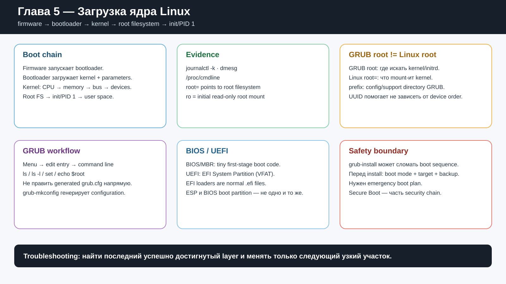
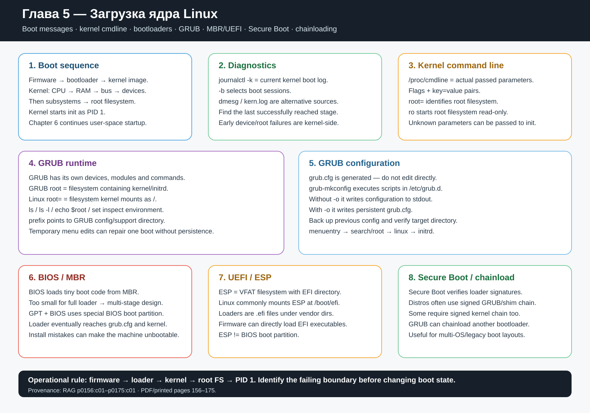

# Глава 5 — Загрузка ядра Linux

Практические и концептуальные заметки по главе 5 книги «Внутреннее устройство Linux», 3-е издание.

## Идентификация

- Book ID: `how-linux-works-3e-ru-2022`
- Глава: 5
- Название: «Загрузка ядра Linux»
- Slug: `linux-kernel-boot`
- Source policy: `rag_only`
- Request contract: `BIBLIOTEKA-VSP-CHAPTER-ANALYSIS-REQUEST v1.2`
- Readiness contract: `BIBLIOTEKA-VSP-BOOK-READINESS v1.2`
- Artifact contract: `BIBLIOTEKA-VSP-CHAPTER-ARTIFACT-COLLECTION v1.6`
- External sources: запрещены
- Model memory: запрещена
- Прямой доступ к PDF: не использовался

## Provenance

- RAG chunk range: `p0156:c01`–`p0175:c01`
- Source format: `pdf`
- Source locator range: `pdf_page 156–175`
- EPUB spine range: `Not applicable`
- PDF page range: 156–175
- Printed page range: 156–175
- Оглавление в `p0010:c01`–`p0011:c01` задаёт структуру главы 5.
- `p0156:c01` начинается заголовком «5 Загрузка ядра Linux».
- Следующий чанк `p0176:c01` начинается главой 6 «Запуск пользовательского пространства».
- Chapter boundary verified: yes
- Completion status: `ACCEPTED`
- Source SHA-256: `60bb698fc2ff849a9814f099c12ca56e8f40c11b0518436f3ce3c44e96152df9`

## Содержимое

- [cheatsheet.md](cheatsheet.md) — operational-шпаргалка по boot flow, kernel parameters, GRUB, BIOS/MBR и UEFI.
- [commands.md](commands.md) — команды и интерфейсы, явно подтверждённые RAG главы.
- [diagram.md](diagram.md) — Mermaid-карта последовательности загрузки и GRUB/firmware layers.
- [visual-cheatsheet.svg](visual-cheatsheet.svg) — компактный обзор.
- [visual-cheatsheet-detailed.svg](visual-cheatsheet-detailed.svg) — подробный обзор всей главы.

Conditional artifacts `summary.md`, `review-questions.md` и `review-answers.md` не создавались: в проверенной границе главы нет отдельного блока контрольных вопросов/упражнений и нет отдельно обозначенного chapter-end summary.

## Карта главы

1. Общая последовательность boot: firmware → bootloader → kernel → root filesystem → init/PID 1.
2. Kernel boot messages и диагностика загрузки.
3. Порядок инициализации ядра.
4. Kernel command line и `/proc/cmdline`.
5. Роль параметра `root=` и initial read-only mount через `ro`.
6. Задачи bootloader и firmware access через BIOS/UEFI.
7. Обзор bootloaders.
8. GRUB 2: menu/editor/command line.
9. GRUB device namespace, GRUB root и Linux root — разные понятия.
10. GRUB filesystem navigation и переменные `root`/`prefix`.
11. Генерация `grub.cfg` через `grub-mkconfig`.
12. Установка GRUB.
13. UEFI Secure Boot.
14. Chainloading.
15. Отличия BIOS/MBR boot и UEFI/ESP boot.
16. Внутренняя последовательность работы GRUB.

## Краткий анализ главы

Глава 5 связывает ранее рассмотренные hardware, devices и filesystems с моментом появления первого user-space process. Упрощённая последовательность автора: firmware или стартовая программа загружает bootloader; bootloader находит kernel image, переносит его в память и запускает; kernel инициализирует устройства и драйверы, монтирует root filesystem и запускает `init` как PID 1. На этом заканчивается предмет главы 5 и начинается глава 6.

Первая эксплуатационная линия главы — boot diagnostics. Kernel и ранний user space генерируют сообщения, но современные системы часто скрывают их splash screen. Источник рекомендует после загрузки обращаться к kernel journal через `journalctl -k`; параметр `-b` используется для просмотра других загрузок. Для систем без systemd названы `/var/log/kern.log` и `dmesg`.

Порядок kernel initialization представлен как dependency chain: CPU → memory → device bus → devices → auxiliary subsystems → root filesystem → user space. Критическая зависимость заключается в том, что драйверы и подсистемы, необходимые для root filesystem, должны быть доступны до перехода к user space. Проблема ранних loadable modules связана с initial RAM filesystem, но её подробности отложены до главы 6.

Kernel command line доступна через `/proc/cmdline`. Параметры бывают flags и `key=value`. Особое значение имеет `root=`, который сообщает kernel, где находится root filesystem. Глава подчёркивает роль `ro`: сначала root монтируется read-only, что позволяет безопасно выполнить проверку filesystem перед последующим remount в read-write режиме. Незнакомые kernel параметры сохраняются и затем передаются программе init.

Bootloader работает до запуска Linux kernel и поэтому не может пользоваться Linux drivers. Для доступа к storage он опирается на firmware interfaces и собственные возможности чтения partition tables/filesystems. Его основная задача — найти kernel image, загрузить его в RAM и передать kernel parameters. Глава перечисляет несколько loaders, но основной объект разбора — GRUB 2.

GRUB образует отдельную среду со своим namespace, модулями, переменными и командами. Важное различие: GRUB root — filesystem, где GRUB ищет kernel/initrd/configuration, а параметр Linux `root=` указывает root filesystem уже для ядра. Путать их нельзя. GRUB умеет перечислять devices, читать partition/filesystem metadata, искать по UUID и перемещаться по filesystems до запуска Linux.

Конфигурация GRUB централизована в `grub.cfg`, но источник прямо не рекомендует редактировать этот generated file вручную. `grub-mkconfig` запускает scripts из `/etc/grub.d` и выводит новую конфигурацию; запись в фактический `grub.cfg` выполняется отдельным вариантом с `-o`. Пользовательские additions предлагается размещать в поддерживаемых custom mechanisms, а перед записью новой конфигурации источник требует backup старой и проверку target directory.

Установка bootloader — существенно более рискованная операция, чем изменение menu configuration. Глава прямо предупреждает, что неправильный `grub-install` способен нарушить boot sequence. До установки нужно определить boot model (MBR или UEFI), target disk, GRUB directory и, для UEFI, mount point EFI System Partition. Источник также требует backup существующего boot state и emergency boot plan.

UEFI меняет архитектуру boot. Вместо tiny boot code в MBR используется EFI System Partition (ESP), обычно VFAT, где firmware может непосредственно найти и запустить `.efi` loader. В Linux ESP обычно доступен под `/boot/efi`. Secure Boot добавляет verification chain: firmware запускает только допустимо подписанный loader, а некоторые distributions расширяют подпись дальше по boot chain до kernel.

Chainloading позволяет GRUB не запускать Linux kernel напрямую, а передать управление другому bootloader. Это особенно важно для multi-boot и legacy boot layouts.

Низкоуровневая часть главы противопоставляет MBR и UEFI. BIOS/MBR boot ограничен маленьким первичным code area и поэтому обычно требует multi-stage loader. В UEFI loader хранится как normal file в ESP, а firmware имеет собственную возможность читать partition/filesystem structures. Для GPT+BIOS используется отдельный BIOS boot partition; он не тождественен ESP.

## Основной принцип

При boot troubleshooting разделять уровни:

`firmware → bootloader → kernel image + parameters → root filesystem → init/PID 1`.

Сначала определить последний успешно достигнутый слой. Не менять GRUB/firmware configuration, пока не подтверждены boot mode, target disk/ESP, текущая kernel command line, существующая boot configuration и recovery path.

## Ограничения

- Глава охватывает только загрузку до старта user space; systemd/init подробно начинаются в главе 6.
- Initramfs/initrd упомянуты, но их полное устройство также отложено до главы 6.
- Конкретное поведение menu key combinations и generated GRUB configuration может зависеть от distribution; здесь сохранено только то, что явно дано в источнике.
- Установка GRUB и редактирование persistent boot configuration рассматриваются как high-risk state changes; без конкретной системы rollback остаётся `[Needs confirmation]`.
