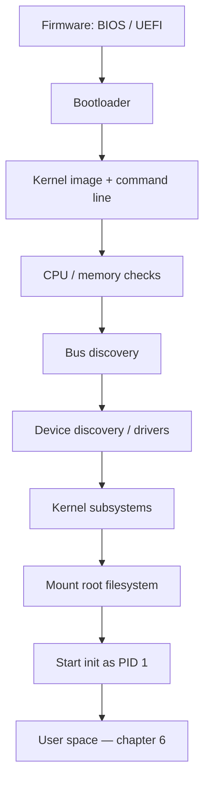
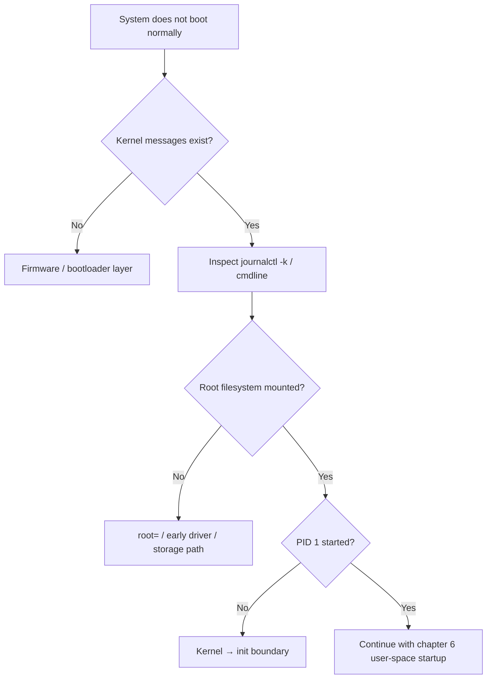
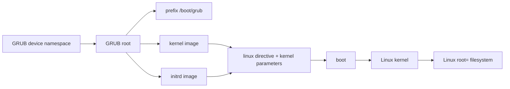
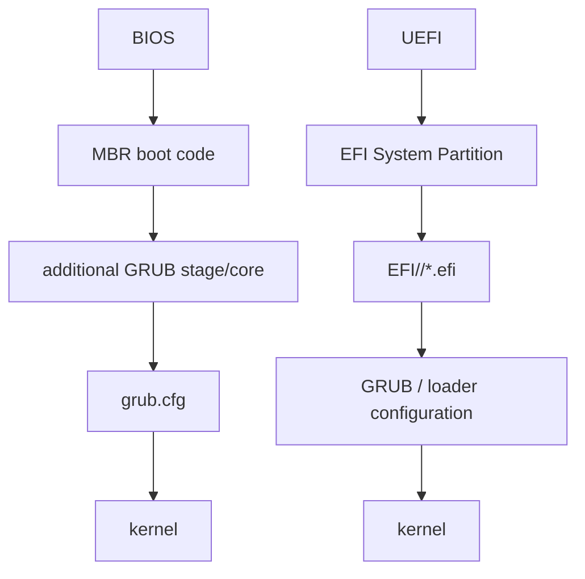

# Диаграмма: загрузка Linux по главе 5

## Основная последовательность

## Boot troubleshooting boundary

## GRUB environment

GRUB root и Linux root filesystem разделены намеренно.

## BIOS/MBR vs UEFI

## Secure Boot chain

