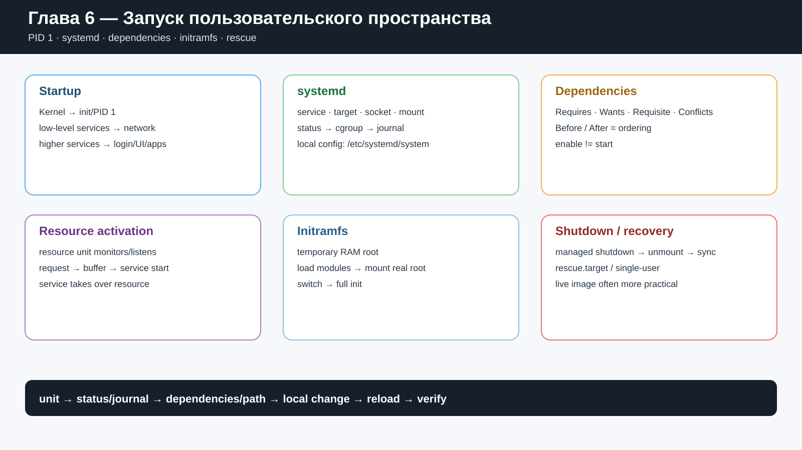
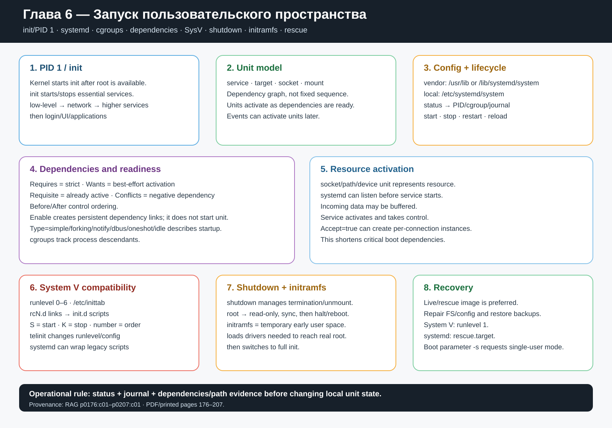

# Глава 6 — Запуск пользовательского пространства

Практические и концептуальные заметки по главе 6 книги «Внутреннее устройство Linux», 3-е издание.

## Идентификация

- Book ID: `how-linux-works-3e-ru-2022`
- Глава: 6
- Название: «Запуск пользовательского пространства»
- Slug: `starting-user-space`
- Source policy: `rag_only`
- Request contract: `BIBLIOTEKA-VSP-CHAPTER-ANALYSIS-REQUEST v1.2`
- Readiness contract: `BIBLIOTEKA-VSP-BOOK-READINESS v1.2`
- Artifact contract: `BIBLIOTEKA-VSP-CHAPTER-ARTIFACT-COLLECTION v1.6`
- External sources: запрещены
- Model memory: запрещена
- Прямой доступ к PDF: не использовался

## Provenance

- RAG chunk range: `p0176:c01`–`p0207:c01`
- Source format: `pdf`
- Source locator range: `pdf_page 176–207`
- EPUB spine range: `Not applicable`
- PDF page range: 176–207
- Printed page range: 176–207
- Оглавление в `p0011:c01` задаёт структуру главы 6.
- `p0176:c01` начинается заголовком «6 Запуск пользовательского пространства».
- Следующий чанк `p0208:c01` начинается главой 7.
- Chapter boundary verified: yes
- Completion status: `ACCEPTED`
- Source SHA-256: `60bb698fc2ff849a9814f099c12ca56e8f40c11b0518436f3ce3c44e96152df9`

## Содержимое

- [cheatsheet.md](cheatsheet.md) — operational-шпаргалка по systemd, unit lifecycle, dependencies, shutdown, initramfs и rescue boot.
- [commands.md](commands.md) — команды и интерфейсы, явно подтверждённые RAG главы.
- [diagram.md](diagram.md) — Mermaid-карта user-space startup, systemd dependency model и initramfs handoff.
- [visual-cheatsheet.svg](visual-cheatsheet.svg) — компактный обзор.
- [visual-cheatsheet-detailed.svg](visual-cheatsheet-detailed.svg) — подробный обзор всей главы.

Conditional artifacts `summary.md`, `review-questions.md` и `review-answers.md` не создавались: в проверенной границе главы нет отдельного блока контрольных вопросов/упражнений и нет отдельно обозначенного chapter-end summary.

## Карта главы

1. Init как первый процесс пользовательского пространства.
2. Определение init implementation: systemd, Upstart, System V.
3. systemd units и unit types.
4. Dependency graph и параллельная активация.
5. Unit configuration directories и локальные изменения в `/etc/systemd/system`.
6. `systemctl`: inventory, status, start/stop/restart, reload, jobs.
7. cgroups и service process tracking.
8. Service `Type=`: simple, forking, notify, dbus, oneshot, idle.
9. Dependencies: Requires, Wants, Requisite, Conflicts, Before, After.
10. `[Install]`, enable/disable и dependency symlinks.
11. Socket/resource activation.
12. Systemd helper components.
13. System V runlevels, `inittab`, rc scripts, link farm и `run-parts`.
14. Systemd compatibility with System V init scripts.
15. Controlled shutdown/reboot.
16. Initramfs как раннее временное user space.
17. Rescue/live boot и single-user/rescue mode.

## Краткий анализ главы

Глава 6 начинается в точке, где kernel уже инициализирован, root filesystem доступна и kernel запускает первый процесс user space — init. Далее init implementation строит остальную работающую систему. Общий порядок автора: init → low-level services вроде udevd/syslogd → network configuration → higher-level services → login/UI/high-level applications.

Основной объект главы — systemd. В отличие от традиционного последовательного init, systemd моделирует систему как набор units и dependency graph. Service units управляют демонами, target units группируют units, socket units представляют точки входящих подключений, mount units — mounts. Systemd активирует units по мере готовности dependencies, а не просто выполняет жёсткий линейный список.

Конфигурация systemd разделена на distribution-provided unit directories и local system configuration. Источник даёт operational правило: не изменять vendor files под `/usr/lib/systemd/system` или `/lib/systemd/system`; локальные изменения размещать в `/etc/systemd/system`, чтобы package updates их не перезаписали.

`systemctl` — основной control plane главы. Через него просматриваются units и status конкретной службы, запускаются/останавливаются units, перезагружается configuration и отслеживаются jobs. `systemctl status` связывает unit state с PID/process tree, cgroup и последними journal messages. Полный journal unit доступен через `journalctl --unit=...`.

Systemd использует cgroups для отслеживания процессов службы даже тогда, когда daemon fork-ится или создаёт descendants. Service `Type=` описывает startup model: `simple`, `forking`, `notify`, `dbus`, `oneshot`, `idle`.

Dependency model отделяет активацию от порядка. `Requires` — строгая dependency; `Wants` — более мягкая activation dependency; `Requisite` требует уже active dependency; `Conflicts` запрещает совместную активность. `Before` и `After` задают ordering. Источник особо выделяет `Wants`, потому что отказ необязательной dependency не должен обязательно останавливать дальнейшую загрузку.

Раздел `[Install]` отвечает за enablement. `systemctl enable` создаёт symbolic link в dependency directory, а `disable` удаляет его. Важная граница: enable не означает немедленную activation.

Раздел socket/resource activation показывает, что service может запускаться только при обращении к ресурсу. Systemd предоставляет resource unit, буферизует входящий запрос, затем активирует service и передаёт ему ресурс. Это позволяет сокращать критический boot path и распараллеливать запуск.

Для исторического контекста глава разбирает System V init: runlevels 0–6, `/etc/inittab`, rc directories и link farm на scripts из `init.d`. Prefix `S` означает start, `K` — stop, numeric prefix задаёт порядок. Systemd умеет оборачивать legacy scripts в service units, но последовательная природа scripts остаётся.

Завершение работы рассматривается как managed lifecycle. `shutdown` уведомляет пользователей, инициирует остановку services/processes, filesystems unmount-ятся, root remount-ится read-only, buffered data синхронизируются, после чего kernel получает reboot/halt request.

Initramfs решает раннюю dependency problem: драйвер, нужный для real root, может сам быть модулем на ещё недоступной filesystem. Bootloader помещает initramfs archive в RAM; kernel монтирует временную RAM filesystem как `/`, запускает её init, загружает необходимые modules, монтирует real root и передаёт ей управление.

Для recovery источник предпочитает live/rescue image. Single-user mode существует как более быстрый вариант: runlevel 1 в System V, `rescue.target` в systemd, boot parameter `-s`; однако network/UI обычно недоступны, поэтому live image практичнее.

## Основной принцип

При диагностике запуска user space сначала определить границу:

`kernel → PID 1/init → units/services → resource activation → login/application layer`.

Для systemd troubleshooting:
1. определить unit;
2. посмотреть `status` и journal;
3. проверить dependencies/order;
4. проверить unit source path;
5. только затем менять local configuration;
6. после изменения перечитать configuration и снова проверить state.

## Ограничения

- Journald, networking, user management и resource control глубже разбираются в последующих главах.
- System V часть дана как legacy/compatibility context.
- Unit names и paths могут отличаться между distributions; источник это прямо отмечает.
- Manual initramfs construction и recovery зависят от distribution; глава называет `mkinitramfs`, `dracut`, `unmkinitramfs`, но не задаёт универсальный build workflow.
