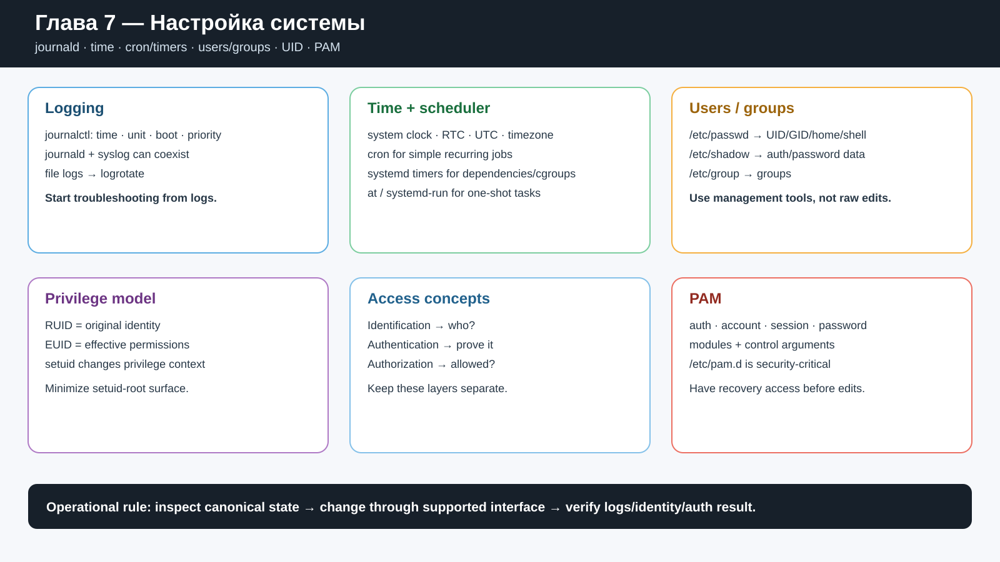
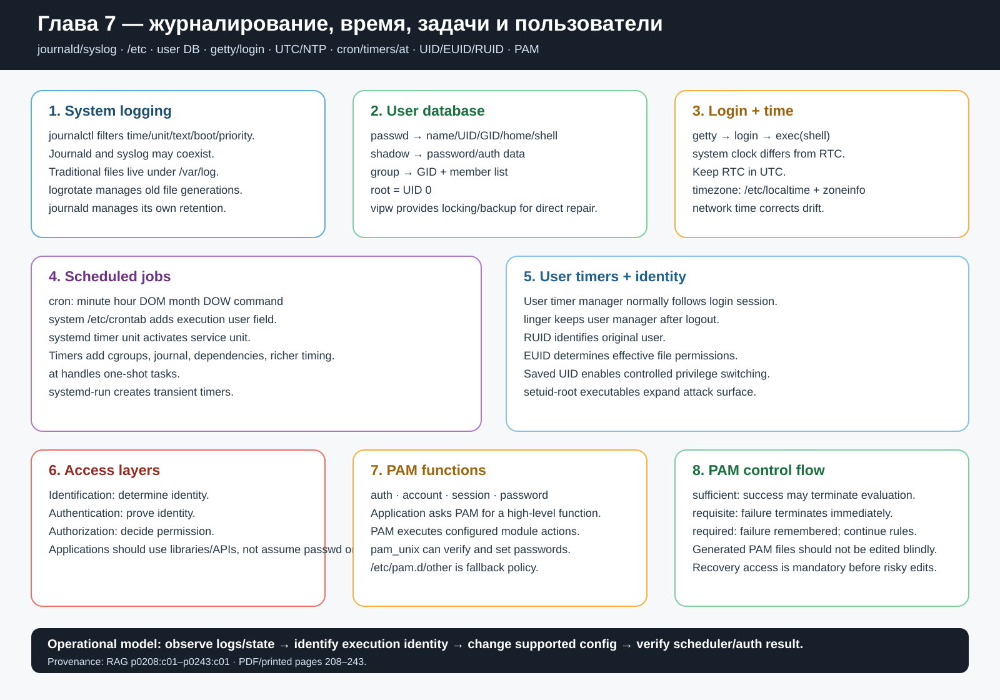

# Глава 7 — Настройка системы: журналирование, системное время, пакетные задачи и пользователи

Практические и концептуальные заметки по главе 7 книги «Внутреннее устройство Linux», 3-е издание.

## Идентификация

- Book ID: `how-linux-works-3e-ru-2022`
- Глава: 7
- Название: «Настройка системы: журналирование, системное время, пакетные задачи и пользователи»
- Slug: `system-configuration-logging-time-jobs-users`
- Source policy: `rag_only`
- Request contract: `BIBLIOTEKA-VSP-CHAPTER-ANALYSIS-REQUEST v1.2`
- Readiness contract: `BIBLIOTEKA-VSP-BOOK-READINESS v1.2`
- Artifact contract: `BIBLIOTEKA-VSP-CHAPTER-ARTIFACT-COLLECTION v1.6`
- External sources: запрещены
- Model memory: запрещена
- Прямой доступ к PDF: не использовался

## Provenance

- RAG chunk range: `p0208:c01`–`p0243:c01`
- Source format: `pdf`
- Source locator range: `pdf_page 208–243`
- EPUB spine range: `Not applicable`
- PDF page range: 208–243
- Printed page range: 208–243
- Оглавление в `p0011:c01`–`p0012:c01` задаёт структуру главы 7.
- `p0208:c01` начинается заголовком главы 7.
- Следующий чанк `p0244:c01` начинается главой 8 «Процессы и использование ресурсов».
- Chapter boundary verified: yes
- Completion status: `ACCEPTED`
- Source SHA-256: `60bb698fc2ff849a9814f099c12ca56e8f40c11b0518436f3ce3c44e96152df9`

## Содержимое

- [cheatsheet.md](cheatsheet.md) — operational-шпаргалка по журналам, времени, cron/systemd timers, user database и PAM.
- [commands.md](commands.md) — команды и интерфейсы, явно подтверждённые RAG главы.
- [diagram.md](diagram.md) — Mermaid-карты logging, scheduling, identity/auth и PAM flow.
- [visual-cheatsheet.svg](visual-cheatsheet.svg) — компактный обзор.
- [visual-cheatsheet-detailed.svg](visual-cheatsheet-detailed.svg) — подробный обзор всей главы.

Conditional artifacts `summary.md`, `review-questions.md` и `review-answers.md` не создавались: в проверенной границе главы нет отдельного блока контрольных вопросов/упражнений и нет отдельно обозначенного chapter-end summary. Раздел 7.11 «Что дальше?» является переходом к главе 8.

## Карта главы

1. Journald/syslog и поиск по системному журналу.
2. Фильтрация journal по времени, unit, fields, text, boot и priority.
3. Monitoring, log rotation и retention.
4. Структура `/etc`.
5. `/etc/passwd`, `/etc/shadow`, `/etc/group` и специальные users.
6. User/password management через специальные инструменты вместо прямого редактирования.
7. Getty → login → shell.
8. System clock, RTC, UTC, time zones и network time.
9. Cron и user/system crontabs.
10. systemd timer units и сравнение timer vs cron.
11. Одноразовые задачи: `at` и transient systemd timers.
12. User timer units и lingering user manager.
13. UID, EUID, RUID, saved UID и setuid model.
14. Identification, authentication и authorization.
15. PAM: configuration, control arguments, modules и password handling.

## Краткий анализ главы

Глава 7 собирает несколько системных сервисов и configuration surfaces, которые напрямую поддерживают повседневную работу user space: logging, time, scheduled jobs, user identity и authentication.

Первый блок — журналирование. Автор рекомендует начинать расследование проблем с журнала. В systemd-системах центральным инструментом становится `journalctl`; традиционный syslog и rsyslog рассматриваются как совместимые/дополняющие механизмы. Журнал фильтруется по времени, unit, полям, тексту, конкретной загрузке и priority. Практический вывод: сначала сузить временной диапазон и service/unit, а затем читать соседний контекст, а не искать одну совпавшую строку.

Для файловых журналов вводится `logrotate`: старые файлы переименовываются, сжимаются и удаляются по политике retention. Для journald retention управляется самим journal service.

Блок `/etc` переходит к user database. `/etc/passwd` сопоставляет login name с UID/GID, home и shell; пароль обычно хранится не там, а в `/etc/shadow`. Root определяется UID 0. Группы находятся в `/etc/group` и задают GID и supplemental membership. Источник не рекомендует править passwd/shadow обычным редактором; при необходимости используются management commands, а для emergency direct edit — `vipw`/`vipw -s` с locking/backup.

Login flow описан как `getty → login → exec(shell)`. В современной среде этот путь чаще относится к virtual terminals; graphical login и SSH используют другие front ends, но authentication всё равно может опираться на PAM.

Время разделено на kernel system clock, RTC и timezone representation. Автор рекомендует RTC в UTC и network synchronization вместо ручной установки времени. Local timezone определяется `/etc/localtime` и файлами из `/usr/share/zoneinfo`; переменная `TZ` позволяет временно переопределить timezone для shell/command.

Планирование задач имеет три модели. Cron — простая и традиционная; user crontab управляется через `crontab`, system-wide entries находятся в `/etc/crontab` и `/etc/cron.d`. Systemd timer использует отдельный timer unit плюс service unit и даёт преимущества cgroups/dependencies/journal integration. `at` предназначен для одноразовой задачи. `systemd-run` может создавать transient timers без постоянных unit files.

User timer units зависят от user manager systemd. Если задача должна пережить logout, источник показывает `loginctl enable-linger`. Это persistent state change и его следует применять осознанно.

Блок user access объясняет различие между identity и privilege. У process есть effective UID, real UID и saved UID. EUID определяет текущие file/access permissions, RUID отражает исходного пользователя, а setuid executable/system calls позволяют контролируемо менять privilege context. Source отдельно подчёркивает security risk лишних setuid-root programs.

Далее разделяются три понятия: identification — кто это; authentication — доказательство identity; authorization — разрешено ли действие. Прямая работа приложения с `/etc/passwd` недостаточно универсальна, потому что user database может приходить не только из локального файла.

Финальный блок — PAM. Приложение вызывает PAM function, а PAM выполняет последовательность configured actions/modules. Основные functions: `auth`, `account`, `session`, `password`. Control arguments определяют flow: `sufficient`, `requisite`, `required`. Source example для `chsh` показывает последовательную оценку `pam_rootok.so`, `pam_shells.so`, `pam_unix.so` и `pam_deny.so`.

PAM configuration расположена в `/etc/pam.d` (или legacy `/etc/pam.conf`). Автор предупреждает, что часть файлов может генерироваться distribution tooling; перед edit необходимо читать комментарии и понимать источник configuration. Это security-critical boundary: ошибка PAM способна повлиять на login/authentication system-wide.

## Основной принцип

Для system configuration сначала определить subsystem и canonical state:

`logs → time → scheduler → identity database → privilege model → authentication policy`.

Изменения user database и PAM делать только через поддерживаемый interface/configuration path и с проверенным recovery route.

## Ограничения

- Network configuration и networked identity подробно не рассматриваются в этой главе.
- Distribution tooling для users, time sync, cron/timers и PAM может различаться.
- PAM examples объясняют evaluation model, но не являются универсальной policy template.
- Direct changes в authentication/user databases и system-wide scheduling могут затронуть доступ к системе; rollback без конкретного host state остаётся `[Needs confirmation]`.
