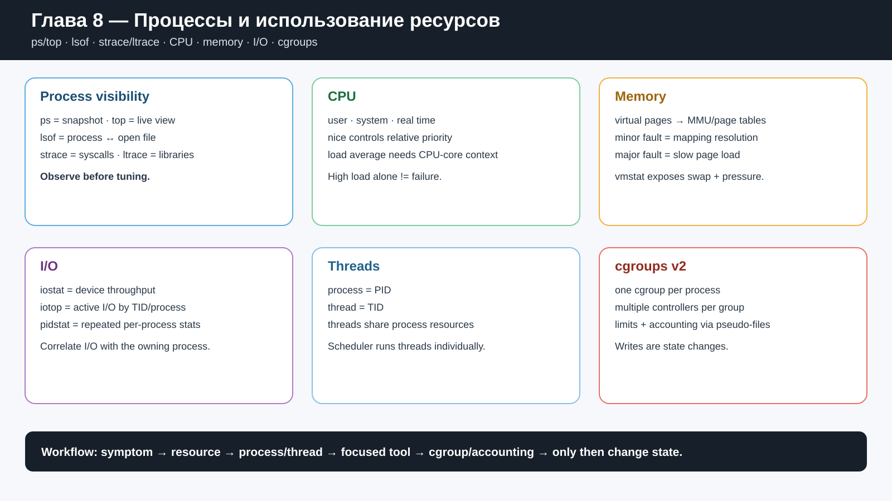
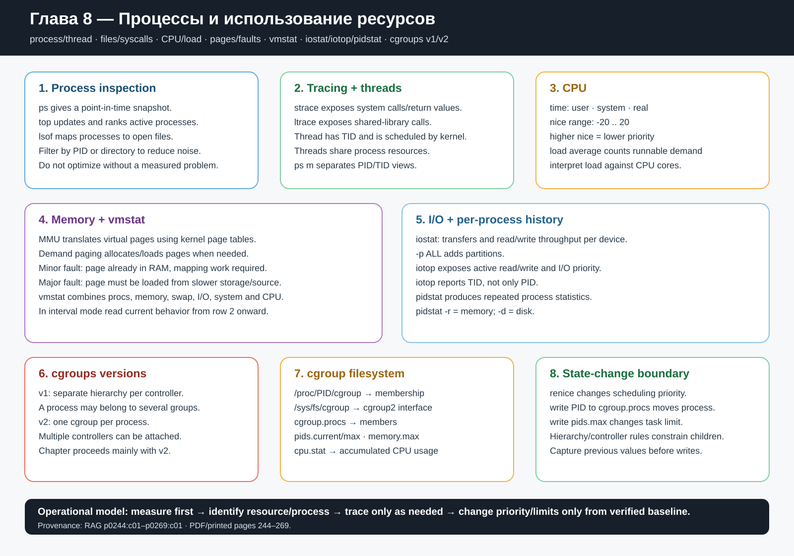

# Глава 8 — Процессы и использование ресурсов

Практические и концептуальные заметки по главе 8 книги «Внутреннее устройство Linux», 3-е издание.

## Идентификация

- Book ID: `how-linux-works-3e-ru-2022`
- Глава: 8
- Название: «Процессы и использование ресурсов»
- Slug: `processes-and-resource-usage`
- Source policy: `rag_only`
- Request contract: `BIBLIOTEKA-VSP-CHAPTER-ANALYSIS-REQUEST v1.2`
- Readiness contract: `BIBLIOTEKA-VSP-BOOK-READINESS v1.2`
- Artifact contract: `BIBLIOTEKA-VSP-CHAPTER-ARTIFACT-COLLECTION v1.6`
- External sources: запрещены
- Model memory: запрещена
- Прямой доступ к PDF: не использовался

## Provenance

- RAG chunk range: `p0244:c01`–`p0269:c01`
- Source format: `pdf`
- Source locator range: `pdf_page 244–269`
- EPUB spine range: `Not applicable`
- PDF page range: 244–269
- Printed page range: 244–269
- Оглавление в `p0012:c01`–`p0013:c01` задаёт структуру главы 8.
- `p0244:c01` начинается заголовком главы 8 «Процессы и использование ресурсов».
- Следующий чанк `p0270:c01` начинается главой 9 «Сеть и ее конфигурация».
- Chapter boundary verified: yes
- Completion status: `ACCEPTED`
- Source SHA-256: `60bb698fc2ff849a9814f099c12ca56e8f40c11b0518436f3ce3c44e96152df9`

## Содержимое

- [cheatsheet.md](cheatsheet.md) — operational-шпаргалка по process/resource troubleshooting.
- [commands.md](commands.md) — команды и интерфейсы, явно подтверждённые RAG главы.
- [diagram.md](diagram.md) — Mermaid-карты process/resource layers и cgroups.
- [visual-cheatsheet.svg](visual-cheatsheet.svg) — компактный обзор.
- [visual-cheatsheet-detailed.svg](visual-cheatsheet-detailed.svg) — подробный обзор.

Conditional artifacts `summary.md`, `review-questions.md` и `review-answers.md` не создавались: в проверенной границе главы нет отдельного блока контрольных вопросов/упражнений и нет отдельно обозначенного chapter-end summary. Раздел 8.7 «Дополнительно» является завершающим обзором и направлением для дальнейшего изучения, а не отдельным summary artifact.

## Карта главы

1. Process tracking через `ps` и `top`.
2. Поиск открытых файлов через `lsof`.
3. System-call tracing через `strace` и library-call tracing через `ltrace`.
4. Threads, PID/TID и отображение потоков.
5. CPU time: user/system/real.
6. Process priority и nice value.
7. Load average.
8. Virtual memory, pages, demand paging и page faults.
9. System-wide CPU/memory monitoring через `vmstat`.
10. I/O monitoring через `iostat` и `iotop`.
11. Per-process historical monitoring через `pidstat`.
12. cgroups v1/v2.
13. cgroup2 filesystem и controller files.
14. Resource limits и accounting по cgroup.
15. Дополнительные инструменты, включая `sar`.

## Краткий анализ главы

Глава 8 смещает фокус от конфигурации системы к наблюдению за тем, как процессы используют CPU, память и I/O. Автор начинает с важного ограничения: не следует оптимизировать систему, которая уже работает нормально. Цель инструментов главы — понять, что измеряется и где действительно находится bottleneck, а не механически «тюнить» значения.

Базовый process view строится на `ps` и `top`. `ps` показывает snapshot, тогда как `top` обновляет state и позволяет быстро видеть наиболее активные процессы. В `top` источник выделяет сортировку по CPU, memory и cumulative CPU time, а также filtering by user.

`lsof` связывает processes с open files. В Unix это особенно полезно, потому что «файл» охватывает много kernel/user-space interfaces. Источник предлагает либо просматривать полный output, либо сразу сужать его по directory или PID. Главная диагностическая идея — выяснить, какой process держит интересующий file descriptor или filesystem object.

`strace` используется, когда внешнего process state уже недостаточно. Он показывает system calls и return values, поэтому хорошо выявляет, например, отсутствующий file через `ENOENT`. `ltrace` находится уровнем выше и отслеживает calls shared libraries, но не kernel system calls.

Threads рассматриваются как scheduler-visible execution units с TID. Потоки одного process разделяют значительную часть ресурсов, включая память и I/O state. Поэтому aggregate process metrics могут скрывать внутреннюю параллельность; `ps m` позволяет увидеть threads отдельно.

CPU monitoring разделён на user time, system time и real elapsed time. Real time включает ожидания и не является суммой только CPU work. Nice value влияет на scheduling priority: более высокое nice означает меньший приоритет. Автор отдельно предупреждает не давать отрицательный nice без веской причины, поскольку это может отнять CPU у system processes.

Load average интерпретируется как среднее число процессов, готовых к запуску. Его нельзя оценивать без числа CPU cores: load 2 на двух cores имеет иной смысл, чем load 2 на одном. Высокий load сам по себе не означает проблему, если система остаётся responsive и другие ресурсы не стали bottleneck.

Раздел памяти объясняет virtual memory через pages и page tables. Demand paging означает, что process получает pages по мере необходимости. Minor page fault не требует загрузки страницы из slow storage; major page fault требует и потому существенно дороже. Большое число major faults — сильный diagnostic signal для memory pressure или slow page sourcing.

`vmstat` объединяет process, memory, swap, I/O, kernel/system и CPU counters. Важное правило чтения из источника: при interval mode первая строка — средние значения за всё uptime, а текущую картину надо читать со второй строки. Для memory pressure особенно важны swap-in/swap-out, blocked processes и изменения CPU/system/I/O columns.

`iostat` переносит focus на block devices: transfers per second и read/write throughput. `iotop` показывает I/O activity по threads/process context и I/O priority. `pidstat` полезен тем, что сохраняет последовательные measurements в обычном text stream, в отличие от перерисовывающегося interactive screen.

Финальная крупная тема — cgroups. Источник различает v1 и v2: в v1 controllers имеют отдельные hierarchies, а в v2 process принадлежит одной cgroup, внутри которой можно использовать несколько controllers. Дальнейший разбор сосредоточен на v2.

cgroups v2 экспонируется как filesystem, обычно под `/sys/fs/cgroup`. Process membership видна через `/proc/<pid>/cgroup`; в cgroup directory доступны файлы вроде `cgroup.procs`, `cgroup.controllers`, `pids.current`, `pids.max`, `memory.max`, `cpu.stat`. Таким образом cgroups одновременно дают grouping, limits и accounting.

Изменение cgroup state выполняется записью в pseudo-files. Это state-changing boundary: запись PID в `cgroup.procs` меняет membership, запись числа в `pids.max` меняет resource limit. Source также подчёркивает hierarchical constraints: child controller availability зависит от parent configuration.

## Основной принцип

Resource troubleshooting идти от наблюдения к локализации:

`process/thread → CPU/memory/I/O symptom → focused tracer/monitor → cgroup/accounting layer`.

Не менять priorities или cgroup limits, пока не подтверждён конкретный bottleneck и не сохранён baseline.

## Ограничения

- Глава объясняет measurement и kernel/resource model, но не даёт универсальных performance tuning recipes.
- cgroups v1 и v2 могут сосуществовать, что усложняет интерпретацию.
- Source сосредоточен на cgroups v2 после вводного сравнения.
- Изменение cgroup controller hierarchy и rollback конкретных limits зависит от текущего host state: `[Needs confirmation]`.
