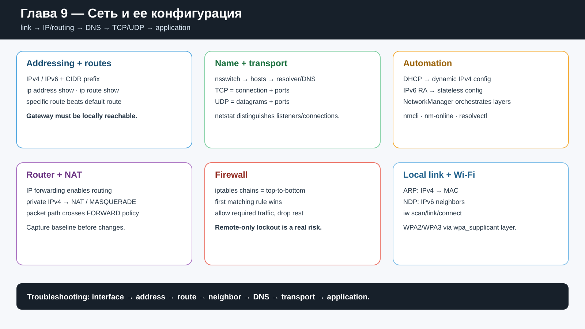
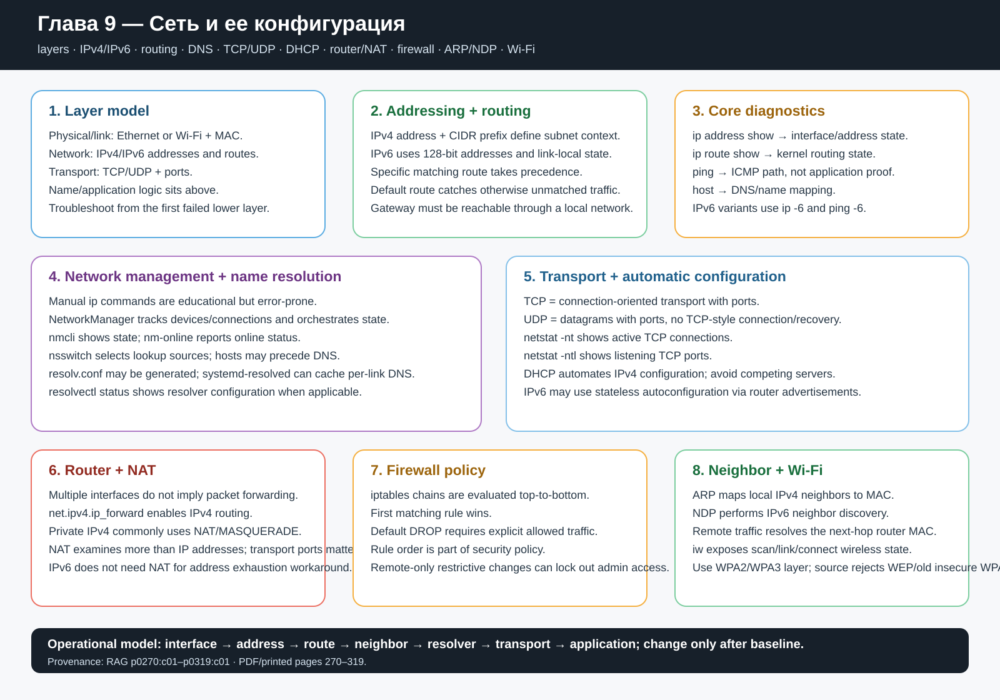

# Глава 9 — Сеть и ее конфигурация

Практические и концептуальные заметки по главе 9 книги «Внутреннее устройство Linux», 3-е издание.

## Идентификация

- Book ID: `how-linux-works-3e-ru-2022`
- Глава: 9
- Название: «Сеть и ее конфигурация»
- Slug: `network-and-configuration`
- Source policy: `rag_only`
- Request contract: `BIBLIOTEKA-VSP-CHAPTER-ANALYSIS-REQUEST v1.2`
- Readiness contract: `BIBLIOTEKA-VSP-BOOK-READINESS v1.2`
- Artifact contract: `BIBLIOTEKA-VSP-CHAPTER-ARTIFACT-COLLECTION v1.6`
- External sources: запрещены
- Model memory: запрещена
- Прямой доступ к PDF: не использовался

## Readiness

- Capability: `chapter-analysis`
- Status: `READY`
- Evidence basis: repository metadata, source checksum, RAG manifest, addressable chunk index, retrieval-index smoke test, accepted v1.6 chapter template.
- Canonical source: `source/book.pdf`
- Source SHA-256: `60bb698fc2ff849a9814f099c12ca56e8f40c11b0518436f3ce3c44e96152df9`

## Provenance

- RAG chunk range: `p0270:c01`–`p0319:c01`
- Source format: `pdf`
- Source locator range: `pdf_page 270–319`
- PDF page range: 270–319
- EPUB spine range: `Not applicable`
- Printed page range: 270–319
- `p0270:c01` начинается заголовком главы 9 «Сеть и ее конфигурация».
- Оглавление в `p0013:c01`–`p0015:c01` задаёт структуру главы 9 и начало главы 10.
- `p0319:c01` содержит раздел 9.28 «Выводы».
- Следующий чанк `p0320:c01` начинается главой 10 «Сетевые приложения и службы».
- Chapter boundary verified: yes
- Completion status: `RAG_GROUNDED`

## Содержимое

- [cheatsheet.md](cheatsheet.md) — operational-шпаргалка по слоям сети, адресации, маршрутам, DNS, TCP/UDP, DHCP, routing/NAT/firewall, ARP/NDP и Wi-Fi.
- [commands.md](commands.md) — source-confirmed network commands с effect/risk/verification/rollback.
- [diagram.md](diagram.md) — Mermaid-карты сетевых слоёв, route/name-resolution flow и firewall/NAT boundaries.
- [visual-cheatsheet.svg](visual-cheatsheet.svg) — компактный визуальный обзор.
- [visual-cheatsheet-detailed.svg](visual-cheatsheet-detailed.svg) — подробная визуальная шпаргалка.
- [summary.md](summary.md) — RAG-grounded конспект явного chapter-end раздела 9.28 «Выводы».

`review-questions.md` и `review-answers.md` не создаются: в проверенной границе главы 9 нет отдельного блока контрольных вопросов или упражнений.

## Карта главы

1. Основы сети: хосты, LAN, маршрутизатор и пакеты.
2. Сетевые уровни: физический, сетевой/интернет, транспортный и прикладной контекст.
3. IPv4: адрес, подсеть, netmask/CIDR.
4. Routing table, routes и default gateway.
5. IPv6: 128-битная адресация, link-local, маршруты и dual stack.
6. ICMP и `ping`; DNS и `host`.
7. Ethernet: MAC-адреса, frames и kernel network interfaces.
8. Ручная конфигурация адресов/маршрутов через `ip`.
9. Boot-time network configuration и network managers.
10. NetworkManager: device/connection model, `nmcli`, `nm-online`, configuration boundary.
11. Name resolution: `/etc/hosts`, `/etc/resolv.conf`, `systemd-resolved`, `/etc/nsswitch.conf`.
12. Localhost/loopback.
13. TCP/UDP: ports, connections, listeners и transport semantics.
14. DHCP и IPv6 stateless autoconfiguration/RA.
15. Linux как router: IP forwarding.
16. Private IPv4 networks и NAT/masquerading.
17. Linux firewall model и `iptables`: chains, policy, rule ordering.
18. ARP для IPv4 и NDP для IPv6.
19. Wi-Fi: `iw`, SSID, `wpa_supplicant`, WPA2/WPA3.
20. Явный chapter-end вывод: network layers — основная mental model главы.

## Краткий анализ главы

Глава 9 строит сетевую модель снизу вверх. Базовая идея — не рассматривать «сеть» как единый механизм. Физический Ethernet/Wi-Fi, IP routing, TCP/UDP и name/application layers решают разные задачи. Диагностика становится существенно проще, если сначала определить, на каком уровне находится проблема.

На сетевом уровне IPv4-адрес описывается вместе с subnet prefix. CIDR связывает адрес и размер подсети. Kernel routing table определяет, куда отправлять пакет; default route применяется тогда, когда более специфичный маршрут не подходит. Источник подчёркивает, что выбор маршрута основан не на порядке строк, а на соответствии сети/префикса.

IPv6 сохраняет идею адресов, подсетей и маршрутов, но использует 128-битное пространство и link-local addresses. IPv4 и IPv6 могут работать одновременно как dual stack; приложение выбирает подходящий protocol family.

Для базовой диагностики глава использует `ip address show`, `ip route show`, IPv6-варианты `ip -6 ...`, `ping` и `host`. `ping` проверяет ICMP path, но отсутствие ответа не доказывает недоступность application service: hosts/firewalls могут игнорировать echo request. `host` показывает DNS resolution и может возвращать как IPv4, так и IPv6 addresses.

На физическом уровне Ethernet использует MAC-адреса и frames. Kernel network interface связывает physical device и network-layer configuration. В выводе `ip address show` одновременно видны interface state, MAC и IP-layer addresses.

Ручная конфигурация через `ip address add` и `ip route add/del` разобрана как учебный/экспериментальный workflow. Source прямо предупреждает, что manual network configuration редко требуется и легко приводит к ошибкам. Persistent/boot-time configuration обычно делегируется network-management layer.

NetworkManager рассматривается как user-space manager, который поддерживает device и connection configuration, выбирает доступный connection и взаимодействует с lower layers. `nmcli` без аргументов даёт сводку, а `nm-online` позволяет проверить, считает ли NetworkManager сеть рабочей. Общая configuration находится под `/etc/NetworkManager`; per-connection data обычно хранится в `system-connections`.

Name resolution проходит через library rules, а не просто «DNS». `/etc/nsswitch.conf` определяет порядок sources; `/etc/hosts` может предшествовать DNS. `/etc/resolv.conf` традиционно задаёт DNS servers/search domains, но в systemd-среде может быть symlink на generated state. `systemd-resolved` добавляет caching и per-interface resolution; состояние проверяется через `resolvectl status`.

Transport layer отделяет application endpoints через ports. TCP даёт connection-oriented transport, а UDP — datagram model без TCP-style connection/reordering recovery. `netstat -nt` показывает активные TCP connections, `netstat -ntl` — listening TCP ports. Source использует этот output, чтобы различать client ephemeral ports и server well-known/listening ports.

DHCP автоматизирует IPv4 configuration, включая address lease и связанные параметры. Source показывает ручной запуск `dhclient <interface>` как тестовый operation и предупреждает о prerequisite routing state. Для IPv6 описана stateless autoconfiguration на основе link-local address и router advertisements.

Linux может маршрутизировать пакеты между интерфейсами после включения IP forwarding. Для private IPv4 networks внешний доступ обычно требует NAT/masquerading. Source показывает пример через `iptables`, но одновременно отмечает, что manual NAT configuration обычно не нужна вне специальных сценариев; её могут создавать virtualization/container platforms или dedicated routers.

Firewall section — один из наиболее рискованных operational boundaries главы. `iptables` chains читаются сверху вниз, и первое совпавшее правило определяет действие. Source рекомендует allow-list style: разрешать необходимое и отбрасывать остальное. Отдельное предупреждение: нельзя последовательно применять restrictive INPUT policy на машине, к которой есть только remote access, если это может немедленно отрезать текущую сессию.

ARP связывает IPv4 address с MAC в локальной подсети; `ip -4 neigh` показывает neighbor cache. Для IPv6 аналогичную роль выполняет NDP. Эти механизмы относятся к local link: для remote destination host ищет MAC не конечного узла, а next-hop router.

Wi-Fi остаётся Ethernet-like physical layer, но добавляет SSID и authentication/encryption. `iw` позволяет scan/link/connect operations; source прямо говорит не использовать WEP и описывает `wpa_supplicant` для WPA2/WPA3. NetworkManager автоматизирует последовательность physical + network-layer configuration.

## Основной принцип

Диагностика сети должна идти по слоям и от read-only evidence:

`link/interface → IP address/subnet → route/default gateway → neighbor resolution → DNS/name resolution → TCP/UDP endpoint → application`.

Если нижний слой не подтверждён, изменение верхнего слоя обычно преждевременно.

## Operational boundaries

- Manual address/route changes могут немедленно изменить connectivity.
- DHCP test меняет interface configuration.
- IP forwarding превращает host в router между сетями.
- NAT/firewall rules меняют packet path и policy.
- Restrictive firewall changes на remote-only host могут отрезать administrative access.
- Wireless connect operations меняют physical-link association.
- Persistent changes в NetworkManager, resolver, sysctl или firewall policy требуют host-specific rollback plan: `[Needs confirmation]`.

## Ограничения

- Глава даёт foundations; dynamic routing protocols, advanced DNS, service-layer debugging и broader security вынесены дальше.
- `netstat` используется как source command; artifact не заменяет его современными альтернативами из model knowledge.
- `iptables` — основной firewall interface в тексте главы; nftables упомянут как successor, но source examples построены вокруг `iptables`.
- Network configuration сильно зависит от distribution/manager; unsupported implementation details не достраиваются.
