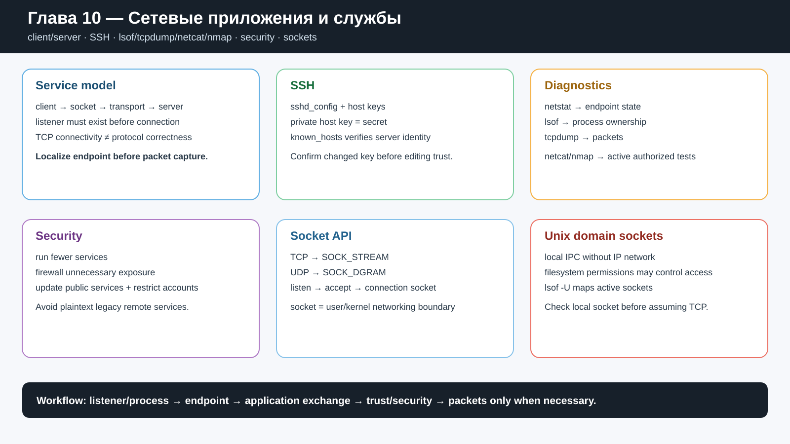
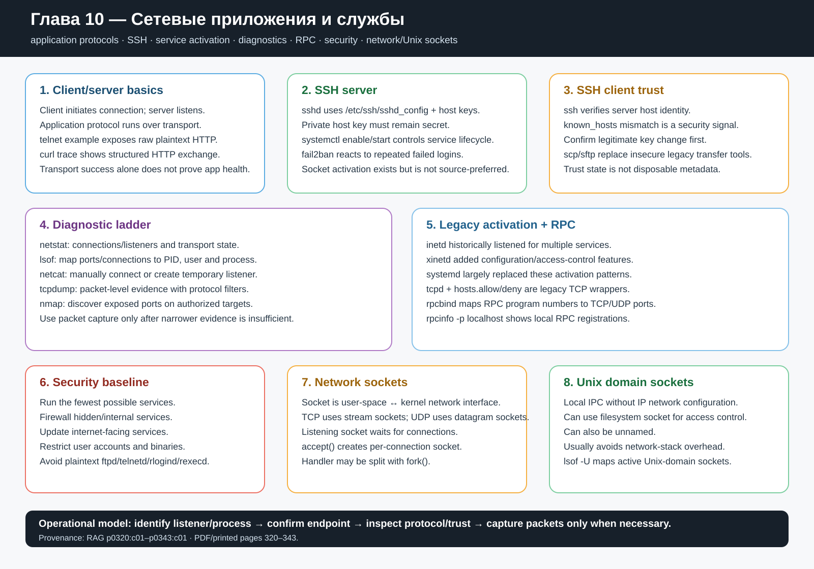

# Глава 10 — Сетевые приложения и службы

Практические и концептуальные заметки по главе 10 книги «Внутреннее устройство Linux», 3-е издание.

## Идентификация

- Book ID: `how-linux-works-3e-ru-2022`
- Глава: 10
- Название: «Сетевые приложения и службы»
- Slug: `network-applications-and-services`
- Source policy: `rag_only`
- Request contract: `BIBLIOTEKA-VSP-CHAPTER-ANALYSIS-REQUEST v1.2`
- Readiness contract: `BIBLIOTEKA-VSP-BOOK-READINESS v1.2`
- Artifact contract: `BIBLIOTEKA-VSP-CHAPTER-ARTIFACT-COLLECTION v1.6`
- External sources: запрещены
- Model memory: запрещена
- Прямой доступ к PDF: не использовался

## Readiness

- Capability: `chapter-analysis`
- Status: `READY`
- Evidence basis: repository registration, metadata/source checksum agreement, READY RAG manifest, addressable chunks, retrieval-index smoke test and accepted v1.6 artifact template.
- Canonical source: `source/book.pdf`
- Source SHA-256: `60bb698fc2ff849a9814f099c12ca56e8f40c11b0518436f3ce3c44e96152df9`

## Provenance

- RAG chunk range: `p0320:c01`–`p0343:c01`
- Source format: `pdf`
- Source locator range: `pdf_page 320–343`
- PDF page range: 320–343
- EPUB spine range: `Not applicable`
- Printed page range: 320–343
- Оглавление в `p0015:c01` задаёт структуру главы 10.
- `p0320:c01` начинается заголовком главы 10 «Сетевые приложения и службы».
- `p0343:c01` завершает раздел 10.10 «Доменные сокеты Unix».
- Следующий чанк `p0344:c01` начинается главой 11 «Сценарии оболочки».
- Chapter boundary verified: yes
- Completion status: `ACCEPTED`

## Содержимое

- [cheatsheet.md](cheatsheet.md) — operational-шпаргалка по service/client diagnostics, SSH, ports, packet inspection, RPC, security и sockets.
- [commands.md](commands.md) — source-confirmed commands с classification/effect/risk/verification/rollback.
- [diagram.md](diagram.md) — Mermaid-карты client/server flow, SSH trust, diagnostics и socket handling.
- [visual-cheatsheet.svg](visual-cheatsheet.svg) — компактный визуальный обзор.
- [visual-cheatsheet-detailed.svg](visual-cheatsheet-detailed.svg) — подробная визуальная шпаргалка.

Conditional artifacts `summary.md`, `review-questions.md` и `review-answers.md` не создаются: в проверенной границе главы нет отдельного chapter-end summary/resume и нет блока контрольных вопросов/упражнений. Раздел 10.8 «Что дальше?» является переходом к последующим темам, а не отдельным summary.

## Карта главы

1. Клиент/server interaction через TCP application protocol.
2. Низкоуровневое наблюдение HTTP через `telnet` и `curl --trace-ascii`.
3. Типы network servers и их activation model.
4. SSH как стандартный secure remote-access service.
5. `sshd_config`, host keys и service startup.
6. `fail2ban` как реакция на repeated failed login attempts.
7. SSH client, host-key verification, `known_hosts`, `scp` и `sftp`.
8. Исторические `inetd/xinetd` и TCP wrappers.
9. Диагностика через `netstat`, `lsof`, `tcpdump`, `netcat`, `nmap`.
10. RPC/`rpcbind`.
11. Network security principles и типовые attack classes.
12. Socket API как boundary user space ↔ kernel.
13. Listening socket → `accept()` → per-connection socket/process.
14. Unix domain sockets как local IPC alternative to IP networking.

## Краткий анализ главы

Глава 10 поднимается на application layer и показывает, как user-space programs используют транспортные механизмы, изученные в главе 9. Базовая модель проста: client инициирует connection, server слушает endpoint и затем обрабатывает входящий stream или datagram.

Для демонстрации обычного TCP service source использует `telnet <host> 80`: это позволяет вручную увидеть request/response application protocol поверх TCP. `telnet` при этом не рассматривается как безопасный remote-login mechanism; source прямо противопоставляет ему SSH. Для более структурированного HTTP interaction применяется `curl --trace-ascii`, который показывает request/response exchange.

SSH — центральный service example главы. OpenSSH разделяется на client `ssh` и server `sshd`. Server configuration находится под `/etc/ssh`; source отдельно предупреждает не путать `sshd_config` и client `ssh_config`. Host key pair состоит из public и private keys; private host key — security-critical secret, который нельзя раскрывать.

Для запуска `sshd` source показывает `systemctl enable sshd` и `systemctl start sshd`. Также рассматривается socket activation, но source отмечает, что on-demand запуск `sshd` может быть неудачным выбором из-за host-key initialization latency.

`fail2ban` описан как log-driven protection against repeated failed login attempts: он наблюдает authentication failures и временно создаёт firewall rule против offending host. Это пример user-space automation поверх logging и packet filtering.

SSH client проверяет server host identity через local `known_hosts`. Предупреждение о changed host key нельзя игнорировать автоматически: source рекомендует сначала подтвердить, что изменение действительно легитимно. Только после подтверждения неверную строку можно удалить или заменить корректным public key.

Для file transfer глава использует `scp` и `sftp` как secure replacements старых insecure mechanisms. `scp` примеры показывают local→remote, remote→local и remote→remote transfer.

Исторический service activation блок объясняет `inetd` как super-server: один daemon слушает множество ports и запускает target service on demand. `xinetd` — более поздний вариант, но source отмечает, что его роль в основном вытеснена systemd. TCP wrappers (`tcpd`, `/etc/hosts.allow`, `/etc/hosts.deny`) описаны как legacy access-control mechanism.

Diagnostic section строит escalation от endpoint ownership к packet-level visibility. `netstat` показывает transport/network state; `lsof -i` связывает ports/connections с process/PID/user; `tcpdump` показывает actual packets; `netcat` позволяет вручную открыть TCP/UDP connection или listener; `nmap` выявляет exposed ports. Source отдельно требует разрешение на scanning чужой сети и предупреждает о privacy implications full packet capture.

`rpcbind` — mapping layer для RPC services, связывающий program numbers с TCP/UDP ports. `rpcinfo -p localhost` показывает registered RPC services.

Security section даёт operational principles: запускать минимум services, блокировать ненужные services firewall, своевременно обновлять internet-facing software, использовать stable supported releases для servers, не давать accounts без необходимости и избегать untrusted binaries. Attack model включает full compromise, denial of service и malware; отдельный риск — plaintext credentials.

Source прямо рекомендует деактивировать устаревшие plaintext services вроде `ftpd`, `telnetd`, `rlogind`, `rexecd` и использовать encrypted alternatives. TLS/SSL упоминается как ключевой mechanism защиты application traffic.

Финальный conceptual block объясняет sockets. Network socket — interface, через который user-space process взаимодействует с kernel networking. TCP соответствует stream sockets, UDP — datagram sockets. Для incoming TCP-like service типовой flow: listening socket → `accept()` → connection socket → часто `fork()` child для обслуживания connection.

Unix domain sockets дают аналогичный IPC interface без network stack. Они могут использовать filesystem socket file для access control, поддерживают local process communication и обычно дешевле network path. `lsof -U` показывает активные Unix domain sockets.

## Основной принцип

Диагностика network service идёт от service endpoint к application protocol:

`listener/process → transport endpoint → packet exchange → application protocol → authentication/trust → service policy`.

Для local IPC отдельно проверить, не используется ли Unix domain socket вместо TCP/UDP.

## Operational boundaries

- Запуск/enable network server меняет attack surface.
- Создание/замена SSH host keys меняет server identity.
- Изменение `known_hosts` ослабляет trust check, если identity не подтверждена.
- `scp`/remote extraction меняют файлы на destination.
- `netcat -l` временно открывает listener.
- Packet capture может раскрывать sensitive traffic.
- Port scanning чужой инфраструктуры требует разрешения.
- Security hardening должен сохранять required access; rollback host-specific: `[Needs confirmation]`.

## Ограничения

- Tooling отражает source chapter: `netstat`, `iptables`, `telnet` и legacy service mechanisms не заменяются современными альтернативами из model knowledge.
- Source references old SSH algorithm examples; artifact не обновляет их внешними рекомендациями.
- `fail2ban`, TLS, Apache/nginx/Postfix и RPC рассматриваются обзорно, без полного production configuration workflow.
- Socket programming показано концептуально; полного API tutorial в главе нет.
