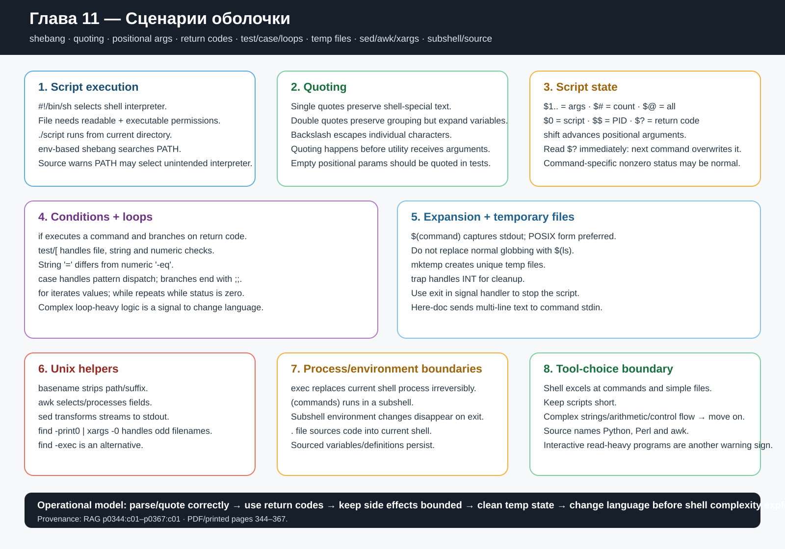

# Глава 11 — Сценарии оболочки

Практические и концептуальные заметки по главе 11 книги «Внутреннее устройство Linux», 3-е издание.

## Идентификация

- Book ID: `how-linux-works-3e-ru-2022`
- Глава: 11
- Название: «Сценарии оболочки»
- Slug: `shell-scripts`
- Source policy: `rag_only`
- Request contract: `BIBLIOTEKA-VSP-CHAPTER-ANALYSIS-REQUEST v1.2`
- Readiness contract: `BIBLIOTEKA-VSP-BOOK-READINESS v1.2`
- Artifact contract: `BIBLIOTEKA-VSP-CHAPTER-ARTIFACT-COLLECTION v1.6`
- External sources: запрещены
- Model memory: запрещена
- Прямой доступ к PDF: не использовался

## Readiness

- Capability: `chapter-analysis`
- Status: `READY`
- Evidence basis: repository registration, metadata/source checksum agreement, READY RAG manifest, addressable chunks, deterministic retrieval-index smoke test and accepted v1.6 artifact template.
- Canonical source: `source/book.pdf`
- Source SHA-256: `60bb698fc2ff849a9814f099c12ca56e8f40c11b0518436f3ce3c44e96152df9`

## Provenance

- RAG chunk range: `p0344:c01`–`p0367:c01`
- Source format: `pdf`
- Source locator range: `pdf_page 344–367`
- PDF page range: 344–367
- EPUB spine range: `Not applicable`
- Printed page range: 344–367
- Оглавление в `p0016:c01` задаёт структуру главы 11.
- `p0344:c01` начинается заголовком главы 11 «Сценарии оболочки».
- `p0367:c01` завершает раздел 11.14 «Когда не стоит использовать сценарии оболочки».
- Следующий чанк `p0368:c01` начинается главой 12 «Передача файлов по сети и доступ к ним».
- Chapter boundary verified: yes
- Completion status: `RAG_GROUNDED`

## Содержимое

- [cheatsheet.md](cheatsheet.md) — operational-шпаргалка по структуре shell script, quoting, arguments, return codes, conditions, loops, temporary files и sourcing.
- [commands.md](commands.md) — source-confirmed shell constructs/utilities с effect/risk/verification/rollback.
- [diagram.md](diagram.md) — Mermaid-карты script execution, control flow, temporary-file lifecycle и subshell/source behavior.
- [visual-cheatsheet.svg](visual-cheatsheet.svg) — компактный визуальный обзор.
- [visual-cheatsheet-detailed.svg](visual-cheatsheet-detailed.svg) — подробная визуальная шпаргалка.

Conditional artifacts `summary.md`, `review-questions.md` и `review-answers.md` не создаются: в проверенной границе главы нет отдельного chapter-end summary/resume и нет блока контрольных вопросов/упражнений.

## Карта главы

1. Основы Bourne shell scripts: shebang, executable/read permissions, запуск.
2. Ограничения shell scripting и выбор подходящего языка.
3. Quoting и literals: single quotes, double quotes, backslash.
4. Специальные переменные: `$1`, `$#`, `$@`, `$0`, `$$`, `$?`.
5. Return codes и `exit`.
6. `if/then/else/fi`, `elif`, `&&`, `||`, `!`.
7. `test` / `[` для file/string/numeric conditions.
8. `case` и pattern matching.
9. Loops: `for`, `while`, `until`, `break`.
10. Command substitution через `$(...)`.
11. Temporary files: `mktemp`, cleanup и `trap`.
12. Here-documents.
13. Script helpers: `basename`, `awk`, `sed`, `xargs`, `expr`, `exec`.
14. Subshells.
15. Sourcing через `.`.
16. User input через `read`.
17. Граница применимости shell scripts.

## Краткий анализ главы

Глава 11 объясняет shell scripting как автоматизацию уже знакомых командных действий. Script — это последовательность команд, которую shell читает из файла. Для Bourne shell используется shebang `#!/bin/sh`; чтобы запускать script как программу, file должен быть доступен на чтение и исполнение.

Shebang — boundary между kernel launcher и interpreter. Source также показывает `#!/usr/bin/env python` как вариант поиска interpreter через current `PATH`, но отмечает trade-off: будет выбран первый совпавший executable, и он может оказаться не тем, который ожидался.

Одна из главных мыслей главы — shell scripts хорошо подходят для orchestration команд и простых file operations, но быстро становятся неудобными для сложного string parsing, повторяющейся арифметики, database work, функций и сложного control flow. Source несколько раз рекомендует переходить к Python, Perl или awk, когда script становится слишком сложным; сами shell scripts должны оставаться короткими.

Quoting — фундаментальный механизм корректности. Single quotes заставляют shell практически не интерпретировать содержимое; double quotes продолжают expansion shell variables. Backslash позволяет экранировать отдельные characters. Source подчёркивает, что многие ошибки возникают потому, что shell изменяет строку до передачи command.

Command-line arguments представлены special variables. `$1`, `$2` и далее содержат individual arguments; `shift` сдвигает их; `$#` даёт число оставшихся arguments; `$@` представляет все arguments; `$0` — script name; `$$` — PID shell process; `$?` — return code последней команды.

Return code — центральный механизм shell control flow. `0` обычно означает success, nonzero — иной outcome/error, но source отдельно предупреждает, что некоторые utilities используют nonzero для нормальных состояний. `grep`, например, возвращает `1`, когда pattern не найден, и это не обязательно error. Поэтому return semantics нужно проверять в documentation конкретной command.

`if` в shell не оценивает boolean expression сам по себе: он запускает command и смотрит на return code. Это объясняет роль `test` / `[`. Empty positional argument может сломать условие вида `[ $1 = hi ]`, поэтому source показывает quoting `"$1"`. Это один из наиболее важных defensive patterns главы.

`test` покрывает file existence/type/permissions, string emptiness/equality и numeric comparison. Source отдельно различает string `=` и numeric `-eq`. File tests вроде `-f`, `-d`, `-h`, `-r`, `-w`, `-x` делают shell особенно удобным для небольших filesystem workflows.

Для branching доступны `elif`, logical `&&` / `||`, negation `!` и `case`. Source рекомендует не злоупотреблять цепочками `elif`; `case` часто лучше подходит для matching строк/patterns.

Loops представлены `for` и `while`. `for` — основной shell-style loop по набору слов/файлов. `while` использует return code command как condition. Source снова проводит boundary: если script начинает активно полагаться на сложные `while`/арифметику, вероятно, выбран не лучший язык.

Command substitution `$(...)` возвращает stdout command обратно в shell expression. Source предпочитает POSIX `$(...)` старому backtick syntax и предупреждает не заменять им обычное glob expansion или массовую обработку результатов `find`, где лучше `xargs` или `-exec`.

Temporary files — отдельная reliability topic. Source рекомендует `mktemp` вместо предсказуемых names и показывает `trap` для cleanup при interrupt. Это уже не просто syntax: script должен учитывать abnormal termination, иначе temp files остаются после Ctrl+C.

Here-document позволяет направить большой блок текста на stdin одной command. Variables внутри обычного here-doc expand, поэтому mechanism удобен для generated reports/templates.

Utilities `basename`, `awk`, `sed`, `xargs`, `expr`, `exec` показывают Unix composability. Особенно важный security/reliability detail: plain `find ... -print | xargs ...` ломается на filenames с spaces/newlines; source рекомендует NULL-delimited pair `-print0 | xargs -0`. `find -exec` — alternative.

`exec` заменяет current shell process указанной program и source подчёркивает необратимость: после successful `exec` исходная shell/script больше не существует. Это state/process-control boundary, а не обычный nested command.

Subshell `(...)` изолирует environment changes. Temporary `cd` или `PATH` modification исчезает после завершения subshell. Source также показывает one-command environment assignment как более лёгкий вариант без нового subshell process.

Sourcing через `. config.sh` принципиально отличается от запуска другого script: sourced commands выполняются в текущей shell и могут менять её variables/definitions. Поэтому source useful framing — sourcing для shared configuration, но это также trust boundary: включаемый file действует внутри текущего process context.

`read` позволяет получать stdin от user и строить простые confirmations/interactions. Последний раздел использует это как критерий сложности: если shell script превращается в развитое interactive application, стоит перейти к более подходящему language.

## Основной принцип

Shell script лучше всего использовать как glue/orchestration layer:

`commands + files + exit codes + simple branching + pipelines`.

Если растут parsing, arithmetic, nested control flow или interactive state, source рекомендует сменить язык вместо дальнейшего усложнения shell.

## Operational boundaries

- `chmod +rx` может сделать script executable/readable для других users; source предлагает mode `700`, если это нежелательно.
- Unquoted variables/filenames могут изменить command semantics до запуска utility.
- `exit` немедленно завершает script.
- `rm -f` cleanup удаляет files и требует корректных temp variables.
- `exec` необратимо заменяет current shell process.
- Sourcing выполняет чужой code в текущем shell context.
- `read`-based confirmations не заменяют корректный validation/rollback.
- File-transform/copy examples могут создавать/overwrite output files; rollback зависит от конкретного data state: `[Needs confirmation]`.

## Ограничения

- Глава обучает Bourne/POSIX-style shell concepts, а не полному Bash feature set.
- Source не даёт comprehensive secure-shell-style guide по quoting arbitrary untrusted filenames beyond shown examples.
- `awk`, `sed`, `expr` и `find` рассматриваются выборочно.
- Более сложные scripting tasks source сознательно выносит в Python/Perl/awk.
