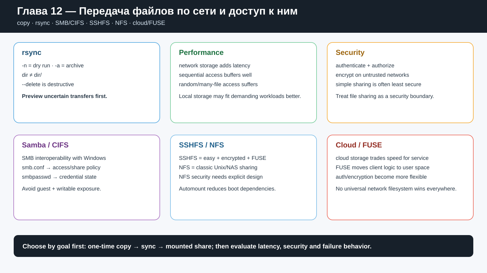
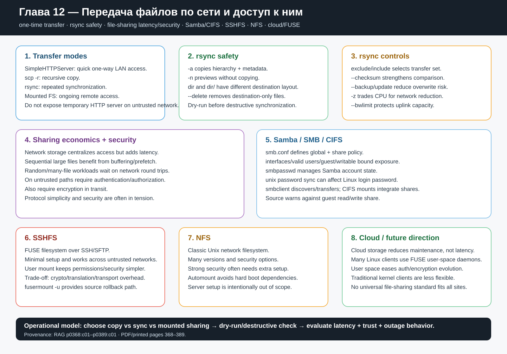

# Глава 12 — Передача файлов по сети и доступ к ним

Практические и концептуальные заметки по главе 12 книги «Внутреннее устройство Linux», 3-е издание.

## Идентификация

- Book ID: `how-linux-works-3e-ru-2022`
- Глава: 12
- Название: «Передача файлов по сети и доступ к ним»
- Slug: `network-file-transfer-and-sharing`
- Source policy: `rag_only`
- Request contract: `BIBLIOTEKA-VSP-CHAPTER-ANALYSIS-REQUEST v1.2`
- Readiness contract: `BIBLIOTEKA-VSP-BOOK-READINESS v1.2`
- Artifact contract: `BIBLIOTEKA-VSP-CHAPTER-ARTIFACT-COLLECTION v1.6`
- External sources: запрещены
- Model memory: запрещена
- Прямой доступ к PDF: не использовался

## Readiness

- Capability: `chapter-analysis`
- Status: `READY`
- Evidence basis: repository registration, metadata/source checksum agreement, READY RAG manifest, addressable chunks, deterministic retrieval-index smoke test and accepted v1.6 artifact template.
- Canonical source: `source/book.pdf`
- Source SHA-256: `60bb698fc2ff849a9814f099c12ca56e8f40c11b0518436f3ce3c44e96152df9`

## Provenance

- RAG chunk range: `p0368:c01`–`p0389:c01`
- Source format: `pdf`
- Source locator range: `pdf_page 368–389`
- PDF page range: 368–389
- EPUB spine range: `Not applicable`
- Printed page range: 368–389
- Оглавление в `p0016:c01`–`p0017:c01` задаёт структуру главы 12.
- `p0368:c01` начинается заголовком главы 12 «Передача файлов по сети и доступ к ним».
- `p0389:c01` завершает раздел 12.8 «Состояние совместного доступа к файлам в сети».
- Следующий чанк `p0390:c01` начинается главой 13 «Пользовательское окружение».
- Chapter boundary verified: yes
- Completion status: `RAG_GROUNDED`

## Содержимое

- [cheatsheet.md](cheatsheet.md) — operational-шпаргалка по выбору механизма передачи/совместного доступа.
- [commands.md](commands.md) — source-confirmed commands с effect/risk/verification/rollback.
- [diagram.md](diagram.md) — Mermaid-карты rsync, Samba, SSHFS/NFS и security/performance trade-offs.
- [visual-cheatsheet.svg](visual-cheatsheet.svg) — компактный визуальный обзор.
- [visual-cheatsheet-detailed.svg](visual-cheatsheet-detailed.svg) — подробная визуальная шпаргалка.

Conditional artifacts `summary.md`, `review-questions.md` и `review-answers.md` не создаются: в проверенной границе главы нет отдельного chapter-end summary/resume и нет блока контрольных вопросов/упражнений. Раздел 12.8 — итоговое обсуждение состояния network file sharing, но не отдельный summary artifact по контракту.

## Карта главы

1. Быстрый одноразовый доступ через Python SimpleHTTPServer.
2. Recursive copy через `scp -r`.
3. `rsync`: archive mode, dry run, delete, trailing slash semantics.
4. `rsync`: exclude/include, checksum, backup/update, compression, bandwidth limit, pull.
5. Теоретические trade-offs network file sharing: convenience vs latency/performance.
6. Security boundary: authentication/authorization + encryption.
7. Samba/SMB server configuration.
8. Samba access control and password database.
9. Samba users, daemon startup, logs and shares.
10. Samba client `smbclient` and CIFS mount.
11. SSHFS as small-scale encrypted FUSE-based sharing.
12. NFS client, security modes and automount direction.
13. Cloud storage through FUSE-style clients.
14. Why no single universal network file-sharing solution exists.

## Краткий анализ главы

Глава 12 разделяет две разные задачи, которые легко смешать: **копирование данных** и **совместный доступ к удалённой файловой системе**. Для разовой передачи достаточно простого сервера или `scp`; для повторяемой синхронизации source рекомендует `rsync`; для mounted shared storage рассматриваются SMB/CIFS, SSHFS, NFS и cloud/FUSE.

Раздел 12.1 показывает самый простой one-way workflow: `python -m SimpleHTTPServer` публикует текущий каталог по HTTP. Source делает жёсткое security-ограничение: запускать такой сервер только в защищённой локальной сети, не в public/untrusted network. Это временный convenience mechanism, а не production file-sharing service.

`rsync` — основной operational tool главы. В отличие от простого recursive `scp -r`, он предназначен для регулярной синхронизации и анализа destination state. Archive mode `-a` переносит directory hierarchy и associated metadata. Source отдельно рекомендует `-n`/dry run, когда результат ещё не очевиден.

Самый опасный `rsync` boundary — `--delete`. Этот option делает destination точной копией source, удаляя destination-only files. Source прямо требует сначала проверять destination и использовать `-nv`, если есть сомнения. Ещё один важный detail — trailing slash. `dir` и `dir/` имеют разные semantics: первый копирует сам directory, второй — его содержимое. Совмещение ошибочного trailing slash с `--delete` может удалить unrelated files.

Exclude/include rules также требуют аккуратной mental model. `--exclude` принимает patterns; leading slash относится к transfer root, а не обязательно к filesystem root. Повторяемые patterns можно вынести в `--exclude-from`.

При проверке existing files rsync по умолчанию использует quick check по size и modification time. Для более строгого comparison source указывает `--checksum`, ценой CPU/I/O. Дополнительные safety controls — `--ignore-existing`, `--backup`, `--suffix`, `--update`.

Compression `-z` — не универсальная оптимизация. На slow/high-latency links она может помочь, но в fast LAN CPU cost compression/decompression может сделать transfer медленнее. Аналогично `--bwlimit` нужен, когда unrestricted upload congests uplink и мешает другому traffic.

Теоретическая часть 12.3 объясняет важную operational reality: network storage всегда зависит от latency. Sequential large-file access можно buffer/prefetch efficiently, но workloads с множеством случайных small accesses suffer. Source прямо рекомендует спросить, нужна ли вообще network filesystem для workload; для demanding editing/build workloads local storage может быть эффективнее.

Security для shared filesystems состоит минимум из двух boundaries: **identity/access control** и **confidentiality in transit**. Если сеть не полностью trusted, source требует authentication/authorization и encryption. Простые file-sharing protocols часто исторически проектировались без сильной security, поэтому иногда приходится добавлять lower-layer protection вроде VPN/IPSec/stunnel.

Samba — bridge между Unix/Linux и Windows SMB. Central configuration — `smb.conf`, обычно под `/etc/samba`. Global section задаёт server/workgroup/network/access controls. Parameters `interfaces`, `bind interfaces only`, `valid users`, `guest ok`, `browseable` формируют exposure surface.

Source рекомендует password authentication для Samba и показывает local TDB backend. `smbpasswd` управляет Samba credentials: add/delete/disable/enable/change. Отдельно отмечен опасный coupling: `unix password sync = yes` может привести к одновременной смене Samba и Linux password, что при неправильном результате может нарушить normal login.

Manual Samba startup через `nmbd` и `smbd` показан в основном для source-built install; source предпочитает позволить systemd управлять service, если Samba установлен пакетно. Runtime diagnostics идут в `log.nmbd` и `log.smbd`.

Share sections определяют path и access behavior. Source особо предупреждает не сочетать guest read/write access. `[homes]` автоматически maps authenticated user к home directory. Printers могут быть shared через CUPS integration.

Client-side Samba имеет два режима. `smbclient` удобен для interactive transfer и discovery; CIFS mount интегрирует remote share в local filesystem. Source command для CIFS содержит `user=username,pass=password` inline; дальнейшие credential-handling implications в главе не разворачиваются и остаются `[Needs confirmation]`.

SSHFS предлагается как low-setup small-scale solution для Linux↔Linux. Он использует SSH/SFTP, работает через FUSE и не требует доверенной LAN, если SSH connectivity уже доступна. Trade-offs: encryption/translation/transport cost и ограниченная multi-user suitability. Source рекомендует монтировать такой filesystem от обычного user и unmount через `fusermount -u`.

NFS — классический Unix network filesystem, но source подчёркивает complexity versions/options и то, что strong authentication/encryption не всегда включены by default. Для small closed networks часто используется host-based access; Kerberos security требует дополнительной инфраструктуры. Для network mounts source рекомендует automount-style behavior, чтобы не создавать boot dependencies.

Cloud storage рассматривается как ещё один remote storage model. В отличие от kernel-centric traditional network filesystems, many cloud clients реализованы через FUSE user-space daemon. Это снижает зависимость от kernel client code и упрощает integration with modern authentication/encryption mechanisms.

Финальный раздел 12.8 объясняет, почему нет одного универсального network filesystem. NFS/CIFS проще, но имеют security/performance trade-offs; AFS решает часть проблем, но требует substantial infrastructure вроде Kerberos. Kernel-space clients ограничивают flexibility и developer surface. FUSE/cloud models переносят больше logic в user space и дают больше свободы для authentication, encryption и name handling.

## Основной принцип

Сначала определить **что нужно**:

`одноразово передать → регулярно синхронизировать → интерактивно смонтировать → централизованно shared storage`.

После этого отдельно оценить:

`performance/latency + authentication/authorization + encryption + failure behavior`.

Не выбирать network filesystem только потому, что его легко смонтировать.

## Operational boundaries

- Temporary HTTP server открывает текущий directory network clients.
- `rsync --delete` удаляет destination-only files.
- Trailing slash меняет rsync destination layout.
- Samba guest/write configuration может расширить access surface.
- `smbpasswd` меняет authentication state.
- `unix password sync = yes` связывает Samba password change с Linux password.
- CIFS/SSHFS/NFS mounts меняют local filesystem namespace и зависимость от remote service.
- Network filesystem outage может блокировать/ухудшать workload.
- Server/storage configuration rollback зависит от текущей topology: `[Needs confirmation]`.

## Ограничения

- Samba server setup намеренно упрощён; source не покрывает крупномасштабную topology.
- NFS server setup лишь обозначен, полного production workflow нет.
- Cloud clients/FUSE implementations не конфигурируются пошагово.
- Source использует `python -m SimpleHTTPServer`; artifact не заменяет эту команду современным вариантом из model knowledge.
- CIFS credential-handling beyond shown inline example не расширяется внешними рекомендациями.
