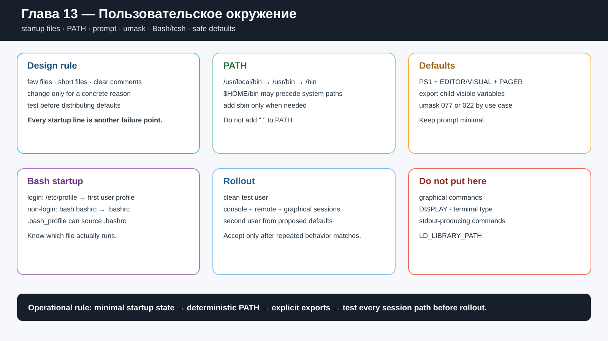
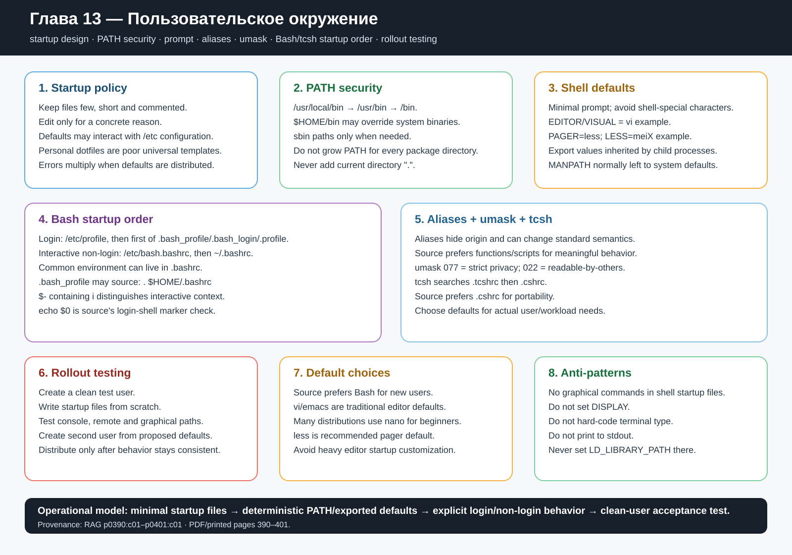

# Глава 13 — Пользовательское окружение

Практические и концептуальные заметки по главе 13 книги «Внутреннее устройство Linux», 3-е издание.

## Идентификация

- Book ID: `how-linux-works-3e-ru-2022`
- Глава: 13
- Название: «Пользовательское окружение»
- Slug: `user-environment`
- Source policy: `rag_only`
- Request contract: `BIBLIOTEKA-VSP-CHAPTER-ANALYSIS-REQUEST v1.2`
- Readiness contract: `BIBLIOTEKA-VSP-BOOK-READINESS v1.2`
- Artifact contract: `BIBLIOTEKA-VSP-CHAPTER-ARTIFACT-COLLECTION v1.6`
- External sources: запрещены
- Model memory: запрещена
- Прямой доступ к PDF: не использовался

## Readiness

- Capability: `chapter-analysis`
- Status: `READY`
- Evidence basis: repository registration, metadata/source checksum agreement, READY RAG manifest, addressable chunks, deterministic retrieval-index smoke test and accepted v1.6 artifact template.
- Canonical source: `source/book.pdf`
- Source SHA-256: `60bb698fc2ff849a9814f099c12ca56e8f40c11b0518436f3ce3c44e96152df9`

## Provenance

- RAG chunk range: `p0390:c01`–`p0401:c01`
- Source format: `pdf`
- Source locator range: `pdf_page 390–401`
- PDF page range: 390–401
- EPUB spine range: `Not applicable`
- Printed page range: 390–401
- Оглавление в `p0017:c01`–`p0018:c01` задаёт структуру главы 13.
- `p0390:c01` начинается заголовком главы 13 «Пользовательское окружение».
- `p0401:c01` завершает раздел 13.7 «Далее о файлах запуска».
- Следующий чанк `p0402:c01` начинается главой 14 «Краткий обзор рабочего стола Linux. Вывод на печать».
- Chapter boundary verified: yes
- Completion status: `ACCEPTED`

## Содержимое

- [cheatsheet.md](cheatsheet.md) — operational-шпаргалка по startup files, PATH, prompt, umask, Bash/tcsh startup order и безопасному rollout.
- [commands.md](commands.md) — source-confirmed shell/configuration constructs с effect/risk/verification/rollback.
- [diagram.md](diagram.md) — Mermaid-карты login/non-login startup, environment propagation и rollout.
- [visual-cheatsheet.svg](visual-cheatsheet.svg) — компактный визуальный обзор.
- [visual-cheatsheet-detailed.svg](visual-cheatsheet-detailed.svg) — подробная визуальная шпаргалка.

Conditional artifacts `summary.md`, `review-questions.md` и `review-answers.md` не создаются: в проверенной границе нет отдельного chapter-end summary/resume и нет блока контрольных вопросов/упражнений. Раздел 13.7 является переходом к graphical startup files и следующей главе.

## Карта главы

1. Принципы startup files: простота и читаемость.
2. Когда startup files действительно стоит менять.
3. `PATH`: порядок каталогов, `$HOME/bin`, sbin directories, запрет точки в пути.
4. `MANPATH`: не переопределять системный default.
5. Prompt: минимализм и опасные shell-special characters.
6. Aliases: ограничения и рекомендация предпочитать functions/scripts.
7. `umask`: варианты 077 и 022.
8. Bash startup order для login и non-login shells.
9. Пример `.bashrc` / `.bash_profile`.
10. Определение interactive shell через `$-`.
11. tcsh/csh startup files.
12. Тестирование defaults на отдельных test users.
13. Defaults: bash, editor, pager.
14. Pitfalls: GUI commands, `DISPLAY`, terminal type, stdout, `LD_LIBRARY_PATH`.
15. Переход к graphical startup environment.

## Краткий анализ главы

Глава 13 рассматривает user environment не как набор случайных dotfiles, а как часть системной конфигурации, влияющую на каждую interactive session. Основная опасность — startup files постепенно обрастают variables, aliases и checks, после чего поведение shell становится непрозрачным.

Source задаёт два базовых принципа для startup files, особенно распространяемых как defaults: **простота** и **читаемость**. Чем меньше строк и скрытых зависимостей, тем меньше потенциальных неисправностей. Комментарии должны объяснять назначение каждого блока.

Перед изменением startup file source предлагает сначала доказать необходимость изменения. Веские причины: изменить prompt, адаптировать критически важное software behavior или восстановить повреждённый startup file. В остальных случаях лучше не вмешиваться: default files могут зависеть от других файлов под `/etc`.

Самый важный элемент environment — command path. Source рекомендует базовый порядок `/usr/local/bin:/usr/bin:/bin`, чтобы local overrides из `/usr/local/bin` имели приоритет над system binaries. Пользовательский `$HOME/bin` можно поставить в начало. Для administrative tools при необходимости добавляются `/usr/local/sbin`, `/usr/sbin`, `/sbin`.

Критический security point: source не рекомендует добавлять текущий каталог `.` в `PATH`. В начале path malicious executable из current directory может подменить стандартную command; даже в конце остаются risks через typos и context-dependent behavior.

`MANPATH` source рекомендует не устанавливать вручную, чтобы не перекрывать system defaults из `/etc/manpath.config`.

Prompt должен быть коротким и полезным. Source показывает `PS1='\u\$ '` и предупреждает не использовать shell-significant symbols, особенно `>`: copy/paste prompt fragments может случайно вызвать redirection и создать пустые files.

Aliases автор оценивает скептически. Они плохо передают arguments, скрывают origin/definition и не переходят в child/noninteractive shells. Особенно опасно silently менять default semantics знакомой command. Для более прозрачного поведения source предпочитает shell function или отдельный script.

`umask` задаёт default permissions для новых files/directories. Source сравнивает `077` как строгий multi-user privacy default и `022` как более permissive read-only-for-others default. Выбор должен соответствовать environment.

Самая важная operational часть — порядок Bash startup files. По source, login shell сначала выполняет `/etc/profile`, затем ищет `.bash_profile`, `.bash_login`, `.profile` и выполняет первый найденный. Interactive non-login shell выполняет `/etc/bash.bashrc`, затем user `.bashrc`. Source предлагает держать common environment в `.bashrc`, а `.bash_profile` использовать для sourcing через `. $HOME/.bashrc`.

Пример `.bashrc` объединяет `PATH`, `PS1`, `EDITOR`, `VISUAL`, `PAGER`, `LESS`, `export` и `umask 022`. Values, которые должны наследоваться child processes, экспортируются.

Для различения interactive/noninteractive contexts source использует `$-`: presence of `i` позволяет branch через `case`.

tcsh имеет другой startup model: source указывает поиск `.tcshrc`, затем fallback к `.cshrc`, и рекомендует `.cshrc` как более portable вариант.

Раздел user defaults важен с точки зрения rollout. Автор рекомендует создать test user с пустым home, написать defaults с нуля, проверить console/remote/graphical paths, затем создать второго test user уже из подготовленного набора. Это фактически acceptance testing для user environment.

Source предпочитает bash как default shell для новых пользователей. Для editor обсуждаются vi/emacs и часто встречающийся nano; для pager рекомендуется `less`. Defaults не должны радикально менять ожидаемое поведение tools.

Финальный safety list: не запускать graphical commands из shell startup files, не задавать `DISPLAY`, не hard-code terminal type, не печатать данные в stdout при startup, не устанавливать `LD_LIBRARY_PATH`.

## Основной принцип

Startup environment должен быть коротким, предсказуемым и проверяемым:

`минимальный PATH → явные exported defaults → минимальный prompt → контролируемый umask → разделение login/non-login → тест на чистом пользователе`.

Не превращать startup files в место для универсальной автоматизации.

## Operational boundaries

- Изменение `PATH` меняет executable resolution order.
- Добавление `.` в `PATH` создаёт security risk.
- `umask` влияет на permissions новых files/directories.
- Sourcing `.bashrc` меняет current shell environment.
- Startup files распространяются на будущие sessions/users; ошибки масштабируются.
- `DISPLAY`, terminal type и `LD_LIBRARY_PATH` в startup files source прямо относит к anti-patterns.
- Rollback startup-file edits зависит от known-good copy: `[Needs confirmation]`.

## Ограничения

- Глава описывает базовые shell startup files и не покрывает полноценно desktop/session startup.
- Source framing для Bash startup order принимается как каноническое для этой главы; artifact не дополняет его внешними manuals.
- Source mentions `chsh` but не даёт полного invocation workflow.
- Graphical startup files (`.xsession`, `.xinitrc`, GNOME/KDE-specific mechanisms) остаются вне detailed scope.
