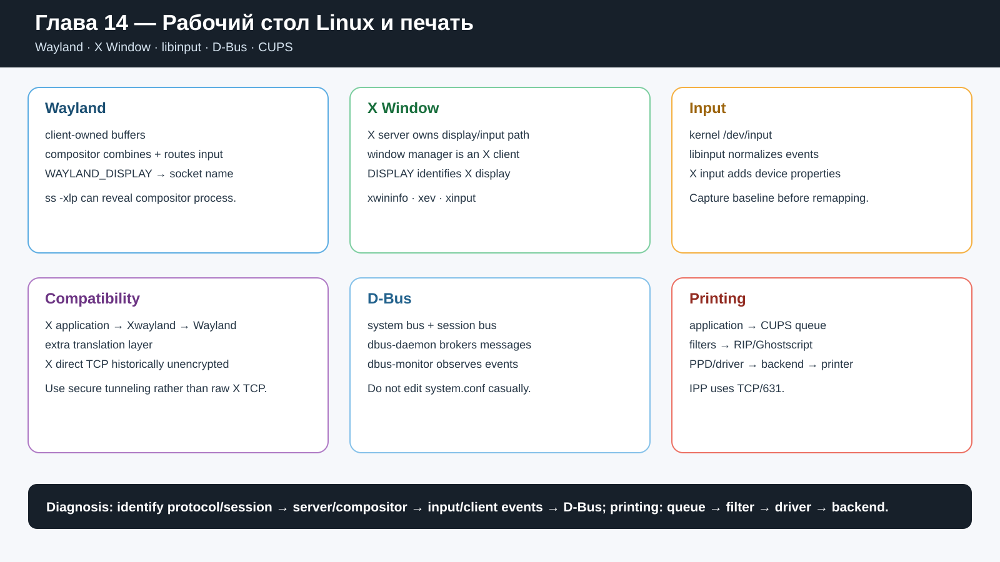
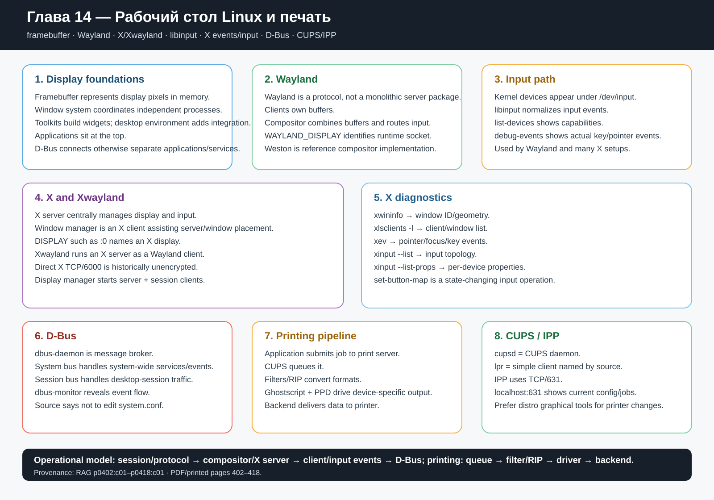

# Глава 14 — Краткий обзор рабочего стола Linux. Вывод на печать

Практические и концептуальные заметки по главе 14 книги «Внутреннее устройство Linux», 3-е издание.

## Идентификация

- Book ID: `how-linux-works-3e-ru-2022`
- Глава: 14
- Название: «Краткий обзор рабочего стола Linux. Вывод на печать»
- Slug: `linux-desktop-and-printing`
- Source policy: `rag_only`
- Request contract: `BIBLIOTEKA-VSP-CHAPTER-ANALYSIS-REQUEST v1.2`
- Readiness contract: `BIBLIOTEKA-VSP-BOOK-READINESS v1.2`
- Artifact contract: `BIBLIOTEKA-VSP-CHAPTER-ARTIFACT-COLLECTION v1.6`
- External sources: запрещены
- Model memory: запрещена
- Прямой доступ к PDF: не использовался

## Readiness

- Capability: `chapter-analysis`
- Status: `READY`
- Evidence basis: repository registration, metadata/source checksum agreement, READY RAG manifest, addressable chunks, deterministic retrieval-index smoke test and accepted v1.6 artifact template.
- Canonical source: `source/book.pdf`
- Source SHA-256: `60bb698fc2ff849a9814f099c12ca56e8f40c11b0518436f3ce3c44e96152df9`

## Provenance

- RAG chunk range: `p0402:c01`–`p0418:c01`
- Source format: `pdf`
- Source locator range: `pdf_page 402–418`
- PDF page range: 402–418
- EPUB spine range: `Not applicable`
- Printed page range: 402–418
- Оглавление в `p0018:c01`–`p0019:c01` задаёт структуру главы 14.
- `p0402:c01` начинается заголовком главы 14.
- `p0418:c01` завершает раздел 14.7 «Дополнительно об окружениях рабочего стола».
- Следующий чанк `p0419:c01` начинается главой 15 «Инструменты разработки».
- Chapter boundary verified: yes
- Completion status: `ACCEPTED`

## Содержимое

- [cheatsheet.md](cheatsheet.md) — operational-шпаргалка по Wayland/X, input diagnostics, D-Bus и CUPS.
- [commands.md](commands.md) — source-confirmed desktop/IPC/input commands с effect/risk/verification/rollback.
- [diagram.md](diagram.md) — Mermaid-карты Wayland/X, D-Bus и print pipeline.
- [visual-cheatsheet.svg](visual-cheatsheet.svg) — компактный визуальный обзор.
- [visual-cheatsheet-detailed.svg](visual-cheatsheet-detailed.svg) — подробная визуальная шпаргалка.

Conditional artifacts `summary.md`, `review-questions.md` и `review-answers.md` не создаются: в проверенной границе нет отдельного chapter-end summary/resume и нет блока контрольных вопросов/упражнений. Раздел 14.7 является завершающим обзором/переходом к следующей теме, а не отдельным summary block.

## Карта главы

1. Компоненты Linux desktop.
2. Framebuffer как базовый display-memory concept.
3. X Window: X server, clients и window manager.
4. Wayland: protocol, client buffers и compositor.
5. Toolkits, desktop environments, applications.
6. Определение Wayland/X через `WAYLAND_DISPLAY`.
7. Поиск Wayland compositor через Unix socket.
8. `libinput` и kernel input events.
9. Xwayland compatibility.
10. X server, displays, virtual terminals и display managers.
11. X network transparency и её security boundary.
12. X inspection: `xwininfo`, `xlsclients`, `xev`, `xinput`.
13. X input preferences и keyboard mapping.
14. D-Bus system/session buses.
15. `dbus-monitor`.
16. Linux printing pipeline.
17. CUPS, IPP, TCP/631 и web interface.
18. RIP/Ghostscript/PPD printer-conversion pipeline.

## Краткий анализ главы

Глава 14 показывает Linux desktop не как единый монолит, а как набор взаимодействующих components. В основе display stack находится framebuffer — memory region, содержимое которой graphics hardware выводит на экран. Window system решает, кто и как может записывать графику, как координировать окна и куда направлять input.

В X Window центральным посредником выступает X server. Clients запрашивают окна и графические operations, server управляет display/input и передаёт events. Window manager в X — отдельный client, который добавляет decorations и управляет размещением окон.

Wayland меняет модель: client получает собственный buffer, а compositor собирает client buffers в итоговый display framebuffer и маршрутизирует input. Source подчёркивает, что Wayland — прежде всего protocol между compositor и clients, а не один большой server package. Weston используется как reference compositor implementation.

Определить текущую графическую систему source предлагает через `WAYLAND_DISPLAY`. Значение вроде `wayland-0` указывает на Wayland. Пустое значение обычно означает X, хотя source оставляет возможность исключений. X и Wayland могут сосуществовать через compatibility layer.

Wayland compositor можно локализовать через его Unix-domain socket. Source показывает `ss -xlp | grep wayland-` и связывает socket с process, например `gnome-shell`/Mutter. Это useful pattern: искать owner endpoint, а не угадывать process name.

`libinput` стандартизирует input events, получаемые из kernel `/dev/input` devices. `libinput list-devices` показывает devices/capabilities, а `libinput debug-events --show-keycodes` — actual input events. Source отдельно отмечает, что libinput используется не только Wayland, но и X.

Compatibility между X и Wayland строится через Xwayland: X server работает как Wayland client и обслуживает X applications. Это добавляет слой translation. Обратная модель не является штатным зеркалом: Wayland clients нельзя просто запустить поверх X тем же способом. Source предупреждает, что запуск отдельного Wayland compositor внутри X может менять поведение dual-backend applications и создавать путаницу.

В X environment ключевое понятие — display identifier, например `:0`, доступный через `DISPLAY`. X server обычно связан с virtual terminal. Source упоминает `chvt` и клавиатурное переключение между virtual terminals, если одновременно работают несколько X servers.

Display manager запускает X server и затем desktop session/clients. Source приводит gdm, kdm и lightdm. Для manual X session называются `startx` и `xinit`, но автор предупреждает, что такой session будет отличаться от session display manager из-за другой startup mechanics/configuration.

X network transparency исторически позволяет remote clients подключаться к X server по TCP/6000. Source считает такой direct mechanism небезопасным из-за отсутствия encryption и отмечает, что distributions обычно отключают listener через `-nolisten tcp`. Для remote X clients source предпочитает SSH tunneling, описанный в предыдущей главе.

X inspection utilities дают operational visibility. `xwininfo` показывает geometry/window ID; `xlsclients -l` перечисляет clients/windows; `xev` показывает X events, включая pointer, focus и keycodes. `xinput --list` отображает input-device topology, а `xinput --list-props <id>` — device properties.

Изменение input configuration — уже state-changing boundary. Source показывает `xinput --set-button-map dev 3 2 1` для перестановки mouse buttons. Также упоминаются `xmodmap`, XKB, `xkbcomp` и `setxkbmap`, но без полного safe workflow/rollback.

D-Bus представлен как message bus / IPC mechanism. Центральным broker является `dbus-daemon`. System bus запускается при boot, использует system configuration и Unix socket; session bus относится к desktop session. Source прямо говорит не изменять `/etc/dbus-1/system.conf`.

`dbus-monitor --system` и `dbus-monitor --session` позволяют наблюдать bus events. System bus обычно менее шумный; session bus может генерировать большой поток desktop events.

Printing section строит pipeline: application → print server/queue → filters → rasterization/driver conversion → backend → printer. CUPS является standard print server, daemon называется `cupsd`, а `lpr` назван simple client для отправки files.

CUPS использует IPP по TCP/631. Source указывает `http://localhost:631/` для просмотра current configuration/jobs, но отдельно предупреждает, что web-based administration в default setup не следует считать безопасным mechanism для изменений. Для добавления/изменения printers source предпочитает distribution graphical tools; config обычно находится под `/etc/cups`.

Для printers без PostScript/PDF support CUPS использует conversion pipeline. RIP создаёт raster image, обычно с Ghostscript, а PPD описывает device-specific settings, например resolution/paper size.

## Основной принцип

Desktop diagnostics лучше вести по concrete component boundary:

`session/protocol → compositor/X server → client/window → input event path → IPC bus → application`.

Для printing:

`application → CUPS queue → filters/RIP/driver → backend → printer`.

## Operational boundaries

- `xinput --set-button-map` меняет active input mapping.
- `startx/xinit` запускают отдельный graphical session.
- Manual X/Wayland compositor experiments могут менять application backend selection.
- D-Bus monitor exposes event/message metadata; не модифицирует bus state в показанном workflow.
- CUPS web interface source не рекомендует как default administration path.
- Editing `/etc/dbus-1/system.conf` source прямо не рекомендует.
- Printer configuration changes должны выполняться через supported distro tools; exact rollback: `[Needs confirmation]`.
- X direct TCP network transparency source считает небезопасной без encryption.

## Ограничения

- Глава обзорная: full desktop/session configuration не рассматривается.
- Wayland tooling intentionally limited in source.
- X input configuration examples не превращены в comprehensive remapping guide.
- D-Bus рассматривается на уровне architecture/monitoring, без full message API.
- Printing configuration intentionally delegated graphical tooling; command-line production setup отсутствует.
