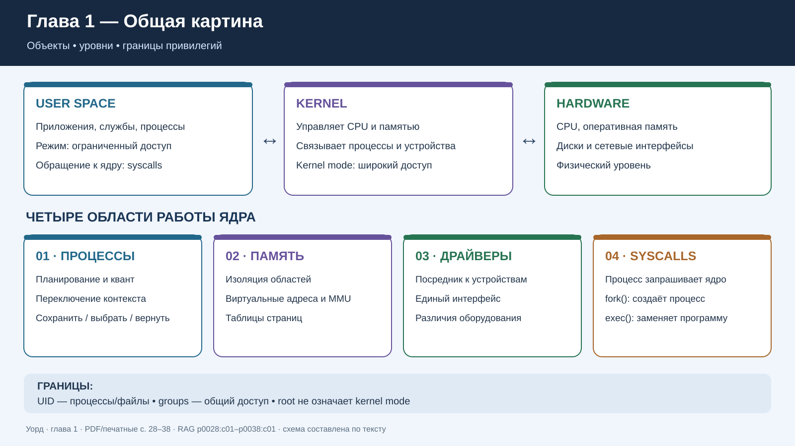
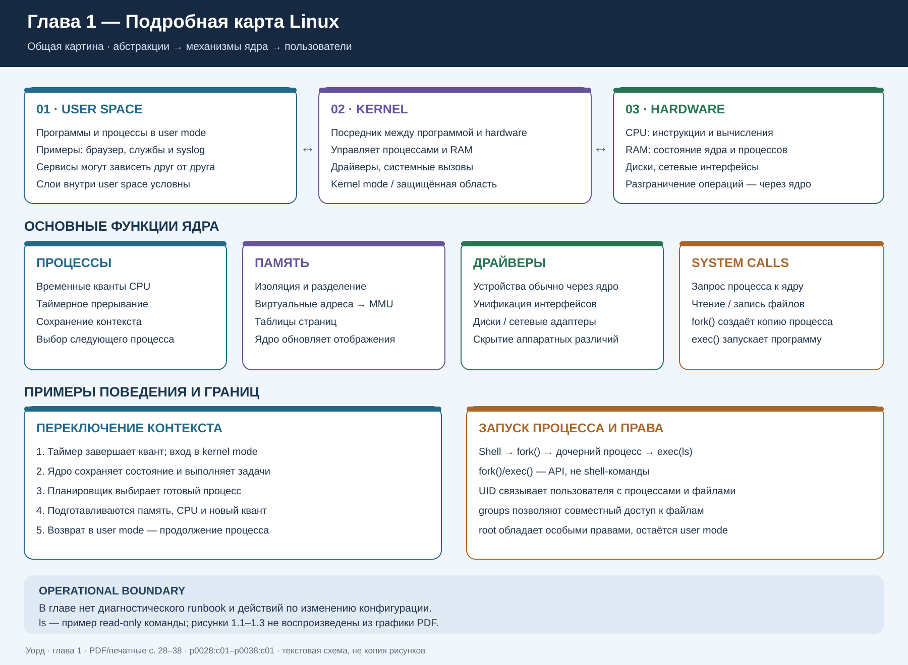

# Глава 1 — Общая картина

Анализ главы 1 книги Брайана Уорда «Внутреннее устройство Linux» (3-е русское издание, 2022).





## Источник и граница

- Book ID: `how-linux-works-brian-ward-3e-ru-2022`; inventory: `0034`.
- Глава: **1. Общая картина**; slug: `big-picture`.
- Canonical source: `source/book.pdf`; SHA-256: `eee3833ea6ac0fe70268f66076c2ed2bd413b41484bd51d75af7b3ed3ae40ac3`.
- Политика: **rag_only**; web, model memory и прямое чтение canonical PDF для содержания главы не применялись.
- RAG: `rag/chunks/p0001-p0100/p0028-c01.md` … `p0038-c01.md` (**11** адресуемых чанков; PDF pages **28–38**, inclusive).
- Печатные страницы: **28–38**, подтверждены номерными колонтитулами в извлечённом тексте.
- Контроль границы: `p0006:c01` (оглавление: глава 1 — с. 28, глава 2 — с. 39); `p0028:c01` начинается «1 / Общая картина», `p0038:c01` завершает §1.6, `p0039:c01` начинается «2 / Основные команды и иерархия каталогов».
- Chapter boundary verified: **YES**.
- Book readiness: **READY**; RAG ingestion acceptance: **ACCEPTED**; извлечение `READY_WITH_KNOWN_LIMITATIONS`.

## Карта главы

| Раздел | Тема | Source PDF pages | Главная идея |
|---|---|---:|---|
| Введение | Абстракция | 28–29 | Понимать назначение компонента и его интерфейс до погружения в детали. |
| 1.1 | Уровни абстракции | 29–31 | Оборудование → ядро → пользовательское пространство; разные привилегии режимов. |
| 1.2 | Оперативная память | 31 | Код, данные и состояние процессов/ядра представлены в памяти. |
| 1.3.1 | Управление процессами | 32–33 | Планирование, временные кванты и переключение контекста. |
| 1.3.2 | Управление памятью | 34 | Изоляция, виртуальная память, MMU и таблицы страниц. |
| 1.3.3 | Драйверы устройств | 34–35 | Ядро посредничает между устройствами и пользовательскими процессами. |
| 1.3.4 | Системные вызовы | 35–36 | Системный вызов связывает процесс и ядро; `fork()` и `exec()`. |
| 1.4 | Пользовательское пространство | 36–37 | Иерархия служб и приложений условная, компоненты взаимодействуют. |
| 1.5 | Пользователи | 37–38 | UID, владение процессами/файлами, root, группы и границы доступа. |
| 1.6 | Что дальше? | 38 | Обзор связи user space ↔ kernel ↔ hardware и переход к файлам/дискам. |

## Краткий анализ

**Метод главы — абстракция.** Linux удобнее разбирать как набор компонентов с понятными задачами и взаимодействиями, а не как список всех внутренних деталей. Это же позволяет локализовать предполагаемый класс проблемы, прежде чем углубляться в подсистему (PDF 28–29).

**Три основных уровня системы:** аппаратное обеспечение (память, CPU, диски, сетевые интерфейсы), ядро (управление процессами, памятью и оборудованием), пользовательское пространство (запущенные программы). Пользовательский режим ограничен; режим ядра обладает значительно более широким доступом. Не следует смешивать `root` и *kernel mode*: суперпользователь остаётся пользовательским процессом (PDF 29–31, 38).

**Память и состояние.** Ядро и процессы находятся в оперативной памяти, процессор считывает из неё инструкции/данные. Состояние можно выразить набором битов, а практические описания используют абстракции вроде «ожидает ввода» (PDF 31).

**Четыре области работы ядра:** (1) управление процессами и квантами CPU; (2) управление памятью и изоляцией с помощью MMU/виртуальных адресов; (3) интерфейсы драйверов устройств; (4) системные вызовы и программные службы (PDF 32–36).

**Процесс и интерфейс ядра.** На одноядерной машине CPU отдаётся разным процессам по временным квантам. Ядро сохраняет контекст прерванного процесса, выбирает следующий и восстанавливает выполнение. В примере оболочка использует `fork()`, после чего дочерний процесс применяет `exec()` для запуска `ls` (PDF 33, 35). Это концептуальная последовательность, а не готовая shell-команда `fork()` или `exec()`.

**Пользовательские службы и границы привилегий.** Глава группирует приложения и сервисы в примерную иерархию, но прямо предупреждает, что строгой схемы в user space нет. UID связан с владением процессами и файлами; `root` обладает особыми возможностями, что повышает риск ошибок (PDF 36–38).

## Главный принцип

```text
Назначение компонента и уровень абстракции
       ↓
hardware ↔ kernel ↔ user processes
       ↓
разграничение памяти / операций / прав
       ↓
понимание взаимодействий без преждевременных деталей
```

## Материалы

- [cheatsheet.md](cheatsheet.md) — модель системы, диагностическое мышление и границы применимости.
- [commands.md](commands.md) — только явно упомянутые команды, системные вызовы и интерфейсы.
- [diagram.md](diagram.md) — Mermaid-карта системы и `fork()` → `exec()`.
- [visual-cheatsheet.svg](visual-cheatsheet.svg) — компактная схема.
- [visual-cheatsheet-detailed.svg](visual-cheatsheet-detailed.svg) — подробная схема.
- [summary.md](summary.md) — заключительный раздел §1.6 «Что дальше?» (не отдельное издательское «Резюме»).
- [source-findings.md](source-findings.md) — ограничения текстового извлечения рисунков.

## Ограничения / acceptance

- В главе **нет** воспроизводимого административного troubleshooting runbook, набора диагностических shell-команд или подтверждённых команд изменения конфигурации.
- Иллюстрации 1.1–1.3 не представлены как самостоятельные мультимодальные RAG-объекты: схема здесь реконструирует **только явно описанные словами** связи, а не копирует графику автора.
- Детальные механизмы виртуальной памяти, процессов и пользовательских утилит отнесены источником к дальнейшим главам; отсутствующие проверки и rollback помечены в шпаргалке.
- Дополнительный текст главы и сведения о текущих версиях Linux не вносились извне.
