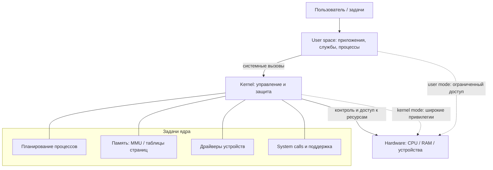
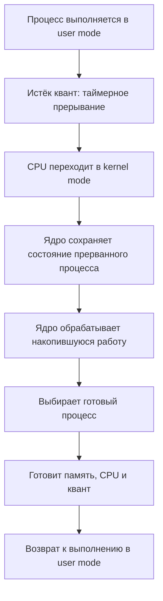
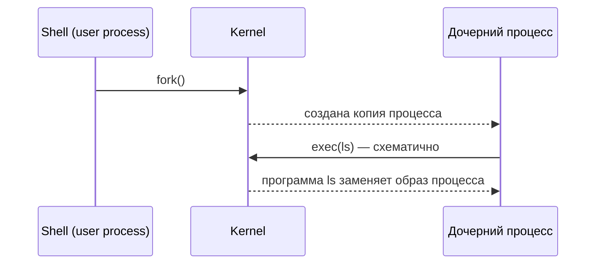
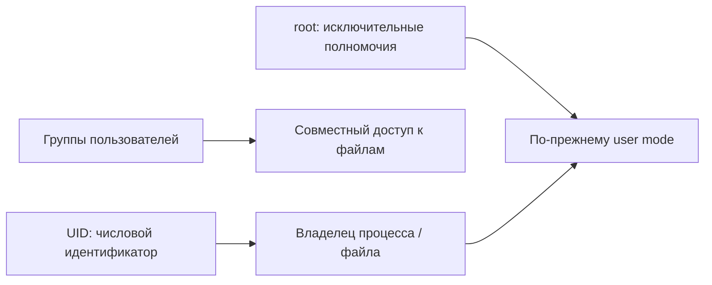

# Глава 1 — Mermaid: уровни, ядро и запуск процесса

Источник: `p0028:c01`–`p0038:c01`. Это **аналитическая схема из текста**, а не точное восстановление иллюстраций 1.1–1.3.

## Слои системы и интерфейсы

**Граница:** пунктир «user mode → hardware» напоминает об ограничении, а не обозначает свободный прямой доступ. Источник подчёркивает посредничество ядра и разграничение режимов (PDF 29–31).

## Переключение контекста на одном CPU

Порядок адаптирован из семи шагов автора на PDF 33. Для многопроцессорной машины автор отдельно оговаривает усложнение этой модели.

## Запуск команды в оболочке

`fork()` / `exec()` здесь — пример системных вызовов, а не готовые shell-команды (PDF 35–36).

## Пользователи и привилегии

Границы root, собственных/чужих процессов и групп подробно обозначены в `p0037:c01`–`p0038:c01`. Правила user-space-иерархии не являются жёсткими (`p0037:c01`).
