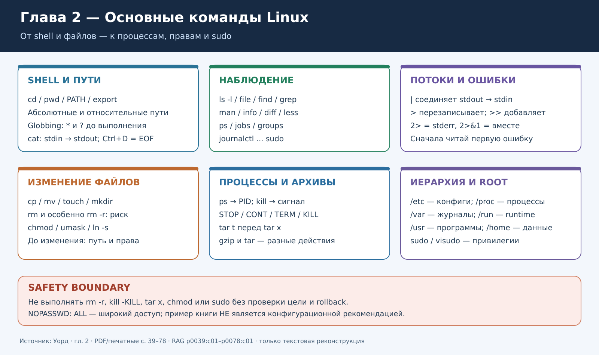
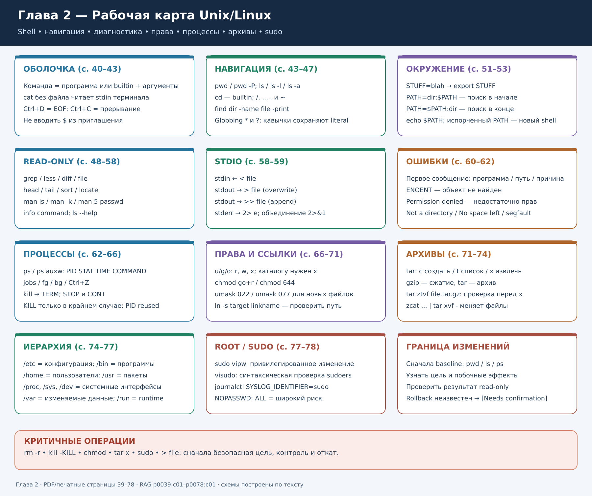

# Глава 2 — Основные команды и иерархия каталогов

Брайан Уорд, «Внутреннее устройство Linux», 3-е русское издание, 2022. В главе формируется базовый интерфейс работы с пользовательским пространством Unix/Linux: оболочка, файлы, процессы, потоки, права доступа, документация, архивы, каталоги и `sudo`.





## Идентификация и readiness

- Book ID: `how-linux-works-brian-ward-3e-ru-2022`; inventory: `0034`.
- Глава 2: **«Основные команды и иерархия каталогов»**; slug: `basic-commands-and-directory-hierarchy`.
- Источник: PDF `source/book.pdf`, SHA-256 `eee3833ea6ac0fe70268f66076c2ed2bd413b41484bd51d75af7b3ed3ae40ac3`.
- Policy: **rag_only**, без чтения исходного PDF напрямую, внешнего поиска и подмены содержания знаниями модели.
- Книга: BOOK-READINESS **READY** (подтверждён CI после onboarding), `rag/acceptance.yaml`: **ACCEPTED**.
- Извлечение текста: `READY_WITH_KNOWN_LIMITATIONS`.

## Provenance: подтверждённые границы

- PDF source pages: **39–78** (40 страниц, нумерация PDF от 1).
- Печатные страницы: **39–78** (совпадение проверено по колонтитулам главы и оглавлению).
- Чанки: `p0039:c01`–`p0078:c01` (40 адресуемых PDF-page чанков, source path `rag/chunks/p0001-p0100/p####-c01.md`).
- Контроль начала: `p0006:c01` — в оглавлении глава 2 начинается на с. 39; `p0039:c01` содержит заголовок главы 2.
- Контроль окончания: `p0008:c01` — следующая глава начинается на с. 79; `p0078:c01` заканчивается §2.21 «Что дальше?»; `p0079:c01` начинается «Глава 3. Устройства».
- **Chapter boundary verified: YES.**

## Карта главы

| Раздел | PDF/печатные с. | Тема | Содержимое |
|---|---:|---|---|
| 2.1–2.2 | 40–43 | Bash, `/bin/sh`, терминал, `cat`, stdin/stdout | Команда, аргумент, интерактивный поток и EOF. |
| 2.3–2.4 | 43–47 | `ls`, `cp`, `mv`, `touch`, `rm`, `echo`; пути/каталоги | Абсолютные/относительные пути, `cd`, `mkdir`, `rmdir`, globbing. |
| 2.5 | 47–51 | Инструменты поиска/просмотра | `grep`, `less`, `pwd`, `diff`, `file`, `find`, `locate`, `head`, `tail`, `sort`. |
| 2.6–2.9 | 51–53 | Пароль, оболочка, dotfiles, env, PATH | `passwd`, `chsh`, `ls -a`, `export`, поиск исполняемых файлов. |
| 2.10–2.13 | 53–58 | Символы, клавиши, редакторы, справка | Контрольные последовательности, `vi`/`Emacs`, `man`/`info`, секции руководства. |
| 2.14–2.15 | 58–62 | stdio, перенаправления, ошибки | `>`, `>>`, `2>`, `2>&1`, `<`, pipe; ENOENT, Permission denied и др. |
| 2.16 | 62–66 | Процессы, сигналы и задания | `ps`, PID, `kill`, STOP/CONT/KILL, `jobs`, `fg`, `bg`, `&`. |
| 2.17 | 66–71 | Unix-права и ссылки | `rwx`, владелец/группа/прочие, `chmod`, `umask`, `ln -s`. |
| 2.18 | 71–74 | Архивы и сжатие | `gzip`/`gunzip`, `tar` (c/x/t), `zcat`, `tar ztvf`, расширения. |
| 2.19 | 74–77 | Иерархия каталогов | `/bin`, `/etc`, `/home`, `/proc`, `/sys`, `/usr`, `/var`, `/boot` и др. |
| 2.20 | 77–78 | Запуск от root | `sudo`, `/etc/sudoers`, `visudo`, `journalctl SYSLOG_IDENTIFIER=sudo`. |
| 2.21 | 78 | Что дальше? | Итог и переход к работе с ядром и user space. |

## Анализ: главная линия

**1. Shell — управляющий слой пользовательского пространства.** Bash запускает программы, подставляет аргументы, изменяет окружение и соединяет потоки. `cd` — встроенная функция оболочки: дочерний процесс не смог бы изменить её текущий каталог (§2.1–2.4, `p0040`–`p0047`).

**2. Команда и её окружение — разные уровни.** До запуска программы shell применяет globbing (`*`/`?`), подставляет переменные (`$STUFF`, `$PATH`) и настраивает перенаправления; аргументы получают уже обработанное значение. PATH задаёт порядок поиска исполняемых файлов, а `export` делает переменную доступной дочерним процессам (§2.4.4, §2.8–2.9, §2.14).

**3. Наблюдение и изменение состояния необходимо разделять.** `ls`, `pwd`, `grep`, `less`, `find`, `ps` и `man` используются для получения сведений. `cp`, `mv`, `rm`, `chmod`, `kill`, `tar xvf`, `sudo vipw` воздействуют на состояние. Даже `ls` c оператором `> file` создаёт/перезаписывает файл — эту границу задаёт оболочка (§2.3–2.5, §2.14–2.20).

**4. Потоки дают наблюдаемость и композицию.** stdin, stdout и stderr являются самостоятельными потоками; перенаправления, включая `2>&1`, и конвейеры позволяют отдельно обрабатывать штатный вывод и ошибки. Сообщение об ошибке анализируется по имени программы, пути и причине; книга рекомендует начинать с первой ошибки (§2.14–2.15).

**5. Процессы и права требуют осторожности.** `ps` отображает PID, состояние и CPU time, `kill` посылает сигналы; `Ctrl+Z` приостанавливает foreground job, а не завершает. `chmod` меняет биты прав; `rmdir` не удаляет непустой каталог; `rm -r` потенциально разрушителен; `sudo` используется для контролируемого повышения привилегий (§2.16–2.20).

**6. Файловая иерархия — карта для диагностики.** `/etc` хранит системную конфигурацию, `/proc` — сведения о процессах/ядре, `/run` — данные выполнения, `/var` — изменяемые системные данные, `/usr` — значительную часть программ и библиотек; предназначение каталогов объяснено в контексте издания, без утверждения об одинаковой структуре на всех современных дистрибутивах (§2.19).

## Главный принцип

```text
Сначала разберись: где я и что вижу?
    pwd / ls / file / man / ps
            ↓
Как оболочка преобразует команду?
    аргументы → globbing/env/PATH → stdin/stdout/stderr
            ↓
Где риск изменений?
    rm / mv / chmod / kill / tar x / sudo / > file
            ↓
Проверка результата и восстановление
    по подтверждённому состоянию; неизвестный rollback = [Needs confirmation]
```

Это аналитическая группировка прочитанного, а **не** готовый универсальный диагностический runbook автора.

## Материалы

- [cheatsheet.md](cheatsheet.md) — краткая операционная карта с восемью обязательными разделами.
- [commands.md](commands.md) — каталог команд по классам и рискам, с точными примерами из главы.
- [diagram.md](diagram.md) — Mermaid: shell, потоковые операторы, анализ ошибок и привилегии.
- [visual-cheatsheet.svg](visual-cheatsheet.svg) — компактный обзор.
- [visual-cheatsheet-detailed.svg](visual-cheatsheet-detailed.svg) — подробная визуальная карта.
- [summary.md](summary.md) — заключительный §2.21, без добавления сторонних выводов.
- [source-findings.md](source-findings.md) — спорные фрагменты источника и ограничения текстового слоя.

## Ограничения и риски

- Книга содержит опасные примеры, предназначенные для изучения синтаксиса, **не для запуска на рабочих системах без проверки контекста**. В особенности: `rm -r`, `chmod`, `kill -KILL`, `tar xvf`, `sudo vipw`, правила `NOPASSWD: ALL`.
- `p0049:c01` содержит спорную клавишную последовательность поиска назад в `less`; `p0073:c01` — необычное расширение для `bzip2`. Они не исправлялись по памяти; подробности в `source-findings.md`.
- Текст RAG не содержит реконструируемого рисунка 2.1 (битовые поля режима) и 2.2 (схема каталогов), только подписи и сопутствующее текстовое объяснение.
- `passwd`/`sudo` и примеры изменяющих команд требуют отдельного плана проверки и rollback; где глава не приводит его, записано **[Needs confirmation]**.
- В главе нет самостоятельных контрольных вопросов или упражнений и нет авторского раздела «Резюме»; есть завершение §2.21.
