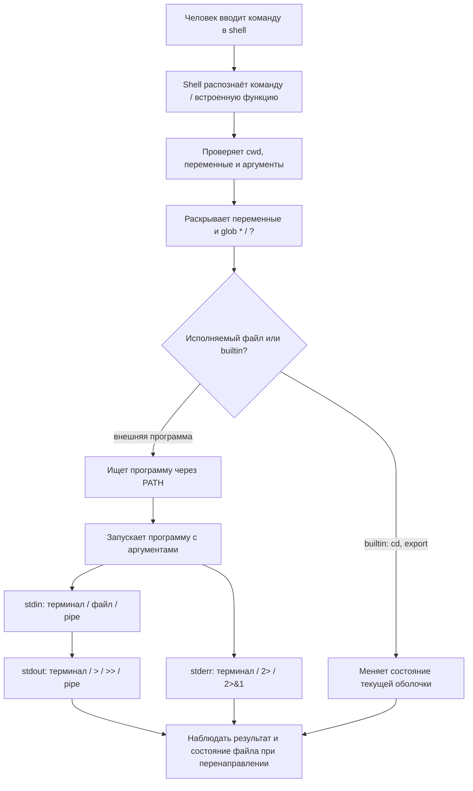
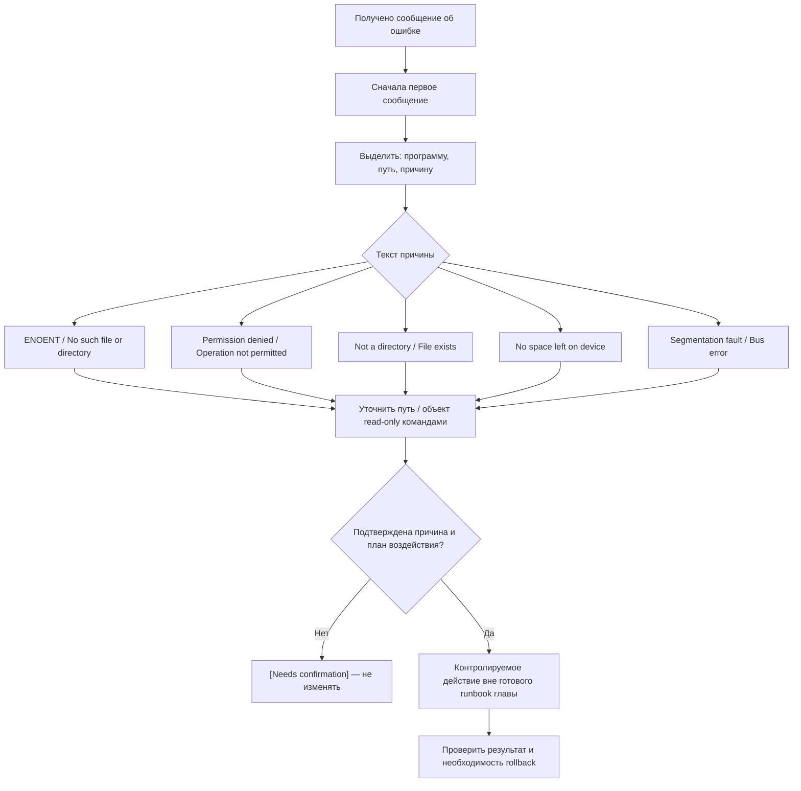
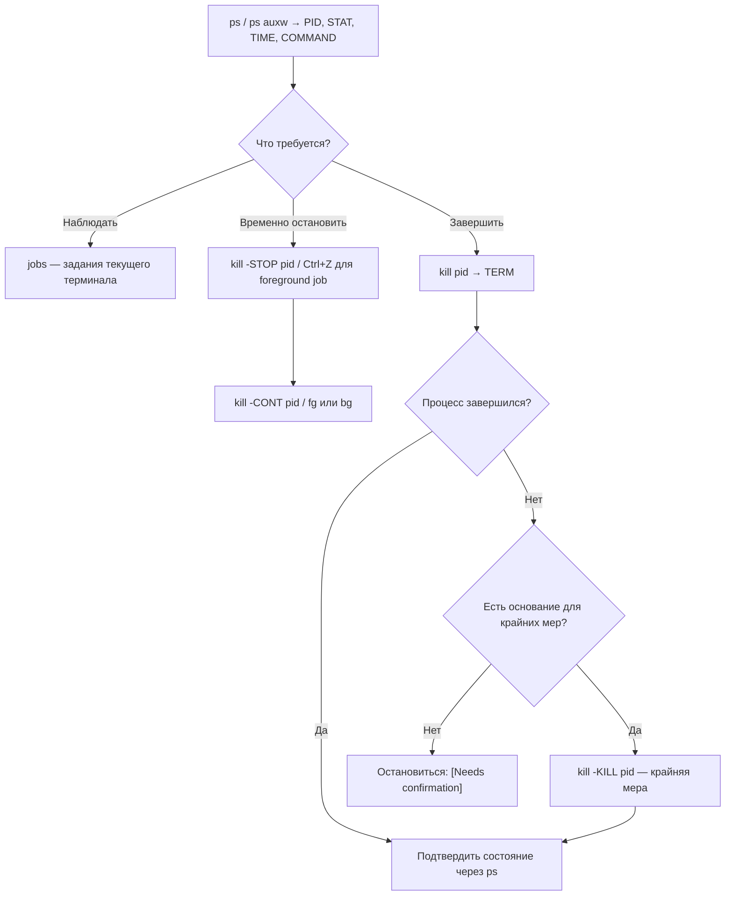
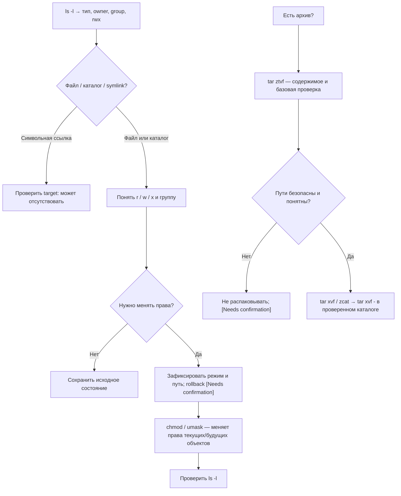
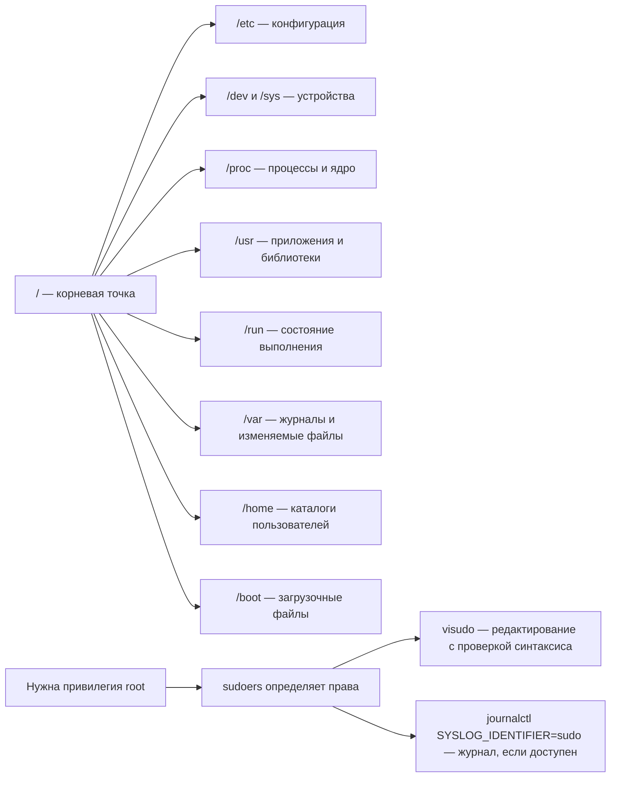

# Mermaid: оболочка, диагностика и границы изменений

Источник: **RAG глава 2**, `p0039:c01`–`p0078:c01`, PDF/печатные с. 39–78. Диаграммы — аналитическое упорядочивание **содержания главы**, не реконструкция исходных иллюстраций.

## 1. Как оболочка готовит выполнение команды (2.1–2.5, 2.8–2.9, 2.14)

**Граница:** `>` и `>>` могут менять файл, даже если выполняемая программа только читает (§2.14, с. 58–59).

## 2. Начальная диагностика ошибки без произвольных изменений (2.15)

Глава показывает категории ошибок, **не** универсальные исправления и команды для измерения свободного места. Решение `GO` является защитным аналитическим ограничением, а не утверждением, что книга описывает полный Change Management.

## 3. Процессы и задания (2.16, с. 62–66)

**Внимание:** PID может переиспользоваться, поэтому повторно проверяйте, какой процесс выбран. Ctrl+Z не эквивалентен Ctrl+C; KILL не даёт процессу завершить очистку (§2.16).

## 4. Файлы, права и архивы (2.17–2.18)

## 5. Иерархия и root: классификация (2.19–2.20)

Это **схематическая карта**, не исчерпывающее дерево FHS и не инструкция менять `sudoers`.

## Примечания

- Секции/команды в диаграммах подтверждены глава 2. Незаданные детали проверки/отката сохраняются как **[Needs confirmation]**.
- Исходные рисунки **2.1** (режим файла) и **2.2** (иерархия каталогов) не закодированы отдельными RAG-графическими объектами; диаграммы выводят только смысл текстового описания (§2.17, §2.19).
- Не следовать ветке `chmod` или `kill` на рабочем хосте без фактической идентификации цели.
