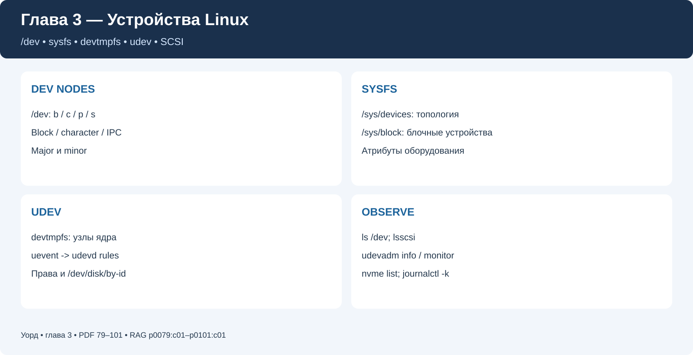
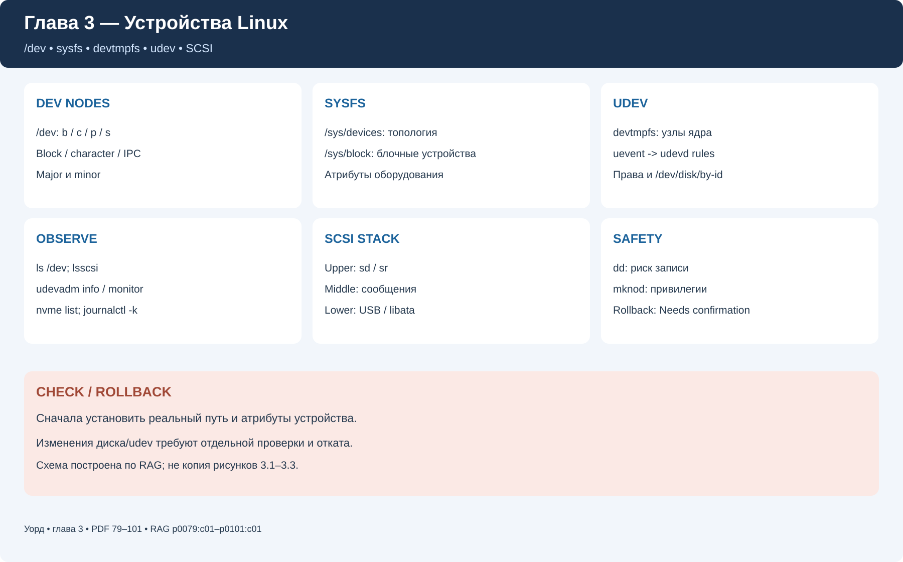

# Глава 3 — Устройства

Брайан Уорд — «Внутреннее устройство Linux», 3-е издание (Питер, 2022).





## Идентификация и допуск

- Book ID: `how-linux-works-brian-ward-3e-ru-2022`; inventory: `0034`.
- Chapter: **3. Устройства**, slug: `devices`.
- Source: `source/book.pdf`, SHA-256: `eee3833ea6ac0fe70268f66076c2ed2bd413b41484bd51d75af7b3ed3ae40ac3`.
- Book-level RAG acceptance: **ACCEPTED** (`rag/acceptance.yaml`, no failed checks). BOOK-READINESS: **READY** (previously verified readiness CI; canonical metadata unchanged).
- Extraction: `READY_WITH_KNOWN_LIMITATIONS`.
- Mode: **rag_only**; external sources, model memory and direct reading of canonical PDF are **not used**.

## Подтверждённая граница главы

- PDF source pages: **79–101** inclusive; printed pages: **79–101** (колонтитулы и оглавление).
- Chunk range: **`p0079:c01`–`p0101:c01`**, 23 source-page chunks.
- Paths: `rag/chunks/p0001-p0100/p0079-c01.md` … `p0100-c01.md`, затем `rag/chunks/p0101-p0200/p0101-c01.md`.
- Start: `p0008:c01` и `p0009:c01` (оглавление); `p0079:c01` содержит заголовок «3. Устройства».
- End: `p0101:c01` содержит конец §3.6.4 и переход к следующей главе; `p0102:c01` начинается «4. Диски и файловые системы».
- **Chapter boundary verified: YES.**

## Карта главы

| Раздел | Печатные/PDF с. | Темы и предмет проверки |
|---|---:|---|
| 3.1 | 79–81 | `/dev`, типы `b/c/p/s`, major/minor, файловый интерфейс устройства. |
| 3.2 | 81–82 | `sysfs`, `/sys/devices`, `/sys/block`, адрес устройства и атрибуты. |
| 3.3 | 82–83 | `dd`: поток → блоки → файл/устройство; `if/of/bs/count/skip`; риск записи. |
| 3.4 | 83–89 | Имена дисков и разделов, `lsscsi`, `nvme list`, mapper, tty, последовательные порты, `mknod`. |
| 3.5–3.5.1 | 89–91 | Историческая схема `/dev`; devtmpfs и `udevd`; `/dev/disk/by-id`. |
| 3.5.2 | 91–93 | `uevent`, `udev` rules (`==`, `!=`, `+=`), идентификация и symlinks. |
| 3.5.3–3.5.4 | 93–95 | `udevadm info`, `udevadm monitor`, KERNEL/ UDEV events. |
| 3.6–3.6.4 | 95–101 | SCSI адрес и LUN; upper/middle/lower drivers; USB-storage, libata, `/dev/sg*`. |

## Основные идеи

**Интерфейс `/dev` — доступ к устройству, а `/sys` — его модель.** Многие устройства представлены файлами в `/dev`, через которые приложение вызывает операции ввода-вывода ядра. Блочные `b` и символьные `c` интерфейсы отличаются характером данных, имена major/minor помогают связать узел с драйвером. Именованные конвейеры `p` и Unix-сокеты `s` — другие типы специальных файлов. Не у каждого физического/логического устройства есть узел в `/dev` (например, сетевые интерфейсы) (§3.1, PDF 79–81).

**`sysfs` описывает структуру и свойства оборудования.** `/sys/devices` отражает путь объекта в дереве устройств; `/sys/block` содержит ссылки на блочные устройства. `udevadm info --query=all --name=/dev/sda` показывает связь имени узла, пути sysfs, дополнительных свойств и символических ссылок (§3.2 и §3.5.3).

**Названия `sdX` не являются постоянными идентификаторами.** Устройство `/dev/sdb` может изменить имя при перестановке или исчезновении другого диска; книга связывает устойчивые ссылки с UUID, LVM и `/dev/disk/by-id`. Классы имен `/dev/nvme*`, `/dev/dm-*`, `/dev/vd*`, `/dev/tty*` отражают различные интерфейсы, но не подтверждают наличие устройств на конкретном хосте (§3.4, PDF 84–88).

**devtmpfs и udev решают разные задачи.** Ядро создаёт узлы устройств в `devtmpfs`; при событиях `uevent` процесс `udevd` применяет правила, настраивает права и создаёт дополнительные ссылки, например в `/dev/disk/by-id`. `udevadm monitor` показывает как сообщения KERNEL, так и обработанные UDEV, а `udevadm info` — установленные свойства (§3.5, PDF 89–95).

**Подсистема SCSI разделена на три уровня.** Верхний драйвер класса (например, `sd`), средний уровень маршрутизации команд и нижний аппаратно-зависимый драйвер. USB-storage и SATA/ATA могут подключаться через мосты; `libata` транслирует команды SATA/ATA в применимую подсистемой SCSI модель. `lsscsi -g` дополнительно показывает generic endpoints `/dev/sg*`, которые нужны для специальных задач, например записи оптических носителей (§3.6, PDF 95–101).

**`dd` не является безусловно безопасным способом исследования.** Пример `dd if=/dev/zero of=new_file bs=1024 count=1` записывает данные в `new_file`. Подстановка пути реального устройства в `of=` без проверки может испортить данные; глава прямо предупреждает о риске и рекомендует направлять вывод в новый файл (§3.3, PDF 82–83).

## Главная концептуальная карта

```text
Hardware detected
       |
       v
Kernel: driver + device topology (/sys/devices)
       |
       +--> devtmpfs: device node in /dev
       |
       +--> uevent --> udevd rules --> permissions and symlinks (/dev/disk/by-id)
                          |
                udevadm info / monitor

User application --> /dev/[block|character|generic] --> driver / kernel --> hardware
```

Связь uevent/udevd/devtmpfs — аналитическое отображение схемы §3.5; она не воспроизводит точную оригинальную графику.

## Содержимое набора

- [cheatsheet.md](cheatsheet.md) — workflow устройства, восемь операционных разделов, риски, acceptance и rollback.
- [commands.md](commands.md) — только source-confirmed команды; классификация read-only / workload-generating / state-changing.
- [diagram.md](diagram.md) — Mermaid-топология устройств, уdev lifecycle и SCSI hierarchy.
- [visual-cheatsheet.svg](visual-cheatsheet.svg) — обязательный компактный визуальный обзор.
- [visual-cheatsheet-detailed.svg](visual-cheatsheet-detailed.svg) — обязательная подробная визуальная схема.
- [source-findings.md](source-findings.md) — неоднозначные примеры udev, извлечение рисунков и опасный синтаксис `mknod`.

## Ограничения

- **[Source extraction issue]** Рисунки 3.1–3.3 (SCSI topology/driver tree) не закодированы отдельными визуальными объектами. Особенно `p0097:c01` содержит только подпись рисунка 3.2. Диаграммы строятся исключительно по тексту (§3.6).
- **[Source wording/code mismatch]** В §3.5.2 `IMPORT{program}` показан с разными переменными `$devnode` и `$tempnode`. Текст правила разорван переносами: не использовать как готовый udev-конфиг.
- **[Source extraction issue]** В §3.4.11 обозначение типов `mknod` читается как `carp`, что не позволяет подтвердить точный синтаксис. Команда `mknod /dev/sda1 b 8 1` **не предназначена для запуска** на реальном хосте.
- В главе **нет** отдельного «Резюме», «Что дальше?» или заданий для повторения. Не создаются `summary.md`, `review-questions.md`, `review-answers.md`.
- Правила udev, имена оборудования, serial consoles и диски описаны в контексте источника, не сверены с текущей версией дистрибутива: **[Needs confirmation]**.
