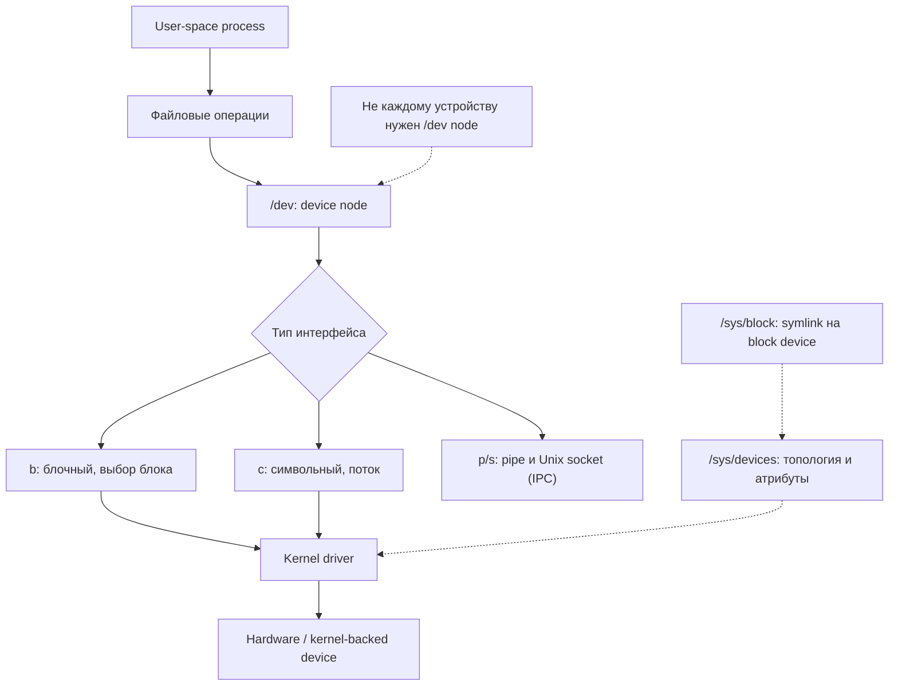
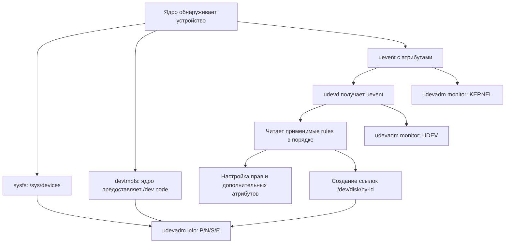
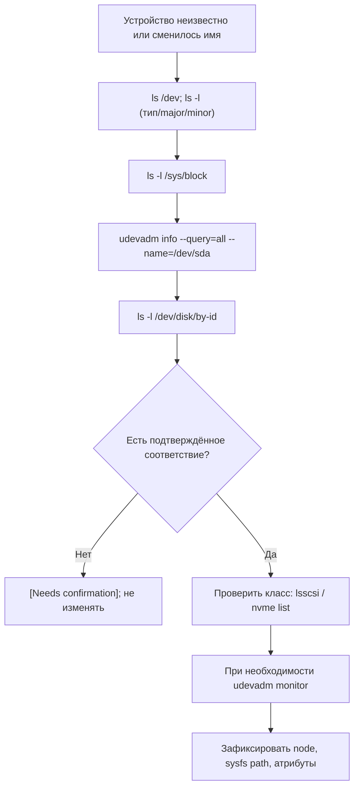
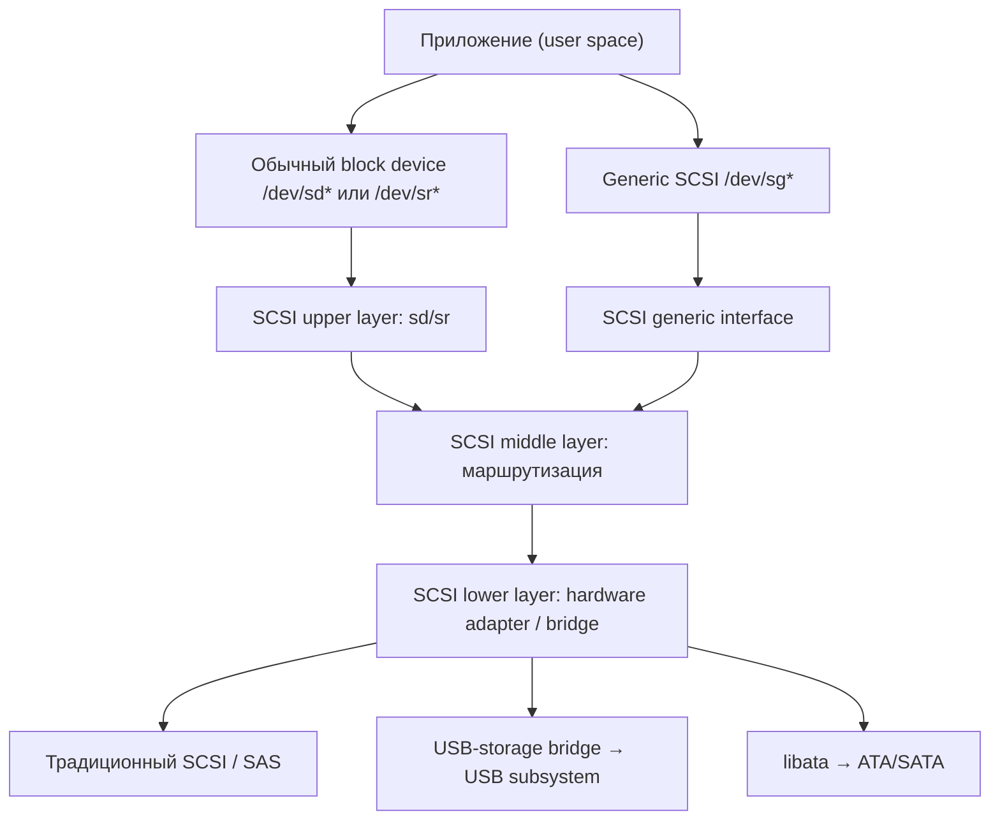
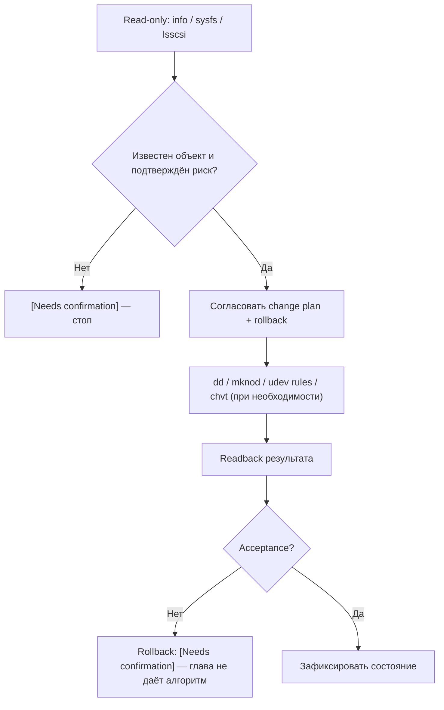

# Mermaid — глава 3 «Устройства»

Источник: `p0079:c01`–`p0101:c01` (PDF/печатные страницы 79–101). Диаграммы синтезированы из словесного описания; **не** копии рисунков 3.1–3.3.

## 1. Device interface и информационная модель

PDF 79–82: назначение `/dev` — интерфейс ввода-вывода; `/sys` — отражение конфигурации и свойств. Major/minor связывают node с представлением устройства ядром.

## 2. Обнаружение /devtmpfs / udev (3.5, с. 89–95)

Правила из `/lib/udev/rules.d` и `/etc/udev/rules.d` используют условные выражения `==`/`!=` и директивы `=`/`+=`/`:=` (PDF 91–93). В RAG имеются различающиеся переменные внутри примера import — `source-findings.md`.

## 3. Read-only локализация устройства

**Никакой из адресов `/dev/sda` не гарантирован** на машине пользователя. Глава не даёт универсального repair workflow; переход к изменению требует отдельного анализа.

## 4. SCSI stack: USB-storage и SATA/ATA (3.6)

По PDF 95–100: `lsscsi` отображает **host:bus:target:LUN**; `lsscsi -g` дополнительно выводит generic node. Упрощение на диаграмме — *SCSI как слои с мостами*, а не точный граф рисунка 3.2.

## 5. Изменяющие операции — отдельная граница

**Опасность:** запись на disk raw device может уничтожить данные; `mknod` с major/minor из печатного примера нельзя применять без подтверждения; `udev` rules требуют отдельной проверки. Эта диаграмма отражает контрольные ограничения, а не предлагает менять конфигурацию.
