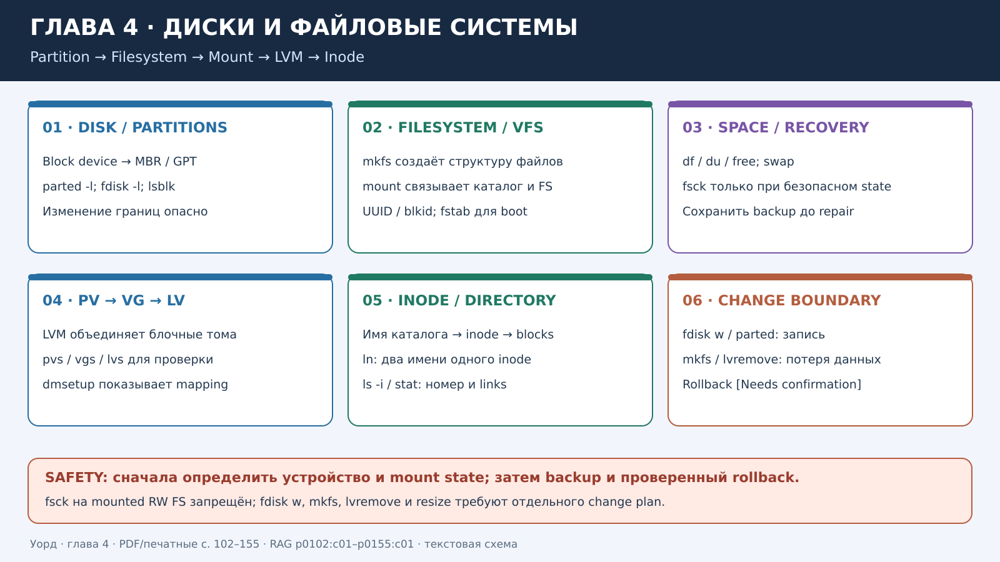
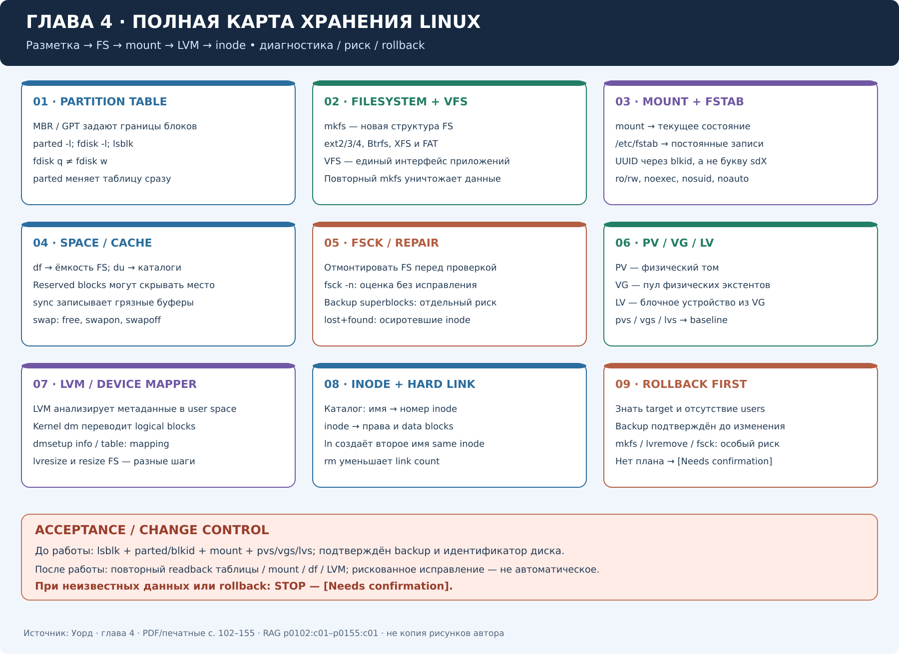

# Глава 4 — Диски и файловые системы

Брайан Уорд, «Внутреннее устройство Linux», 3-е издание (2022).

## Source policy и readiness

- `book_id`: `how-linux-works-brian-ward-3e-ru-2022`; inventory `0034`.
- PDF: `source/book.pdf`; SHA-256 `eee3833ea6ac0fe70268f66076c2ed2bd413b41484bd51d75af7b3ed3ae40ac3`.
- RAG ingestion `ACCEPTED` (`rag/acceptance.yaml`, `failed_checks: []`); book-level readiness **READY** (подтверждена для chapter-analysis при предыдущем onboarding).
- Extraction: `READY_WITH_KNOWN_LIMITATIONS`. Содержимое главы извлечено только из GitHub RAG: **rag_only**, без веба, чтения исходного PDF напрямую или дополнений по памяти.
- Глава: **4. Диски и файловые системы**; slug: `disks-and-filesystems`.
- Диапазон PDF и печатных страниц: **102–155** включительно (54 страницы). RAG-чанки: `p0102:c01`–`p0155:c01`, `rag/chunks/p0101-p0200/p####-c01.md`.
- Проверка границы: оглавление `p0009:c01`–`p0010:c01`, заголовок главы в `p0102:c01`, конец §4.6.3 в `p0155:c01`, заголовок главы 5 в `p0156:c01`.
- **Chapter boundary: VERIFIED**.

## Карта разделов

| Раздел | Страницы | Предмет |
|---|---:|---|
| Вступление | 102–104 | Диск → partition table → раздел → файловая система; верхний интерфейс и raw block I/O. |
| 4.1–4.1.3 | 104–111 | MBR/GPT, `parted -l` / `fdisk -l`, изменение таблицы, commit `w`, отмена `q`. |
| 4.1.4–4.1.5 | 111–114 | CHS/LBA и выравнивание SSD, адрес начала раздела в `/sys/block`. |
| 4.2–4.2.4 | 114–120 | VFS, ext2/3/4, Btrfs, XFS, FAT, `mkfs`, `mount`/`umount`, UUID/`blkid`. |
| 4.2.5–4.2.9 | 120–124 | Буферизация, `sync`, параметры монтирования, `/etc/fstab` и systemd mount units. |
| 4.2.10–4.2.12 | 124–130 | `df`, `du`, reserved blocks, `fsck`/`debugfs`, proc/sysfs/tmpfs/overlay. |
| 4.3 | 130–132 | Swap: `free`, `mkswap`, `swapon`, `swapoff`, swap-файл, риск OOM. |
| 4.4.1 | 132–145 | LVM: PV → VG → LV, `pvs/vgs/lvs`, создание/удаление/расширение томов. |
| 4.4.2 | 145–149 | LVM user space и kernel device mapper, `dmsetup` и mapping extents. |
| 4.5 | 149–150 | Переход от доступа к raw blocks к обычному filesystem API. |
| 4.6–4.6.3 | 150–155 | inode, имена и hard links, bitmap, `fsck`, VFS/FUSE. |

## Аналитические выводы

1. **Раздел ≠ файловая система.** Partition table задаёт границы блоков (MBR/GPT); `mkfs` инициализирует отдельную структуру хранения файлов; `mount` добавляет её в единую иерархию каталогов. Неверный raw I/O или повторный `mkfs` способны уничтожить данные (PDF 102–104, 105–109, 116–118).
2. **Сначала идентификация диска.** Примеры с `/dev/sdd`/`/dev/sdf` принадлежат авторской тестовой конфигурации, а не хосту читателя. Для наблюдения: `lsblk`, `parted -l`, `fdisk -l`, `blkid`, `mount`, `df`. UUID в `/etc/fstab` позволяет избежать зависимости от меняющихся имён устройств (PDF 105–110, 119–125).
3. **Изменения опасны даже в «интерактивном» инструменте.** `fdisk` держит правки до команды записи `w`, `q` выходит без сохранения; `parted` применяет изменения немедленно. Автор требует резервную копию и отсутствие использования разделов перед переписыванием таблицы (PDF 108–111).
4. **Mount state, persistence и repair — разные вещи.** `mount` без аргументов показывает активные mountpoints; `/etc/fstab` задаёт постоянную конфигурацию; `sync` сбрасывает буферы. `fsck` на смонтированной системе запрещён автором (кроме оговорённого режима root read-only). `fsck -n` — режим исследования, не замена backup (PDF 118–128).
5. **LVM добавляет трансляцию адресов.** Physical volumes входят в volume group, из которой выделяются logical volumes. LVM tools собирают метаданные в user space, а device mapper в ядре преобразует logical blocks в реальные. Увеличение LV само по себе не всегда увеличивает filesystem; уменьшение файловой системы требует иной последовательности и размонтирования (PDF 132–149).
6. **inode и путь — разные сущности.** Каталог связывает имя с inode; hard link создаёт второе имя того же inode. При удалении имени уменьшается `link count`, а VFS скрывает детали разных реализаций; для некоторых файловых систем операции Unix недоступны (PDF 150–155).

## Приоритет безопасности

**Read-only baseline → verify block-device identity → validate mount/users/backups → explicit change plan → verification → rollback.** Это операционная структуризация примеров; книга не предоставляет универсального change plan для конкретного сервера. `mkfs`, `fdisk w`, `lvremove`, `fsck` в режиме исправления, `swapoff`, `lvresize` и raw `dd` не выполнять на рабочих устройствах без подтверждённой цели и точки восстановления.

## Материалы

- [cheatsheet.md](cheatsheet.md) — восемь обязательных операционных разделов.
- [commands.md](commands.md) — source-confirmed команды, read-only/state-changing и границы безопасности.
- [diagram.md](diagram.md) — Mermaid: storage layers, FS lifecycle, LVM и inode.
- [visual-cheatsheet.svg](visual-cheatsheet.svg) — компактная схема.
- [visual-cheatsheet-detailed.svg](visual-cheatsheet-detailed.svg) — подробная схема.
- [summary.md](summary.md) — **§4.5 «Что дальше?»**, тематический итог перед необязательным углублением §4.6; это не последняя страница главы.
- [source-findings.md](source-findings.md) — несогласованные имена/UUID, разрывы в извлечённом тексте и ограничения рисунков.

Отдельных издательских контрольных вопросов/упражнений в границах главы не обнаружено. Review-артефакты не создаются. Рисунки 4.1–4.10 в RAG представлены текстом и подписями, но не графикой; текущие схемы не копируют оригинал.
