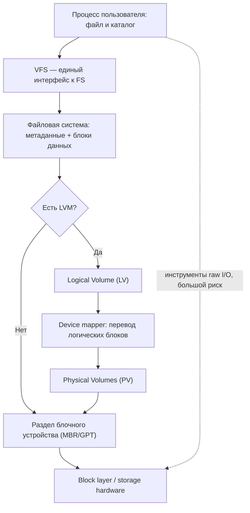
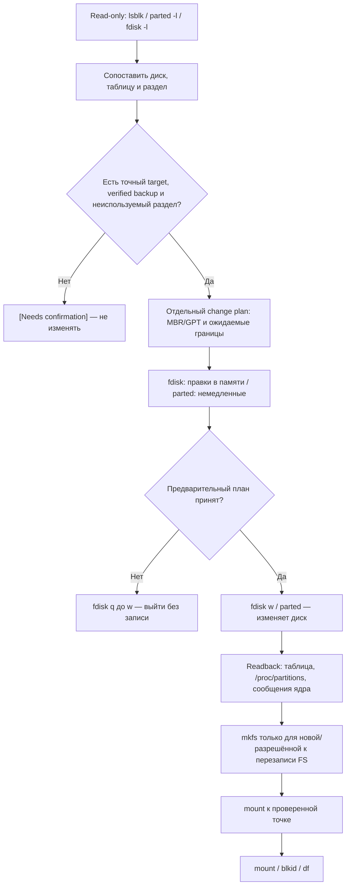
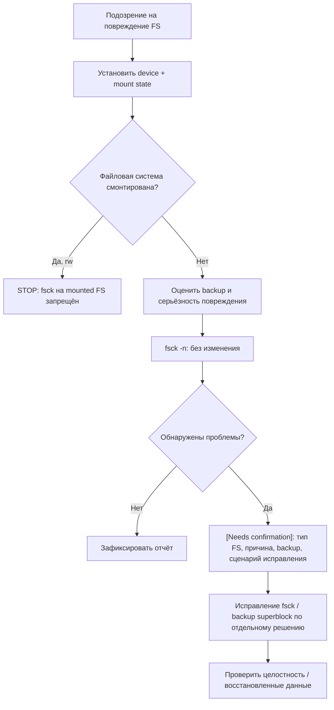
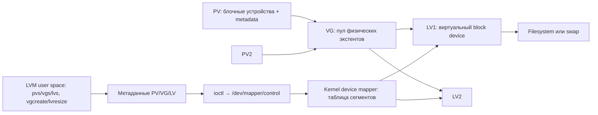
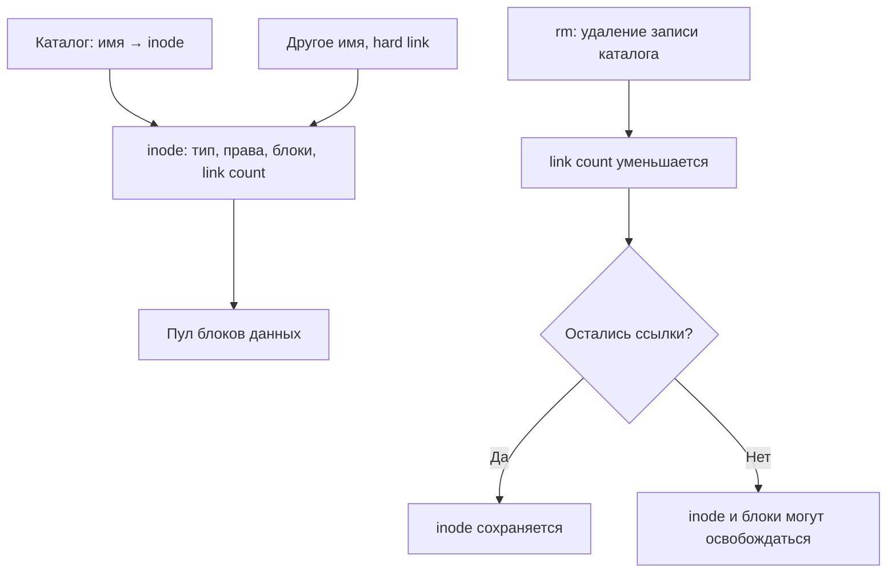

# Mermaid — глава 4 «Диски и файловые системы»

**Source RAG:** `p0102:c01`–`p0155:c01`, PDF/печатные с. 102–155. Диаграммы — аналитическая схема по тексту; исходные рис. 4.1–4.10 из мультимодального PDF не восстановлены.

## 1. Storage stack и доступ к файлу (§4, 4.1, 4.2, 4.4)

`parted/fdisk` меняют границы разделов; `mkfs` создаёт структуру файловой системы; `mount` подключает её к общей иерархии. LVM добавляет mapping **между** FS и физическими блоками (PDF 102–104, 114, 132–146).

## 2. Change boundary: partition и filesystem (4.1–4.2)

**Неприведённый rollback:** после изменения таблицы или повторного `mkfs` общий способ возврата **[Needs confirmation]** (PDF 108–111, 116–119).

## 3. Перепроверка файловой системы (4.2.11)

Исключение книги: root, смонтированный read-only в single-user mode; оно не превращает диагностику рабочей RW FS в безопасную процедуру (PDF 127–129).

## 4. LVM: user space и kernel mapper (4.4)

`lvresize` изменяет размер LV; `fsadm` или `lvresize -r` координирует FS, но сокращение и увеличение имеют разные требования. `lvremove` уничтожает LV (PDF 139–149).

## 5. inode, каталоги, hard links (4.6)

PDF 150–155: `ls -i`/`stat` показывают inode; не все файловые системы поддерживают hard links. Таблицы inode/bitmap могут требовать исправления после несогласованного состояния.

## Примечания о рисунках

`rag/manifest.yaml` не кодирует иллюстрации отдельно. Схемы здесь объясняют **подтверждённые словами** связи, не визуальные детали рисунков 4.1–4.10. Любые данные о конкретном существующем сервере: **[Needs confirmation]**.
