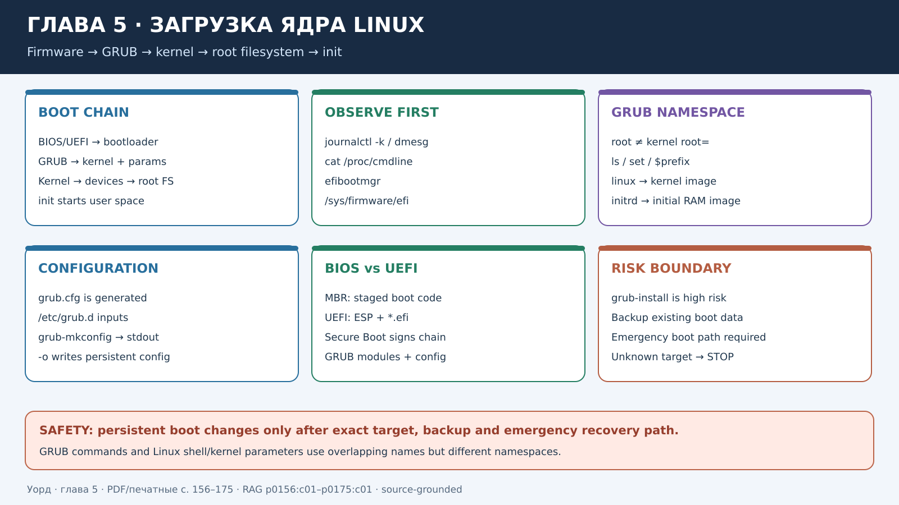
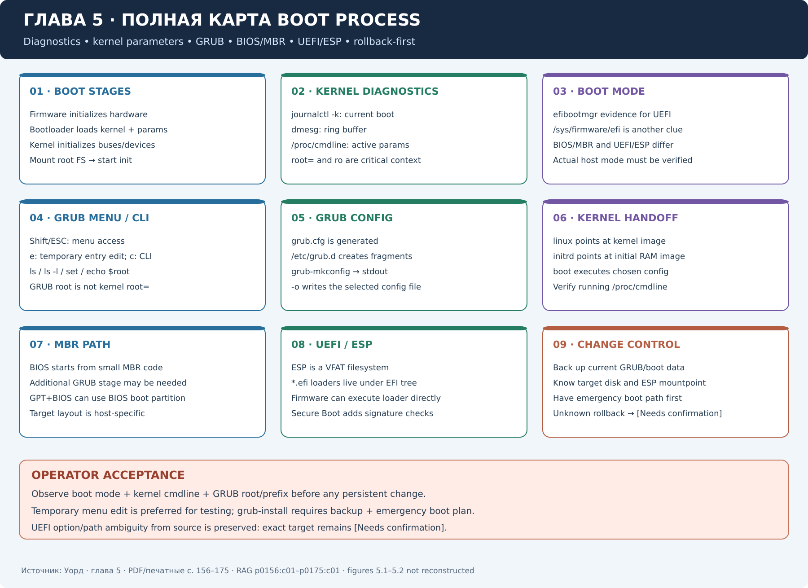

# Глава 5 — Загрузка ядра Linux

Брайан Уорд — «Внутреннее устройство Linux», 3-е русское издание, 2022.





## Идентификация и readiness

- Book ID: `how-linux-works-brian-ward-3e-ru-2022`; inventory: `0034`.
- Chapter: **5. Загрузка ядра Linux**; slug: `linux-kernel-boot`.
- Source: `source/book.pdf`; SHA-256 `eee3833ea6ac0fe70268f66076c2ed2bd413b41484bd51d75af7b3ed3ae40ac3`.
- RAG acceptance: **ACCEPTED**; `failed_checks: []`.
- Extraction: `READY_WITH_KNOWN_LIMITATIONS`.
- Source policy: **rag_only**; external web, model-memory completion and direct canonical-PDF reading are not used.

## Chapter boundary

- PDF/printed pages: **156–175** inclusive.
- RAG chunks: **`p0156:c01`–`p0175:c01`**.
- Chunk path: `rag/chunks/p0101-p0200/p####-c01.md`.
- TOC evidence: `p0010:c01`–`p0011:c01`.
- `p0156:c01` starts «5. Загрузка ядра Linux».
- `p0175:c01` ends §5.8.3 and explicitly transitions to the next chapter.
- `p0176:c01` starts «6. Запуск пользовательского пространства».
- **Chapter boundary verified: YES.**

## Карта главы

| Раздел | PDF/печатные с. | Содержание |
|---|---:|---|
| Вступление | 156 | BIOS/firmware → bootloader → kernel → root FS → init; глава покрывает первые четыре шага. |
| 5.1 | 157–158 | Boot diagnostics: `journalctl -k`, previous boot option, `dmesg`, kernel messages. |
| 5.2 | 158–159 | Порядок kernel initialization: CPU, memory, buses, devices, subsystems, root FS, user space. |
| 5.3 | 159–160 | Kernel parameters, `/proc/cmdline`, `root=`, `ro`, параметры init. |
| 5.4–5.4.2 | 160–162 | Роль bootloader, BIOS/UEFI access, LBA, выбор kernel/parameters, загрузчики. |
| 5.5–5.5.1 | 163–167 | GRUB menu/editor/CLI, GRUB root, devices, partitions, `ls`, `set`, `boot`. |
| 5.5.2 | 167–169 | `grub.cfg`, `/etc/grub.d`, `custom.cfg`, `grub-mkconfig`. |
| 5.5.3 | 170–171 | `grub-install`, MBR/UEFI targets, boot directory/ESP, recovery risk. |
| 5.6 | 171–172 | UEFI Secure Boot and signed boot chain. |
| 5.7 | 172–173 | Chainloading another bootloader from GRUB. |
| 5.8–5.8.3 | 173–175 | BIOS/MBR vs UEFI/ESP internals; full GRUB execution sequence. |

## Основные идеи

**1. Boot chain is staged.** Firmware initializes hardware and transfers control to a bootloader; the bootloader locates a kernel image and parameters, loads the kernel, then the kernel initializes enough hardware and subsystems to mount the root filesystem and start the first user-space process (§5 intro, §5.2).

**2. Boot diagnostics are evidence, not decoration.** Kernel logs expose hardware discovery, kernel command line and storage initialization. The chapter uses `journalctl -k` as the primary post-boot view and names `dmesg` / `/var/log/kern.log` for systems without systemd (§5.1).

**3. Kernel command line is part of the boot contract.** `/proc/cmdline` shows active parameters. `root=` determines the root filesystem source, while `ro` starts it read-only so early checking can occur before later remounting read-write (§5.3).

**4. GRUB has its own namespace and commands.** GRUB's `root`, `insmod`, `ls`, device names such as `(hd0,msdos1)`, variables and modules belong to the bootloader environment, not the running Linux kernel. The `linux` and `initrd` commands point GRUB to kernel and initial-RAM-filesystem images (§5.5–5.5.1).

**5. Generated configuration should be distinguished from source configuration.** `grub.cfg` is generated. The chapter advises against editing it directly; `grub-mkconfig` collects fragments from `/etc/grub.d`, while custom settings can be placed in dedicated files (§5.5.2).

**6. Installing a bootloader is a high-risk state change.** `grub-install` writes bootloader components and, in UEFI cases, may interact with firmware boot variables. The chapter explicitly requires knowing the boot mode, target disk/ESP, backing up existing boot data, and having an emergency boot plan (§5.5.3).

**7. BIOS/MBR and UEFI/ESP solve the same handoff differently.** BIOS/MBR starts from a tiny boot area and may require staged code; UEFI can navigate an ESP filesystem and launch an `.efi` executable directly. GRUB then loads configuration, modules, kernel and optional initrd (§5.8).

## Главный принцип

```text
firmware
   ↓
bootloader code
   ↓
GRUB config + modules
   ↓
kernel image + kernel parameters (+ initrd)
   ↓
kernel initializes CPU/memory/buses/devices
   ↓
root filesystem
   ↓
first user-space process
```

Operationally:

```text
observe boot mode + logs + active cmdline
        ↓
identify GRUB root / kernel / initrd / target disk
        ↓
distinguish temporary boot edit from persistent config
        ↓
before grub-install: backup + rescue path + exact target
        ↓
change → reboot/verify → keep or rollback
```

The second sequence is a safety-oriented synthesis of the chapter, not an author's universal recovery runbook.

## Артефакты

- [cheatsheet.md](cheatsheet.md) — required operational structure with observation/change boundaries.
- [commands.md](commands.md) — source-confirmed Linux and GRUB commands/config fragments.
- [diagram.md](diagram.md) — boot chain, GRUB namespaces, configuration generation and MBR/UEFI.
- [visual-cheatsheet.svg](visual-cheatsheet.svg) — compact visual summary.
- [visual-cheatsheet-detailed.svg](visual-cheatsheet-detailed.svg) — detailed chapter map.
- [source-findings.md](source-findings.md) — extraction/code-form anomalies preserved without silent correction.

## Ограничения

- Figures 5.1 and 5.2 are referenced in RAG, but images are not independently encoded; visual artifacts here do **not** reconstruct exact original screenshots.
- The UEFI `grub-install` example on PDF 171 contains a suspicious dash form before `bootloader-id`; preserved in `source-findings.md` and not normalized silently.
- Actual firmware mode, kernel path, UUID, disk target, ESP mountpoint, Secure Boot policy and GRUB layout on a real host are **[Needs confirmation]**.
- No explicit chapter-end «Summary/Resume» heading or review exercises are present. `summary.md`, `review-questions.md` and `review-answers.md` are therefore omitted.
