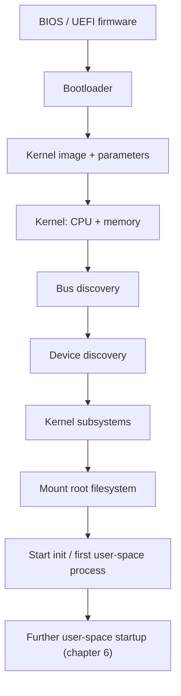
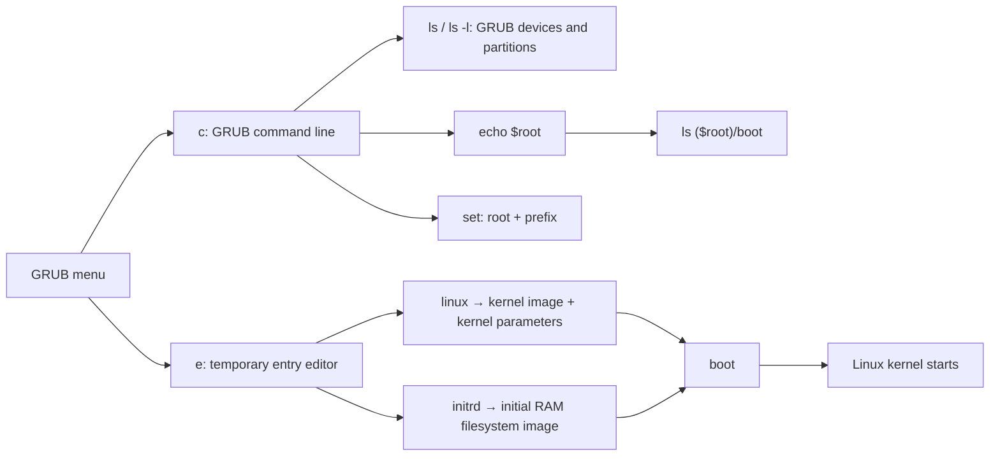
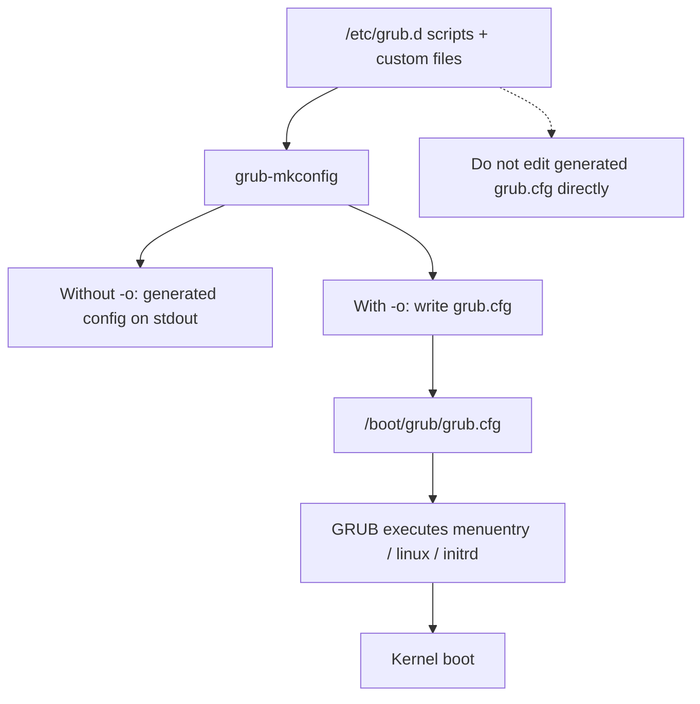
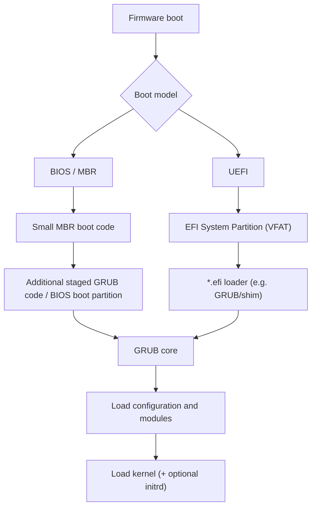
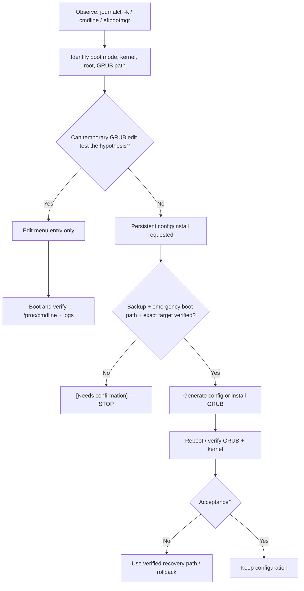
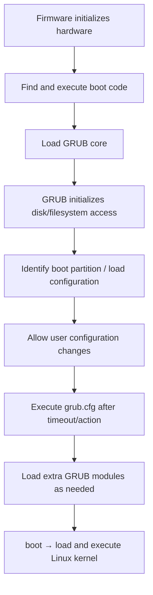

# Mermaid — глава 5 «Загрузка ядра Linux»

Источник: **RAG `p0156:c01`–`p0175:c01`**, PDF/печатные страницы 156–175. Диаграммы синтезированы из текста главы; точные рисунки 5.1–5.2 не реконструируются.

## 1. Общая последовательность boot

Глава 5 покрывает firmware/bootloader/kernel и переход к первому user-space process; детальное продолжение systemd/init отложено до главы 6 (§5 intro, §5.2).

## 2. Как GRUB видит систему

**Namespace boundary:** GRUB's `root`, `insmod`, `ls` and device syntax such as `(hd0,msdos1)` are not Linux shell/kernel equivalents (§5.5–5.5.1).

## 3. Persistent GRUB configuration

Before replacing the target configuration, the chapter instructs the reader to back up the previous configuration and confirm the destination (§5.5.2).

## 4. BIOS/MBR versus UEFI/ESP

The chapter contrasts code outside the filesystem in traditional MBR boot with a filesystem-based ESP containing UEFI executables (§5.8.1–5.8.3).

## 5. Operational decision boundary

This safety sequence is an analytical organization of the chapter's warnings, not a complete vendor-neutral recovery procedure.

## 6. Full GRUB execution sequence from §5.8.3

For UEFI/ESP, firmware can navigate the ESP and directly execute the GRUB/other `.efi` loader; for non-UEFI paths the process can start from MBR boot code (§5.8.3).
